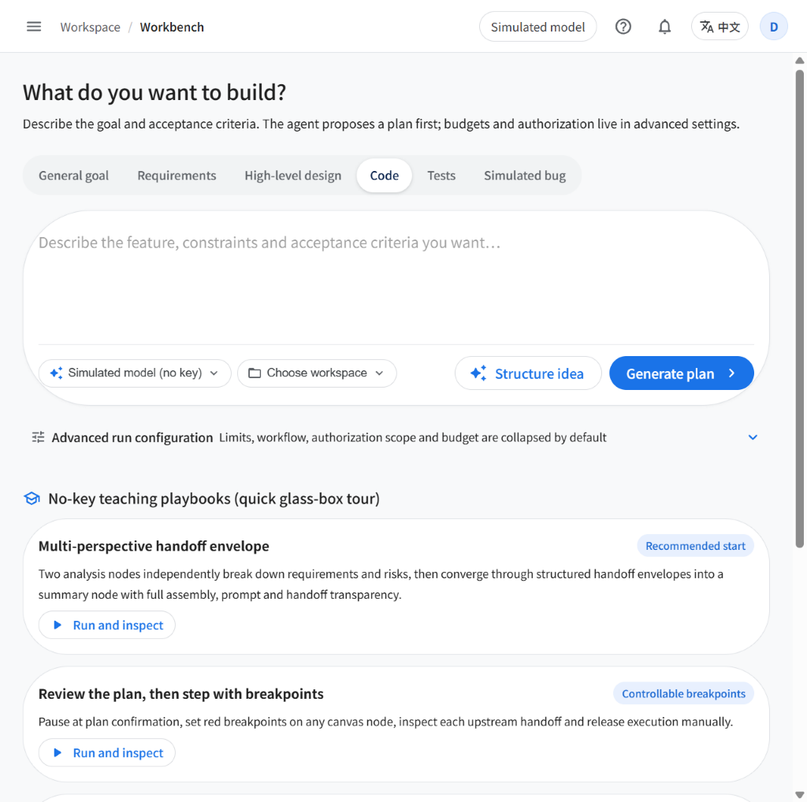
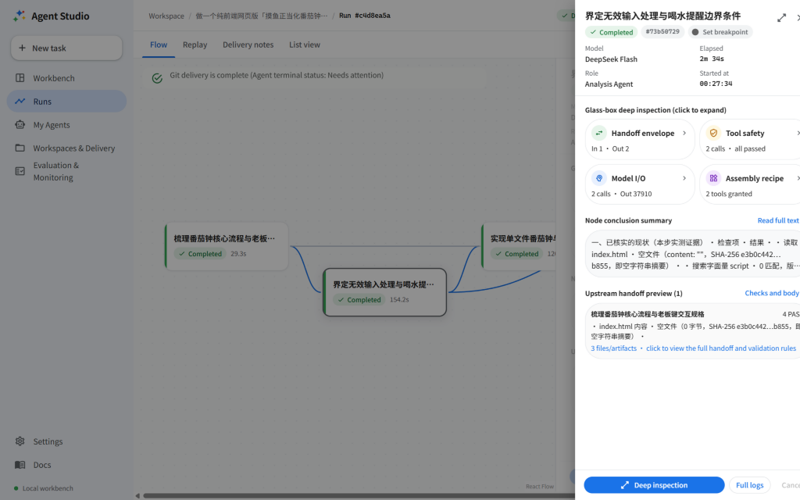
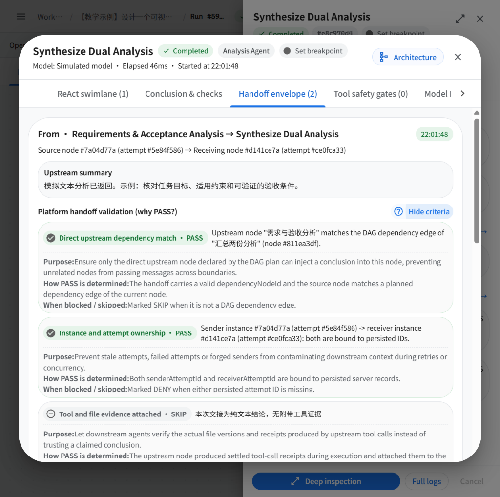
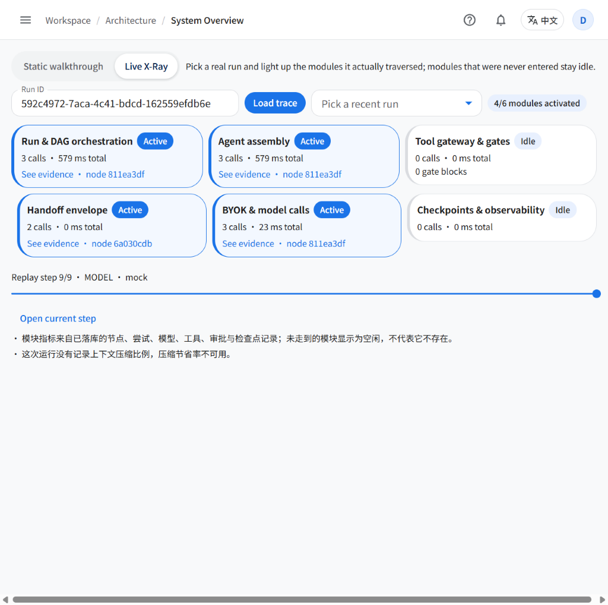
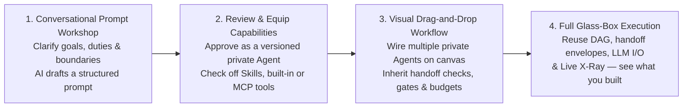

<div align="center">

# Glass-Box Agent Studio

**Open the Black Box of AI Agents: A Glass-Box Visual Learning & Debugging Studio for Understanding Every Step of Multi-Agent Workflows**

**English** | [简体中文](./README.zh-CN.md)

[](https://github.com/Qi-95827/glassbox-agent-studio/actions/workflows/ci.yml)
[](https://openjdk.org/)
[](https://spring.io/projects/spring-boot)
[](https://react.dev/)
[](https://github.com/agentscope-ai/agentscope-java)
[](#option-c-manual-local-setup--verification)
[](./LICENSE)

*New to AI Agents and wondering how a goal turns into a multi-step DAG, how each agent is assembled, what prompt is really sent to the LLM, why a tool call passes or gets blocked, and how one agent safely hands off work to the next? Here, every single step is **visible to the naked eye, pausable, and auditable** — with built-in **zero-API-key teaching playbooks**.*

</div>

---

## Why This Project Exists

For beginners and developers alike, most AI agent frameworks behave like a **black box**: you type a prompt, text streams past, and the real engineering mechanics stay hidden:

- **How is work planned?** How does a high-level goal become a multi-node DAG with dependencies, parallel branches, and human checkpoints?
- **How is each agent assembled?** Which role, skills, and model are bound — and which risky tools were **explicitly stripped** by permission boundaries?
- **What actually goes to the LLM?** What exact `SYSTEM / USER / TOOL` messages, tool JSON schemas, and context compaction steps happen behind the scenes?
- **How do agents hand off without hallucinating?** What verified evidence moves from an upstream node to a downstream node, and how are stale retries blocked?
- **What enforces safety at runtime?** Which security gates inspect every tool invocation, and why was a call marked `PASS` or `DENY`?

**Glass-Box Agent Studio** has one clear goal: **turn a production multi-agent engine into a transparent glass box** — serving both as a hands-on learning studio where beginners can inspect every internal mechanism without an API key, and as a usable local engineering workbench (isolated Git worktrees, encrypted BYOK model support, and human-in-the-loop delivery).

---

## Follow One Real Task: See Every Step of a Multi-Agent Workflow

Even without an API key, these **6 core views** walk you through the entire lifecycle from prompt to verified delivery:

### 1. Zero-Friction Start: Key-Free Teaching Playbooks
Launch tasks across General, Requirements, Design, Code, Test, and Simulated Bug entries — or click any of the **3 built-in key-free teaching playbooks** (multi-perspective handoff, breakpoint stepping, and `ToolGateway` safety limits) to watch a full multi-agent run immediately.



### 2. Big Picture: Interactive Multi-Agent DAG & Breakpoints
Every run renders as a live React Flow DAG showing upstream/downstream dependencies, node status, and latency. Click any node to open a clean summary drawer with 4 direct Glass-Box entries, or toggle a **red breakpoint** to pause execution before a node runs and inspect its upstream inputs.



### 3. Verifiable Handoffs: Structured Envelopes & Transparent "Why PASS?" Rules
No opaque string relays. Every handoff between agents is captured as a **structured envelope** showing the upstream conclusion and 4 platform verification checks (`DEPENDENCY_MATCH`, `ATTEMPT_IDENTITY`, `TOOL_EVIDENCE`, `ACCEPTED_RECEIPT`) — expand **"How PASS is determined"** to learn exactly why each check passed or skipped.



### 4. Raw LLM Transparency: Full Prompt, `tool_calls` & ReAct Swimlane
Open the wide-screen Glass-Box modal to inspect every role-colored `SYSTEM / USER / ASSISTANT / TOOL` message, injected tool JSON schemas, raw responses, and `tool_calls` arguments — alongside a turn-by-turn **ReAct live swimlane**, separated streaming reasoning traces, and 6-layer context compaction diffs, all redacted before persistence.


### 5. Permission Boundaries: Agent Assembly Blueprint & Tool Funnel
See exactly how each node's agent was constructed: role definition, version, model, bound skills, context sources, and the platform-enforced **Tool Permission Funnel** showing both granted tools and tools **explicitly removed by security boundaries** (across built-in workspace tools and external MCP tools), backed at runtime by 6 `ToolGateway` security gates + Gate 5.5 HITL approval.


### 6. System-Wide Telemetry: Live Architecture X-Ray
Switch **Architecture → Live X-Ray** and bind any real run to light up the exact backend modules traversed during execution — complete with real call counts, latency, step-by-step replay scrubbing, and deep links back to the exact Glass-Box evidence tab.



---

## What Is Built Today (Engineering Summary)

Beyond the 6 core learning views above, the current release completes the **V1–V6 Glass-Box visualization suite and production hardening** — backed 100% by persisted records and live SSE frames (zero mock telemetry):

| Pillar | What Works Today |
| :--- | :--- |
| **Unified DAG Workflow Engine** | Single-track `WorkflowScheduler` DAG engine (legacy direct track retired); interactive visual plan composer with live write-conflict & cycle highlighting, bounded reflection loops (`maxRevisions`), non-blocking breakpoints, and **post-delivery multi-round task iteration (`run_iterations`)** |
| **Context & Hybrid RAG Microscope** | 4-tier context compaction (Query-Aware L1 artifact offload/readback, L2 structured anchors, L3 paired-tool hard guard) + 6-layer SVG water-level chart; Hybrid RAG (BM25 with real TF & CJK/ASCII tokenization + `pgvector` → RRF funnel) and 3-layer memory governance with version-guarded backfill |
| **Timeline, Forking & Open Trace** | 7-span Gantt timeline, frozen Checkpoint inspector, What-If run forking & side-by-side run diff; redacted **OpenTelemetry / Glass-Box trace export**, read-only external Python/Java agent trace ingestion, and one-click run distillation into Eval Lab v2 regression cases |
| **Observability, Triage & Eval Lab** | Grafana-style pure-SVG monitoring dashboard with **per-task focus filtering**, 5-step automated fault diagnostics with deep links, and Eval Lab v2 six-axis radar with attributable A/B comparison |
| **Security Sandbox & BYOK** | Multi-provider BYOK (DeepSeek / OpenAI / Qwen / GLM / SiliconFlow / custom OpenAI-compatible) with AES-256-GCM encryption & SSRF guard; full-channel streaming + **JSON-leaf-level secret masking with structure-preserving truncation**; whole-workspace (`.`) 3-mode scope bar, Git worktree isolation, and per-tool MCP admission funnel |
| **Engineering & Quality Foundation** | 64-stripe per-run locking (`RunLockRegistry`), transactional scheduled cold-data TTL retention, **7 ArchUnit architecture rules** (cycle-free, pure `domain/framework`, field-level zero `@Lob`, unified outbound HTTP), TypeScript frontend contract base, multi-stage `Dockerfile`, and GitHub Actions CI |

---

## Roadmap: From "Understanding Agents" to "Building Your Own" (V7 Vision)

Today's release focuses on helping learners **see and understand every detail of how a multi-agent system works**. Our next evolution (**V7**) naturally extends this foundation so users can move from **transparent observers** to **visual builders**:



- **AI-Guided Prompt Workshop**: Describe in plain language what role you want to build and its boundaries; the assistant structures it into a clean prompt draft that becomes a reusable, versioned private Agent asset once you approve it.
- **Checkbox Skill & Tool Equipping**: Grant Skills, built-in sandboxed tools, or custom MCP tools via simple checkboxes while previewing the exact Tool Permission Funnel and risk profile upfront.
- **Visual Multi-Agent Workflow Studio**: Drag and wire multiple private Agents together on a canvas — automatically inheriting this repository's verified handoff checks, 6-gate `ToolGateway`, Gate 5.5 HITL approvals, budget circuit breakers, and full Glass-Box observability.

> See the detailed design direction in [V7 Visual Drag-and-Drop Agent Workshop & Workflow Studio (Chinese)](docs/概要设计/V7_可视化拖拽Agent工坊与工作流工作室_演进方向.md).

---

## Quick Start (5 Minutes)

### Option A: One-Click Setup with an AI Coding Agent (Recommended)

Using **Antigravity, Claude Code, Cursor, Codex, or Windsurf**? Paste this prompt to let your assistant verify prerequisites, build, and launch automatically:

```text
Please clone and set up the open-source project https://github.com/Qi-95827/glassbox-agent-studio locally:
1. Verify prerequisites: Java 21, Maven 3.9+, Node.js 20+, and Git (Docker Desktop is optional and only needed for Simulated Bug container verification). Tell me clearly if any tool is missing.
2. Clone the repository into a clean local folder.
3. Build the frontend from `frontend/user-workbench/` using `npm ci && npm run build`.
4. Start the Spring Boot backend from the repository root (where `pom.xml` lives) using `mvn spring-boot:run`.
5. Wait until Tomcat is listening on `http://127.0.0.1:8088`, confirm it is up, and give me the link to open in my browser. Do NOT create or commit any real API keys.
```

### Option B: Run with Docker

Includes a 3-stage `Dockerfile` (frontend build → Fat JAR → minimal non-root JRE image with mounted data volume):

```bash
git clone https://github.com/Qi-95827/glassbox-agent-studio.git
cd glassbox-agent-studio

docker build -t glassbox-agent-studio .
docker run --rm -p 127.0.0.1:8088:8088 -v glassbox-data:/app/data glassbox-agent-studio
```

> Always bind `-p 127.0.0.1:8088:8088` on the host so the workbench stays loopback-only; `LocalOriginFilter` continues to enforce `Host` and `Origin` validation inside the app.

### Option C: Manual Local Setup & Verification

**Prerequisites**: Java 21 · Maven 3.9+ · Node.js 20+ · Git (Docker Desktop optional)

```bash
# 1. Build frontend & start backend
cd frontend/user-workbench && npm ci && npm run build
cd ../..
mvn spring-boot:run
```

Open **http://127.0.0.1:8088**, initialize your local admin account, and try any of the **3 key-free teaching playbooks** immediately — or add your own API key under **Settings → Models & API Keys (BYOK)**.

```bash
# 2. Run full verification suite (Baseline: 944 Backend | 207 Frontend | 7 ArchUnit rules)
mvn test

cd frontend/user-workbench
npm run format:check
npm run lint
npm run typecheck
npm test
npm run build
```

---

## Architecture & Documentation

Strict layered architecture automatically enforced by **ArchUnit** (`ArchitectureGuardTest`, 7 rules), with mirrored externalized bilingual prompt suites (`prompts/` & `prompts/en/`) so learners can inspect native prompts in either English or Chinese.

```text
frontend/user-workbench/   React 19 · TypeScript contracts · Vite 6 · MUI · React Flow · React Query
backend/src/main/java/
  dev.workbench.domain          Pure domain models (zero persistence/web deps)
  dev.workbench.framework       Pure contracts, ToolGateway (6.5 gates), JsonLeafMasker, SensitiveDataMasker, OutboundUrlGuard
  dev.workbench.infrastructure  AgentScope Java 2.0.4, BYOK/Embedding adapters, hardened MCP & pgvector
  dev.workbench.orchestration   64-stripe RunLockRegistry, unified WorkflowScheduler DAG, reflection, breakpoints & iterations
  dev.workbench.planning        Idea drafting, candidate DAG generation/validation & safe budgets
  dev.workbench.control         4-tier context compaction & isolated L1 artifact readback
  dev.workbench.memory          Layered long-term memory & workspace Hybrid RAG (BM25 + pgvector + RRF)
  dev.workbench.observability   SSE streaming events, per-task monitoring dashboard, 5-step diagnostics & Prometheus metrics
  dev.workbench.timeline        Timeline Gantt, Checkpoint/What-If fork & diff, Live Architecture X-Ray, OTel/External Trace & Eval Flywheel
  dev.workbench.maintenance     Transactional scheduled cold-data TTL retention
backend/src/main/resources/
  prompts/ & prompts/en/        Mirrored Chinese & English externalized prompts and tool contracts
  db/migration/                 Flyway H2 migrations (V1 ~ V18)
  db/migration-pg/              Flyway PostgreSQL 16 + pgvector migrations (V1 ~ V8)
```

- **[Full Documentation Index (Chinese)](docs/README.md)** · **[Product Requirements & Architecture Overview](docs/项目总览_产品需求与技术架构.md)**
- **[V7 Roadmap: Visual Drag-and-Drop Agent Workshop & Workflow Studio](docs/概要设计/V7_可视化拖拽Agent工坊与工作流工作室_演进方向.md)**
- **[V0–V6 Visualization Verification Log](docs/交接/AI框架可视化_V0-V6_最终验收记录.md)** · **[External Agent Trace & OTel Guide](docs/交接/外部Agent_Trace接入指南_2026-11-26.md)**
- **[PostgreSQL 16 + pgvector Guide](docs/开发记录/PGVector切换与部署指南.md)** · **[Engineering & Security Standards](docs/开发规范/代码开发规范.md)**

---

## License

This project is licensed under the [MIT License](./LICENSE).
