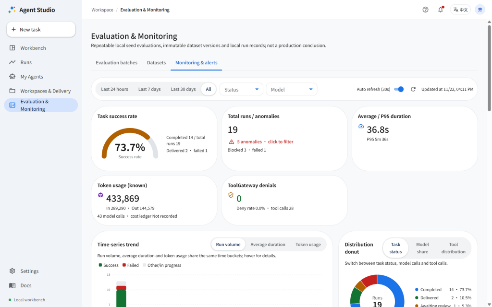
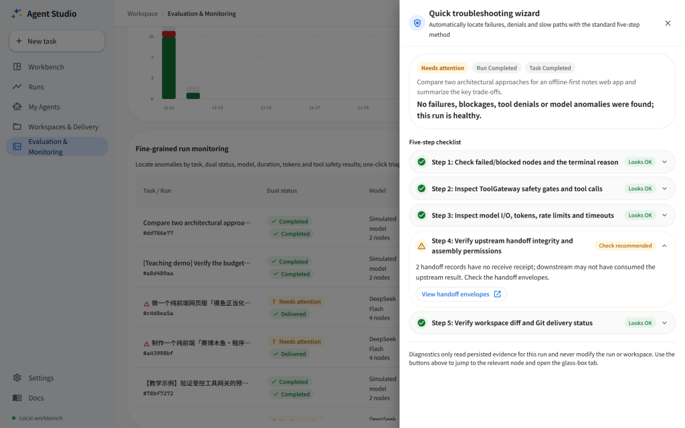

<div align="center">

# Glass-Box Agent Studio

**An Open-Source Visual Multi-Agent Software Engineering Workbench & Learning Platform**

**English** | [简体中文](./README.zh-CN.md)

[](https://openjdk.org/)
[](https://spring.io/projects/spring-boot)
[](https://react.dev/)
[](https://github.com/agentscope-ai/agentscope-java)
[](./LICENSE)

*Turn black-box AI agents into a transparent **Glass-Box**: watch how multi-agent DAGs are planned, assembled, sandboxed, handed off, verified, monitored, and delivered to Git.*

</div>

---

## Why This Project Exists

Most AI coding agent frameworks run as a **black box**: you type a prompt, text streams by, and you have no clear visibility into:
- How each agent was assembled (role, skills, model, and which tools were **explicitly stripped away** by permission boundaries);
- What exact `SYSTEM / USER / TOOL` messages and tool schemas were sent to the LLM;
- Why a tool call was **allowed (`PASS`)** or **blocked (`DENY`)** by security gates;
- How upstream agents pass evidence to downstream agents without hallucinating or leaking stale retries;
- Why a run failed, slowed down, or spent unexpected tokens.

**Glass-Box Agent Studio** solves this both as a **usable local engineering workbench** (with isolated Git worktrees, human-in-the-loop review, and Bring-Your-Own-Key LLM support) and as a **hands-on learning platform** where every internal mechanism of a production multi-agent system is exposed visually — and even runnable **without an API key** via built-in teaching playbooks.

---

## Visual Tour & What Is Visualized

| Module | What Is Visualized | Key Learning Value |
| :--- | :--- | :--- |
| **1. Workbench Home & Playbooks** | Multi-entry task composer, built-in key-free teaching playbooks, dual-layer status (`TaskStatus` × `RunStatus`) | Understand task routing, planning vs. execution, and human delivery lifecycle |
| **2. Interactive DAG Execution Graph** | Live React Flow DAG, node status & duration, node breakpoints, lightweight inspector + full-screen Glass-Box modal | Learn DAG dependency scheduling, step-by-step breakpoints, and state projection |
| **3. Structured Handoff Envelope** | Upstream conclusion, artifacts, decisions, open risks, **transparent `PASS/SKIP/DENY` validation rules** | Learn how to make multi-agent handoffs verifiable and audit-safe |
| **4. Full LLM I/O Inspector** | Role-colored `SYSTEM / USER / ASSISTANT / TOOL` messages, injected tool JSON schemas, raw responses & `tool_calls` | Master real-world prompt assembly, context management, and tool-calling loops |
| **5. Agent Assembly & ToolGateway** | Tool permission funnel (granted vs. stripped tools with lock reasons) + 6-gate `ToolGateway` inspection | Learn least-privilege sandboxing, path whitelisting, loop guards, and optimistic locks |
| **6. Grafana-Style Monitoring & Diagnostics** | KPI gauges, time-series charts, status/model/tool donut charts, slow-node rankings, **5-step auto-diagnostics** | Learn LLM observability, latency/token attribution, and structured incident triage |
| **7. BYOK Model & Key Manager** | Multi-provider OpenAI-compatible presets, AES-256-GCM encrypted key storage, masked display, connectivity probe | Learn secure credential management, SSRF protection, and multi-provider model routing |

---

### 1. Workbench Home & Key-Free Teaching Playbooks

Launch tasks across General, Requirements, Design, Code, Test, and Simulated Bug entries — switch seamlessly between **English / 中文** in the top bar, or click one of the **3 key-free teaching playbooks** to explore multi-agent collaboration, breakpoint debugging, and `ToolGateway` security boundaries immediately.


**What you can learn here:**
- **Dual-Layer Status Modeling (`TaskStatus` vs. `RunStatus`)**: Why an immutable agent execution status (`RunStatus`, e.g., `BLOCKED` awaiting review) should be separated from the user-facing delivery lifecycle (`TaskStatus`, e.g., `DELIVERED` once committed in Git).
- **Candidate Plan Review**: How to generate a structured DAG candidate first and let humans adjust nodes, models, file scopes, and budgets before execution.

---

### 2. Multi-Agent DAG Execution Flow & Breakpoint Debugging

Every task executes as a live React Flow DAG. Clicking any node opens a clean right-side overview drawer with 4 direct entry cards into the wide-screen Glass-Box inspector modal, plus one-click **node breakpoints** to pause execution before a node starts.


**What you can learn here:**
- **Event-Driven Projection**: How backend execution events (`ExecutionGraphProjector`) are projected into a deterministic frontend DAG without coupling UI state to raw engine internals.
- **Controlled Execution**: How breakpoints, cancellation signals, and bounded waits work safely across concurrent workflow threads.

---

### 3. Structured Handoff Envelope & Transparent "Why PASS?" Rules

Instead of opaque free-text relays between agents, every handoff is inspected as a structured envelope showing the upstream conclusion, involved files, key decisions, open risks, and platform verification checks — with an expandable **"How PASS is determined"** rule guide explaining **why** each check passed or skipped.


**What you can learn here:**
- **Anti-Hallucination Handoffs**: How the platform enforces `DEPENDENCY_MATCH`, `ATTEMPT_IDENTITY`, `TOOL_EVIDENCE`, and `ACCEPTED_RECEIPT` so downstream agents only receive verified outputs from direct upstream DAG dependencies.
- **Deterministic Extraction**: Inspect `StructuredHandoffExtractor.java` to see how bilingual structured summaries and evidence pointers are extracted from agent outputs.

---

### 4. Full LLM I/O Trace (Messages, Tool Schemas & `tool_calls`)

See the exact masked payload sent to the LLM (`SYSTEM`, `USER`, `ASSISTANT`, `TOOL`), every injected tool JSON schema, token counts, latency, and the model's raw response or `tool_calls` decisions.


**What you can learn here:**
- **Externalized Bilingual Prompt Engineering**: All agent personas, skills, planning prompts, and tool descriptions live as clean external resources under `backend/src/main/resources/prompts/` (Chinese) and `prompts/en/` (English).
- **Data Masking at Capture Time**: Inspect `ControlledModel.java` and `SensitiveDataMasker.java` to see how 64 KB truncation and secret redaction happen before payloads hit the database.

---

### 5. Agent Assembly Blueprint & Tool Permission Funnel

Understand **how an agent is born** for each node: its role definition, bound skills, model, context sources, and the **Tool Permission Funnel** showing both granted tools and tools explicitly stripped by platform security boundaries (e.g., removing `WORKSPACE_WRITE` from read-only review nodes).


**What you can learn here:**
- **Least-Privilege Agent Sandboxing**: Even if a prompt tries to trick a reviewer agent into editing files, the write tool is never even injected into its runtime — and `ToolGateway` enforces 6 runtime security gates (`OWNERSHIP_AND_SCOPE`, `TOOL_REGISTRY_GRANT`, `BUDGET_AND_LOOP`, `PATH_WHITELIST`, `ARGUMENT_SCHEMA`, `CANCEL_STATE`).

---

### 6. Grafana-Style Fine-Grained Monitoring Dashboard

Monitor every run, node, model, and tool across `24h / 7d / 30d / All` time windows with zero heavy charting dependencies (pure React SVG): KPI cards with success-rate gauge, stacked/line/area time-series charts, status/model/tool donut charts, slow-node rankings, and `ToolGateway` interception analytics.



**What you can learn here:**
- **Practical Agent Observability**: How to aggregate run latency (Avg / P95), token consumption, failure rates, and security gate denials from relational audit tables (`MonitoringDashboardService.java`).

---

### 7. 5-Step Automated Fault Diagnostics & Deep-Link Triage

When a run fails, blocks, triggers security gates, or hits slow LLM calls, click **"One-Click Triage"** to open a guided 5-step diagnostics drawer (`Terminal Status → ToolGateway → LLM I/O → Handoff & Assembly → Workspace Git`). Every finding includes a direct action link that jumps straight to the target node and auto-opens the exact Glass-Box modal tab.



**What you can learn here:**
- **Root-Cause Triage Automation**: Inspect `RunDiagnosticsService.java` to learn how to synthesize multi-table execution evidence into actionable, locale-aware engineering diagnostics.

---

### 8. BYOK (Bring Your Own Key) Model & Encrypted Credential Management

Configure your own API keys directly in **Settings → Models & API Keys (BYOK)** with built-in presets for **DeepSeek, OpenAI, Qwen (DashScope), Zhipu GLM, SiliconFlow, and any OpenAI-compatible endpoint**. Test connectivity in one click and optionally set reference pricing for local budget estimation.


**What you can learn here:**
- **Production-Grade Secret Hygiene**: `SecretCipher.java` encrypts API keys with **AES-256-GCM** (random 12-byte IV), never returns plaintext keys to the frontend (masked as `sk-****xxxx`), validates Base URLs against SSRF, and enforces per-user ownership isolation.

---

## Full-Stack Bilingual Design: Why Two Externalized Prompt Suites?

Unlike typical web apps, an AI Agent platform has **three distinct language layers**: UI copy, backend validation/diagnostics, and **LLM prompts**.

Because **Glass-Box Agent Studio** is built for **visual transparency and hands-on learning**, we intentionally maintain **two mirrored externalized prompt suites** (`backend/src/main/resources/prompts/` for Chinese and `prompts/en/` for English) instead of forcing everyone to read a single language in the LLM inspector:
1. **Native Clarity in Glass-Box Learning**: When an English learner opens **Model I/O**, they see idiomatic English system prompts, skill guidelines, and tool JSON schemas; when a Chinese learner switches to `中文`, they see native Chinese prompts — making multi-agent prompt engineering effortless to read and compare.
2. **Task-Frozen Locale (`tasks.locale`)**: Every task persists its creation locale (`zh-CN` / `en-US`) via Flyway `V6`, driving `PromptResourceLoader.load(locale, path)` with automatic fallback so historical runs remain reproducible.
3. **Code-First Backend & Frontend i18n**: Security gates (`ToolGateway`), handoff checks, and diagnostics are modeled with semantic codes + Spring `MessageSource` (`Accept-Language`) and zero-dependency React JSON locales — so even historical runs adapt cleanly when you switch UI languages.

---

## Quick Start (5 Minutes)

### Prerequisites
- **Java 21** & **Maven 3.9+**
- **Node.js 20+**
- **Git** (Docker Desktop is *optional*, only needed for Simulated Bug container verification)

### 1. Clone & Build Frontend
```bash
git clone https://github.com/Qi-95827/glassbox-agent-studio.git
cd glassbox-agent-studio

cd frontend/user-workbench
npm ci
npm run build
cd ../..
```

### 2. Start the Backend Server
```bash
mvn spring-boot:run
```

Open **http://127.0.0.1:8088** in your browser:
1. Follow the on-screen prompt to initialize your local administrator account.
2. Try any of the **3 key-free teaching playbooks** immediately with the built-in `mock` model.
3. To use real LLMs, open **Settings → Models & API Keys (BYOK)**, choose a provider (e.g. DeepSeek / OpenAI / Qwen), paste your own API key, and click **Test Connectivity**.

### 3. Run Full Verification Suite
```bash
# Backend unit, integration, Flyway migration & ArchUnit architecture guard tests
mvn test

# Frontend format, lint, unit tests & production build
cd frontend/user-workbench
npm run format:check
npm run lint
npm test
npm run build
```

---

## Architecture Overview

Strict layered architecture automatically enforced by **ArchUnit** (`ArchitectureGuardTest`): zero top-level package cycles, pure `domain` & `framework` layers, and strict isolation of `io.agentscope` SDK calls to `infrastructure` / `app`.

```text
frontend/user-workbench/   React 19 · Vite · MUI (M3) · React Flow · React Query · React Router
backend/src/main/java/
  dev.workbench.domain          Pure domain enums & value objects (zero persistence/web deps)
  dev.workbench.framework       Pure contracts, ToolGateway, SecretCipher & trace extractors
  dev.workbench.infrastructure  AgentScope Java 2.0.4 & OpenAI-compatible model adapters
  dev.workbench.modelconnection BYOK encrypted model connections, probing & usage estimation
  dev.workbench.persistence     JPA entities, repositories & Flyway V1~V6 migrations (H2)
  dev.workbench.planning        Idea drafting, entry routing, candidate DAG generation & validation
  dev.workbench.orchestration   Run lifecycle, DAG scheduler, breakpoints & handoff coordination
  dev.workbench.delivery        Execution graph projector, node detail & delivery aggregation
  dev.workbench.workspace       Authorized file sandbox & Git worktree review/commit/merge
  dev.workbench.privateagent    Versioned private Agents, Skills & read-only Tool configs
  dev.workbench.bug             Simulated Bug triage & Docker container regression verification
  dev.workbench.evaluation      Versioned evaluation suites, datasets & batch comparison
  dev.workbench.observability   Cursor event stream, Grafana-style dashboard & 5-step diagnostics
backend/src/main/resources/
  prompts/                      Externalized Chinese prompts & tool contracts (default)
  prompts/en/                   Mirrored English prompts & tool contracts (for EN tasks)
  i18n/                         Spring MessageSource bundles (messages_zh_CN / messages_en_US)
  db/migration/                 Flyway versioned migrations (V1 ~ V6)
```

---

## Documentation

- [Documentation Index (Chinese)](docs/README.md)
- [Product Requirements & Technical Architecture](docs/项目总览_产品需求与技术架构.md)
- [Glass-Box Multi-Agent Full-Link Visualization Design](docs/概要设计/玻璃盒多Agent全链路可视化_概要设计.md)
- [Engineering & Security Coding Standards](docs/开发规范/代码开发规范.md)

---

## License

This project is licensed under the [MIT License](./LICENSE).
