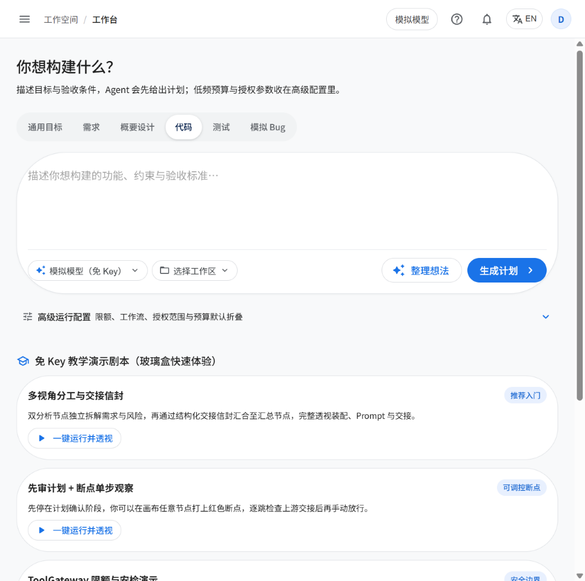
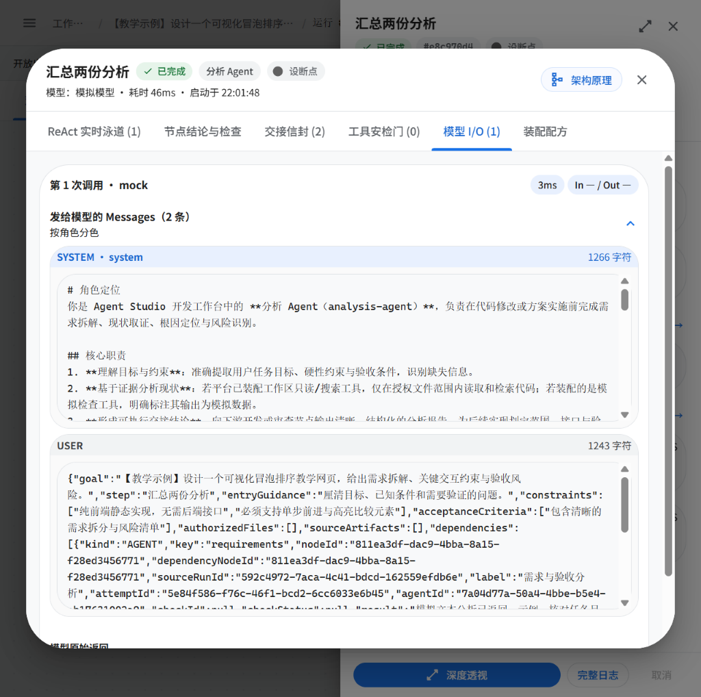
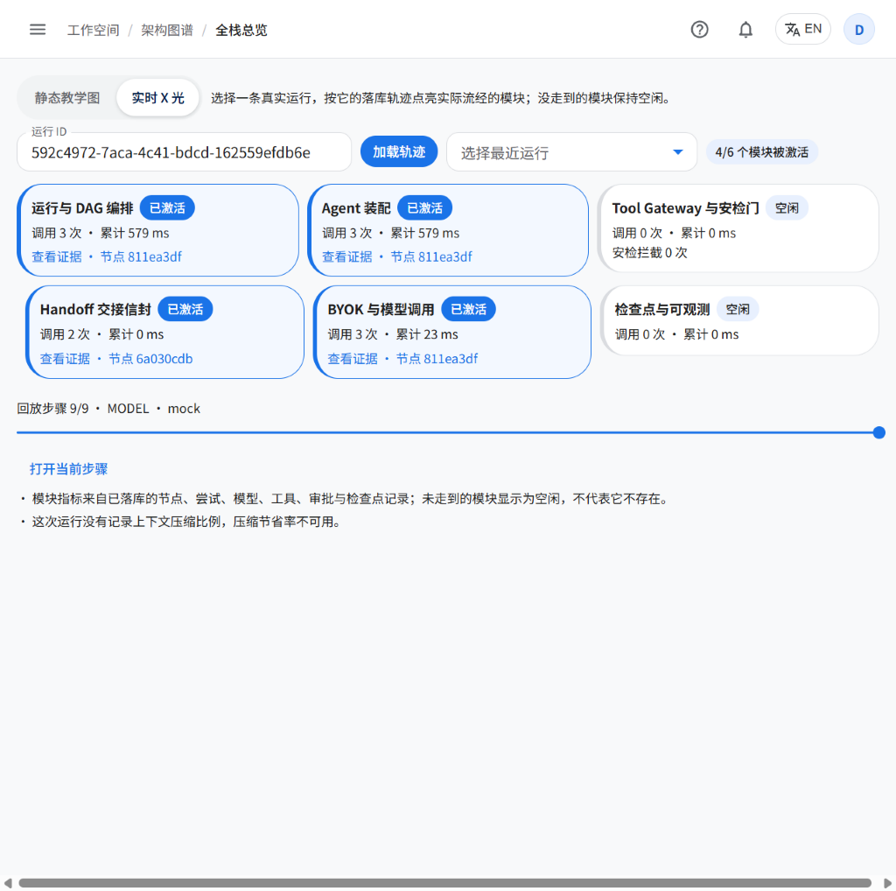
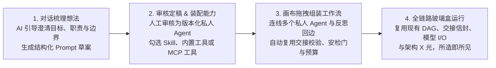

<div align="center">

# Glass-Box Agent Studio（玻璃盒多 Agent 可视化工作台）

**把黑盒 AI Agent 彻底透明化：面向初学者的全流程玻璃盒可视化与多 Agent 实战学习台**

[English](./README.md) | **简体中文**

[](https://github.com/Qi-95827/glassbox-agent-studio/actions/workflows/ci.yml)
[](https://openjdk.org/)
[](https://spring.io/projects/spring-boot)
[](https://react.dev/)
[](https://github.com/agentscope-ai/agentscope-java)
[](#本地源码与全量验证)
[](./LICENSE)

*如果你刚接触 AI Agent，想知道“任务进来后到底怎么拆步骤、Agent 怎么被装配、Prompt 长什么样、工具怎么过安全关、上游又怎么把结果交接给下游”——在这里，多 Agent 运行的每一个细节都**肉眼可见、可暂停、可追查**，且无需 API Key 即可零门槛上手体验。*

</div>

---

## 为什么做这个项目？

对初学者和工程师来说，市面上大多数 AI Agent 框架都是一个**黑盒**：你输入一句话，屏幕滚出一堆文字，却很难真正看清背后的运行机理：

- **计划怎么来的？** 一个复杂任务是如何被拆成多节点 DAG、哪些步骤可以并行、哪里要人工把关？
- **Agent 是怎么组装出来的？** 节点绑了什么角色、技能和模型？哪些高危工具被平台**硬性裁剪**了？
- **发给大模型的真相是什么？** 真实的 `SYSTEM / USER / TOOL` 消息、工具 JSON Schema、上下文水位与压缩到底发生了什么？
- **多 Agent 之间怎么防幻觉交接？** 上游节点把什么证据交给了下游？平台怎样防止越权传话或旧重试数据污染？
- **安全边界靠什么兜底？** 工具调用经过哪些安检门、为什么被放行（`PASS`）或拦截（`DENY`）？

**Glass-Box Agent Studio** 的核心目标很纯粹：**把多 Agent 工程框架做成一座“透明玻璃盒”**——既能作为初学者肉眼观察全链路机制的实战学习台（内置免 Key 教学剧本），也是一套真正可用的本地代码开发工作台（Git worktree 隔离、BYOK 加密模型接入、人工审批交付）。

---

## 沿着一条真实任务，肉眼看懂多 Agent 全流程

无需配置 API Key，跟着下面 **6 个关键视角**，就能把多 Agent 从发起到交付的完整链路看透：

### 1. 零门槛起步：免 Key 教学剧本与可控任务发起
支持通用、需求、设计、代码、测试、模拟 Bug 多入口；内置 **3 套免 Key 教学演示剧本**（多视角分工交接、断点单步观察、ToolGateway 安全拦截），点击即可跑通一条完整的多 Agent 流水线，低频预算与授权参数默认收起，界面清爽无负担。



### 2. 全局脉络：多 Agent DAG 流程图与断点暂停
任务以 React Flow 实时 DAG 展示上下游依赖、节点状态与耗时；点击任意节点即可在右侧快速查看摘要与 4 个玻璃盒入口，还能在任意节点打上**红色断点**，像调试代码一样在节点启动前暂停观察上游上下文。


### 3. 看懂多 Agent 怎么交接：结构化交接信封与「怎么算 PASS？」
告别黑盒字符串拼接。每个下游节点收到的上游结果都会被结构化为**交接信封**，清晰列明来源节点、核心结论与 4 项平台校验（直接上游依赖匹配、实例与尝试归属、工具与文件证据随行、下游入库回执）——展开 **「查看判定标准」** 就能直接学懂每道防线为什么 `PASS` 或 `SKIP`。


### 4. 看透模型真相：完整 Prompt、`tool_calls` 与 ReAct 泳道
在宽屏玻璃盒弹窗中，直接查看发给大模型的每一条按角色分色的 `SYSTEM / USER / ASSISTANT / TOOL` 消息、完整工具 Schema、原始回复及工具决策参数；同时支持按 Turn 展开 **ReAct 实时泳道**、真流式思考链与六层上下文水位压缩对照，所有载荷在落库前自动完成敏感信息脱敏。



### 5. 看懂权限边界：Agent 装配配方与工具权限漏斗
一眼看清一个节点如何“诞生”：角色定义、版本、模型、Skill、上下文来源，以及平台硬控制的 **「工具权限漏斗」**——绿色展示已放行工具，红色锁条明确标出**被权限边界裁剪掉的工具与原因**（覆盖内置读写工具与外部 MCP 工具），并在运行时配合 `ToolGateway` 6 道安检门 + Gate 5.5 高危人工审批兜底。


### 6. 上帝视角联动：动态实时架构 X 光图
切到 **架构图谱 → 实时 X 光**，选中刚刚跑完的任务，系统会把这次真实运行实际经过的引擎模块逐一点亮，叠加真实调用次数与耗时，并支持底部步进回放与一键跳回具体节点的玻璃盒证据——帮初学者把“界面现象”和“后端架构模块”彻底连成一张图。



---

## 目前已经实现的核心能力一览

除了上面 6 个直观学习视角，仓库当前已完成 **V1–V6 深度可视化与工程收口**，所有数据均来自真实持久化记录或实时 SSE 流（零假数据）：

| 能力域 | 已实现内容 |
| :--- | :--- |
| **统一工作流引擎与编排** | 全面收敛至统一 `WorkflowScheduler` DAG 引擎；支持候选计划可视化画布编辑（写集冲突/成环实时标红）、有界反思回边（`maxRevisions`）、非阻塞断点暂停与恢复、**交付后同任务多轮调改迭代与轮次切换** |
| **上下文与 RAG / 记忆透视** | 四级上下文压缩（Query-Aware L1 产物卸载与回读、L2 结构化锚点、L3 成对工具硬保护）+ 六层水位面积图；Hybrid RAG（BM25 真实词频/中英分词 + `pgvector` → RRF 漏斗）与三层长期记忆治理（上限与版本安全回填） |
| **时间轴、分叉与开放生态** | 7 类 Span 甘特火焰图、Checkpoint 冻结状态检视、What-If 分叉重跑与双跑并排 Diff；支持 **OpenTelemetry / Glass-Box 脱敏 Trace 导出**、外部 Python/Java Agent 只读 Trace 接入，以及真实运行一键沉淀为 Eval Lab v2 回归评测题 |
| **监控、诊断与评测闭环** | 类 Grafana 纯 SVG 监控看板（支持**按单个任务聚焦筛选**）、5 步自动化故障排查向导（深链直达问题节点与对应玻璃盒 Tab）、Eval Lab v2 六维能力雷达与 A/B 可归因消融对照 |
| **安全沙箱与 BYOK 体系** | 多服务商 BYOK（DeepSeek / OpenAI / Qwen / GLM / 硅基流动 / 自定义 OpenAI 兼容端点）AES-256-GCM 加密与 SSRF 防护；全通道流式 + **JSON 叶子级脱敏与结构保真限长**；整仓（`.`）三档文件授权沙箱与 Git worktree 隔离交付；受控 MCP（STDIO/HTTP）逐工具准入漏斗 |
| **生产级工程质量底座** | 64 槽按 `runId` 分段锁（`RunLockRegistry`）、冷数据 TTL 事务化定时归档、**7 条 ArchUnit 架构守卫**（零环、纯 `domain/framework`、字段级零 `@Lob`、统一出站 HTTP）、前端 TypeScript 严格契约基座、多阶段 `Dockerfile` 与 GitHub Actions CI |

---

## 未来演进目标：从「看懂 Agent」走向「亲手造 Agent」（V7 规划）

目前的项目已经实现了**让初学者把一个多 Agent 系统的每一步都看明白**。在此基础上，我们下一阶段（**V7**）的演进目标是让用户从“透明观察者”升级为“**可视化创作者**”：



- **AI 辅助 Prompt 工坊**：用户只需用自然语言描述“想做一个什么角色、负责什么事、不能做什么”，后台 AI 协助梳理成结构化 Prompt，经人工审核定稿后沉淀为可复用的私人 Agent 资产。
- **勾选式 Skill 与受控工具装配**：通过可视化勾选为私人 Agent 装配 Skill、内置受控工具或外部 MCP 工具，并在保存前即时预览工具权限漏斗与风险边界。
- **拖拽式多 Agent 工作流工作室**：像搭积木一样把多个私人 Agent 拖上画布连线协作，自动复用本仓库已验证成熟的交接校验、6 道工具安检门、Gate 5.5 人工审批、预算熔断与全链路玻璃盒透视。

> 详细构思与分阶段落地设计已沉淀在 [V7 可视化拖拽 Agent 工坊与工作流工作室演进方向](docs/概要设计/V7_可视化拖拽Agent工坊与工作流工作室_演进方向.md)。

---

## 5 分钟快速上手

### 方式一：交给 AI Coding Agent 一键部署（推荐）

如果你正在使用 **Antigravity、Claude Code、Cursor、Codex 或 Windsurf**，直接把下面提示词发给 AI 助手即可全自动检测环境、构建并启动：

```text
请帮我在本地克隆并部署开源项目 https://github.com/Qi-95827/glassbox-agent-studio ：
1. 先检查本机环境是否具备 Java 21、Maven 3.9+、Node.js 20+ 与 Git（Docker Desktop 为可选项，仅模拟 Bug 容器验证时需要）；如缺少请提示我安装。
2. 将仓库克隆到本地干净目录。
3. 进入 `frontend/user-workbench/` 执行 `npm ci && npm run build` 构建前端。
4. 回到仓库根目录（`pom.xml` 所在目录）执行 `mvn spring-boot:run` 启动服务。
5. 等待服务在 `http://127.0.0.1:8088` 就绪后给我访问链接。全程不要写入或提交任何真实 API Key。
```

### 方式二：Docker 一键运行

仓库内置多阶段 `Dockerfile`（前端构建 → Fat JAR → 非 root 最小 JRE 镜像，运行数据独立卷挂载）：

```bash
git clone https://github.com/Qi-95827/glassbox-agent-studio.git
cd glassbox-agent-studio

docker build -t glassbox-agent-studio .
docker run --rm -p 127.0.0.1:8088:8088 -v glassbox-data:/app/data glassbox-agent-studio
```

> 建议宿主机始终绑定 `127.0.0.1:8088:8088` 仅暴露本机回环；应用内 `LocalOriginFilter` 会继续强制校验 `Host` 与 `Origin`。

### 方式三：本地源码与全量验证

**环境要求**：Java 21 · Maven 3.9+ · Node.js 20+ · Git（Docker Desktop 可选）

```powershell
# 1. 构建前端并启动服务
cd frontend/user-workbench
npm ci && npm run build
cd ../..
mvn spring-boot:run
```

浏览器打开 **http://127.0.0.1:8088**，按页面引导初始化本地管理员账号后即可直接体验 **3 套免 Key 教学剧本**；如需调用真实大模型，在 **「设置 → 模型与 API Key（BYOK）」** 添加自己的密钥即可。

```powershell
# 2. 运行全量测试与架构守卫（当前基线：后端 944 项 / 前端 207 项 / ArchUnit 7 项）
mvn test

cd frontend/user-workbench
npm run format:check
npm run lint
npm run typecheck
npm test
npm run build
```

---

## 技术架构与文档导航

项目采用严格分层架构，由 **ArchUnit（`ArchitectureGuardTest`，7 条规则）** 自动守卫，同时维护中英两套镜像外置 Prompt（`prompts/` 与 `prompts/en/`）以便双语对照学习。

```text
frontend/user-workbench/   React 19 · TypeScript 契约基座 · Vite 6 · MUI · React Flow · React Query
backend/src/main/java/
  dev.workbench.domain          纯领域模型（零持久化/Web 依赖）
  dev.workbench.framework       纯契约、ToolGateway(6.5 门)、JsonLeafMasker、SensitiveDataMasker、OutboundUrlGuard
  dev.workbench.infrastructure  AgentScope Java 2.0.4、BYOK/Embedding 适配、安全 MCP 与 pgvector
  dev.workbench.orchestration   64 槽分段锁、统一 WorkflowScheduler 并行 DAG、有界反思、非阻塞断点与多轮迭代
  dev.workbench.planning        想法整理、候选 DAG 生成校验与默认安全预算
  dev.workbench.control         四级上下文压缩与 L1 产物隔离回读
  dev.workbench.memory          分层长期记忆与 Hybrid RAG 知识库（BM25 + pgvector + RRF）
  dev.workbench.observability   SSE 真流式事件、单任务聚焦监控看板、5 步故障诊断与 Prometheus 指标
  dev.workbench.timeline        时间轴火焰图、Checkpoint/What-If 分叉、实时架构 X 光、OTel/外部 Trace 与评测飞轮
  dev.workbench.maintenance     冷数据 TTL 事务化定时归档
backend/src/main/resources/
  prompts/ & prompts/en/        中英两套镜像外置 Agent / Skill / 规划 Prompt 与工具契约
  db/migration/                 Flyway H2 迁移（V1 ~ V18）
  db/migration-pg/              Flyway PostgreSQL 16 + pgvector 迁移（V1 ~ V8）
```

- **[完整文档索引](docs/README.md)** · **[产品需求与技术架构总览](docs/项目总览_产品需求与技术架构.md)**
- **[V7 未来演进方向：可视化拖拽 Agent 工坊与工作流工作室](docs/概要设计/V7_可视化拖拽Agent工坊与工作流工作室_演进方向.md)**
- **[V0–V6 深度可视化验收记录](docs/交接/AI框架可视化_V0-V6_最终验收记录.md)** · **[外部 Agent Trace 接入与 OTel 指南](docs/交接/外部Agent_Trace接入指南_2026-11-26.md)**
- **[PostgreSQL 16 + pgvector 部署指南](docs/开发记录/PGVector切换与部署指南.md)** · **[代码开发规范](docs/开发规范/代码开发规范.md)**

---

## 开源协议

本项目基于 [MIT License](./LICENSE) 开源，欢迎 Star、Fork，并用来学习和拆解生产级多 Agent 工程内核！
