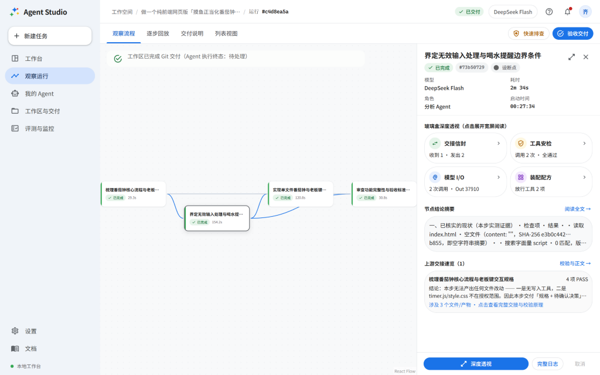
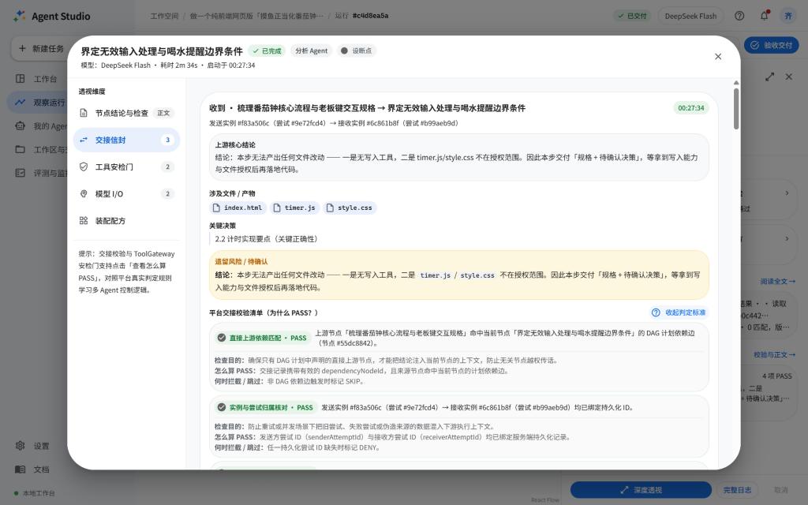
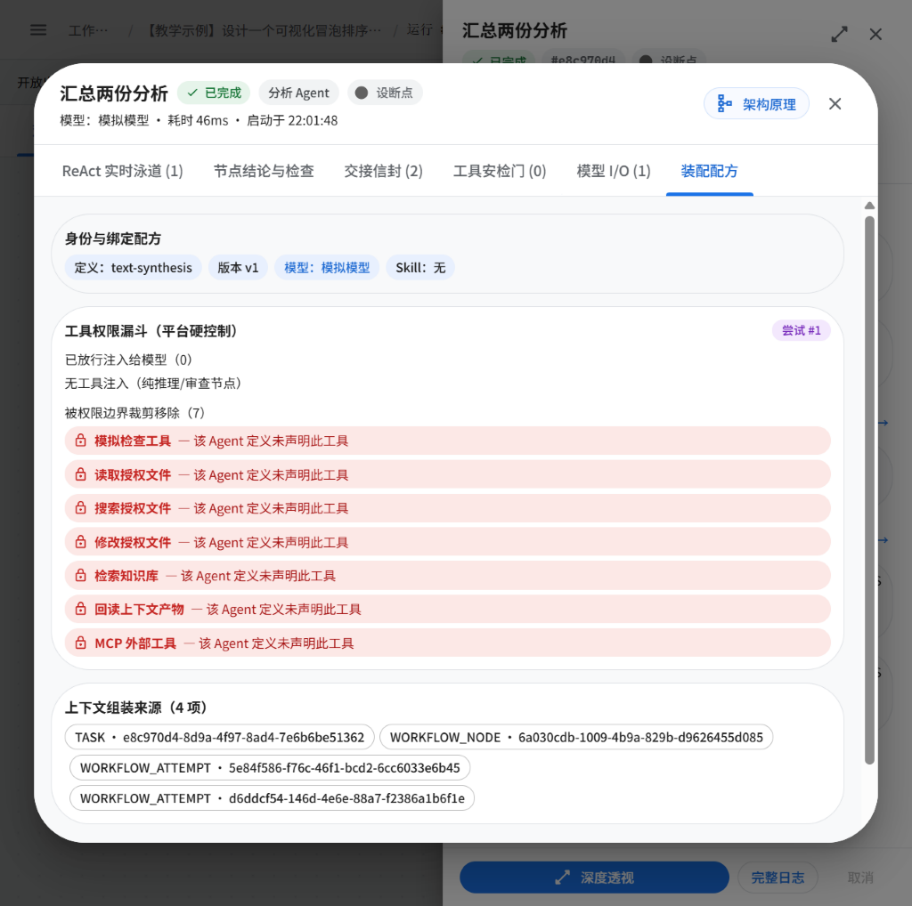
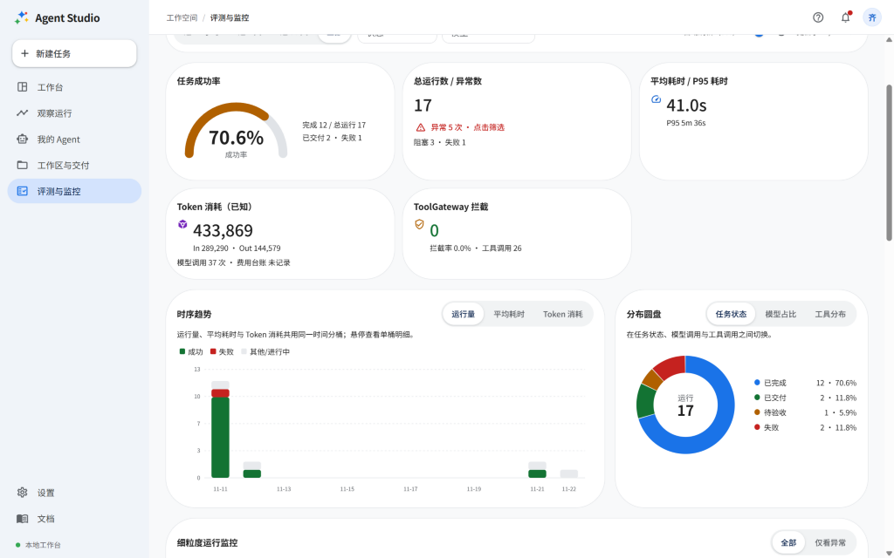
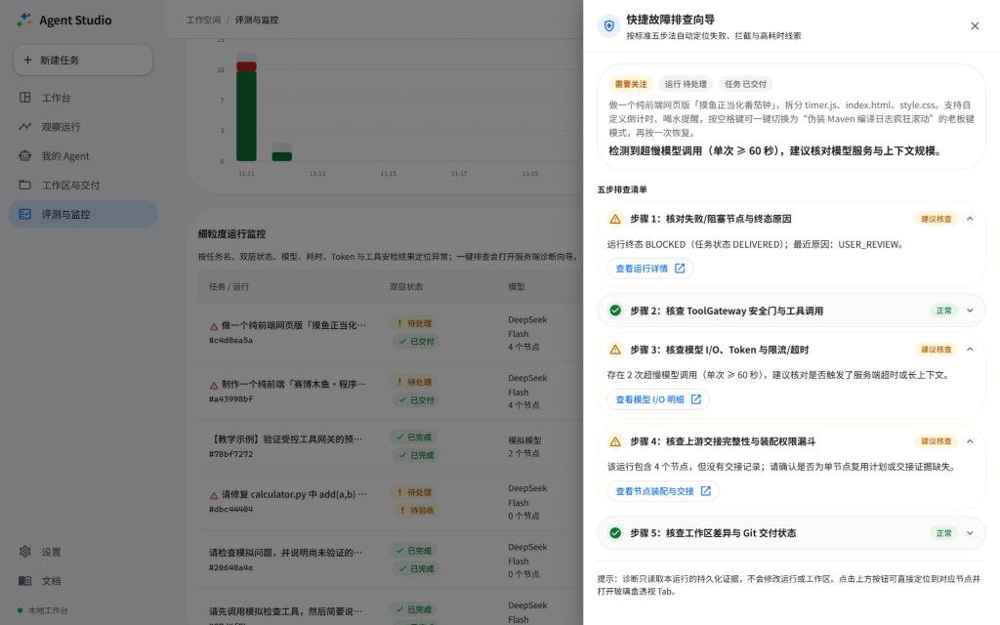
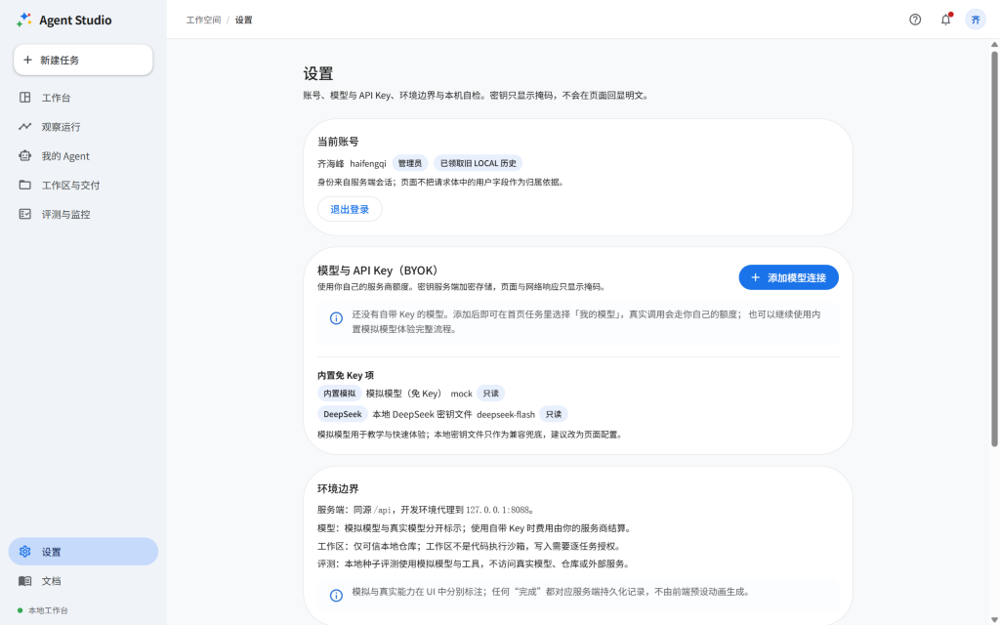

<div align="center">

# Glass-Box Agent Studio（玻璃盒多 Agent 可视化工作台）

**一个面向开发者与 AI Agent 学习者的开源「玻璃盒」多 Agent 协作工作台与实战教学平台**

[English](./README.md) | **简体中文**

[](https://openjdk.org/)
[](https://spring.io/projects/spring-boot)
[](https://react.dev/)
[](https://github.com/agentscope-ai/agentscope-java)
[](./LICENSE)

*把黑盒 AI Agent 彻底拆成透明的**「玻璃盒」**：亲眼看见多 Agent 如何规划 DAG、如何按权限装配、如何受控调用工具、如何校验交接、如何监控排障并安全交付到 Git。*

</div>

---

## 为什么做这个项目？

市面上大多数 AI Agent 框架对开发者来说都是一个**黑盒**：输入一句提示词，屏幕滚出一堆文字，但你很难真正看清和学会：
- 每个 Agent 节点到底是怎么被装配出来的？（绑定了哪些 Skill、哪些工具被平台权限边界**硬性裁剪**了？）
- 发给大模型的 `SYSTEM / USER / TOOL` 完整上下文与工具 Schema 究竟长什么样？
- 一次工具调用为什么被网关**放行（`PASS`）**或**拦截（`DENY`）**？到底怎么算 `PASS`？
- 上游 Agent 给下游交接了什么？平台如何防止跨节点越权传话或旧重试数据污染？
- 一次运行为什么失败、为什么变慢、Token 都花在了哪个节点？

**Glass-Box Agent Studio** 既是一个**真正可用的本地代码开发 Agent 工作台**（支持独立 Git worktree 隔离修改、人工审查提交、用户自带 API Key 调用真实模型），更是一个**把生产级多 Agent 工程内核完全透明化的学习项目**——内置免 Key 模拟模型与教学剧本，零成本即可跑通全链路并逐层透视学习。

---

## 核心可视化内容一览

| 功能模块 | 实现了哪些可视化内容 | 你能从中学到什么 |
| :--- | :--- | :--- |
| **1. 工作台首页与教学剧本** | 多入口任务发起器、3 个免 Key 玻璃盒教学剧本、任务与 Agent 双层状态 | 理解任务路由、先规划后执行，以及「Agent 运行态」与「任务交付态」解耦设计 |
| **2. 多 Agent DAG 执行流程图** | React Flow 实时流程图、节点状态与耗时、节点断点开关、轻量右侧概览 + 宽屏透视弹窗 | 学习 DAG 依赖调度、断点单步控制与后端事件到前端执行图的投影模式 |
| **3. 结构化交接信封与校验原理** | 上游核心结论、涉及文件/产物、关键决策、遗留风险、**可展开的「怎么算 PASS」校验标准** | 掌握多 Agent 协作防幻觉交接机制：依赖边校验、实例归属绑定与工具证据随行 |
| **4. 模型 I/O 全链路透视** | 按角色分色的 `SYSTEM / USER / ASSISTANT / TOOL` Messages、注入的工具 Schema、原始回复与 `tool_calls` | 看懂真实生产环境的 Prompt 拼装、外置化管理、脱敏截断与工具调用决策循环 |
| **5. 装配配方与 ToolGateway 安检门** | 工具权限漏斗（已放行 vs. 红色锁条展示被裁剪工具与原因）+ 6 道网关安检门实测依据 | 学习最小权限沙箱、路径白名单防越界、防死循环指纹、乐观锁与预算熔断 |
| **6. 类 Grafana 细粒度监控看板** | 成功率仪表盘、KPI 指标卡、时序趋势图、状态/模型/工具圆环图、慢节点与拦截排行 | 学习 LLM 应用可观测性指标建模（Avg/P95 耗时、Token 归因、安全拦截率） |
| **7. 一键故障排查向导** | 健康等级评定、一句话根因定位、1→5 步标准排查清单与一键直达目标节点/透视 Tab | 学习如何基于多表持久化证据自动生成可执行的故障诊断路径 |
| **8. BYOK 自带模型与 API Key 管理** | 多家 OpenAI 兼容服务商预设、AES-256-GCM 加密存储、掩码回显、一键测连通性 | 掌握密钥安全治理（加密落库、零明文回显、SSRF 校验、多账号隔离） |

---

## 图文详解：看懂每一块可视化与可学知识点

### 1. 工作台首页与免 Key 教学演示剧本

支持通用、需求、设计、代码、测试、模拟 Bug 多入口发起任务；即使暂时没有配置大模型 API Key，也可以一键运行 **3 套免 Key 教学演示剧本**，直观体验多视角分工交接、断点单步观察与 `ToolGateway` 限额安检。


**本模块可以学到：**
- **双层状态设计（`TaskStatus` × `RunStatus`）**：为什么要把不可变的 Agent 运行终态（如等待人工验收的 `BLOCKED`）与面向用户的任务交付状态（提交 Git 后自动升级为 `已交付 DELIVERED`）分层建模。
- **先审计划再执行**：任务发起前先生成结构化候选 DAG，支持人工调整节点、模型与文件白名单。

---

### 2. 多 Agent DAG 执行流程图与断点调试

每次运行以 React Flow 展示完整的节点依赖拓扑；点击任意节点后，右侧呈现清爽的轻量概览抽屉（2×2 元数据 + 4 个玻璃盒入口卡片 + 清洗后的摘要），支持给任意节点打上红色断点，在执行前自动暂停观察上游上下文。



**本模块可以学到：**
- **事件溯源与视图投影**：阅读 `ExecutionGraphProjector.java`，学习如何把持久化运行事件确定性地投影为前端可回放、可恢复的 DAG 状态图。
- **受控并发与断点挂起**：阅读 `WorkflowScheduler.java` 与 `RunControl.java`，理解多线程调度下的安全暂停、恢复与取消信号传播。

---

### 3. 宽屏玻璃盒透视：结构化交接信封与「为什么 PASS？」

告别黑盒字符串拼接！点击「交接信封」在宽屏弹窗中查看上游核心结论、涉及文件、关键决策、遗留风险与完整 Markdown 正文（含表格渲染）。更关键的是，平台交接校验清单不仅告诉你 `PASS / SKIP`，还直接展示**本次实测依据**，点击 **「查看怎么算 PASS」** 即可对照学习每项检查的判定标准与拦截条件。



**本模块可以学到：**
- **可审计的多 Agent 交接协议**：学习 `DEPENDENCY_MATCH`（直接上游依赖边匹配）、`ATTEMPT_IDENTITY`（实例与尝试 ID 归属绑定）、`TOOL_EVIDENCE`（工具证据随行）、`ACCEPTED_RECEIPT`（下游落库回执）四道防线。
- **确定性信封提取**：阅读 `StructuredHandoffExtractor.java` 与前端 `checkExplanations.js`。

---

### 4. 宽屏玻璃盒透视：模型 I/O 完整 Prompt 与 `tool_calls`

完整透视发给大模型的每一条按角色分色的 `SYSTEM / USER / ASSISTANT / TOOL` 消息、注入的工具 JSON Schema、Token 统计、调用耗时以及模型的原始回复与 `tool_calls` 决策参数。


**本模块可以学到：**
- **Prompt 外置化工程实践**：所有角色人设、Skill 模板、规划提示词与工具契约均外置在 `backend/src/main/resources/prompts/` 下，可独立维护与版本追踪。
- **落库前脱敏与截断**：阅读 `ControlledModel.java` 与 `SensitiveDataMasker.java`，学习如何在不影响排查的前提下自动脱敏密钥并按 64 KB 上限安全截断。

---

### 5. 宽屏玻璃盒透视：Agent 装配配方与工具权限漏斗

彻底看懂一个 Agent 节点是如何被“组装诞生”的：角色定义、版本、绑定模型、Skill、上下文组装来源，以及极具教学价值的 **「工具权限漏斗（平台硬控制）」**——绿色展示已放行注入给模型的工具，红色锁条清晰列明**被权限边界裁剪移除的工具及原因**（例如只读审查节点被平台强制剥离写入工具）。



**本模块可以学到：**
- **平台硬控制 vs. Prompt 软约束**：明白为什么安全边界不能只靠 Prompt 叮嘱大模型“不要改文件”，而是要在装配阶段从工具集里彻底裁剪，并在运行时由 `ToolGateway` 经 6 道安检门（身份归属、工具注册权限、预算与防循环、路径白名单、参数 Schema、取消状态）逐项兜底。

---

### 6. 类 Grafana 细粒度运行监控看板

纯 React SVG 实现的零重型依赖类 Grafana 仪表盘：支持 `近 24 小时 / 近 7 天 / 近 30 天 / 全部` 切换与 30 秒自动刷新，覆盖 **5 张核心 KPI 卡（含成功率圆弧仪表盘）、时序趋势图（运行量 / 耗时 / Token）、任务状态/模型/工具 Donut 圆环图、细粒度运行明细表、Top 慢节点与高频拦截安检门排行**。



**本模块可以学到：**
- **AI Agent 可观测性落地**：阅读 `MonitoringDashboardService.java` 与 `MonitoringCharts.jsx`，学习如何从关系型执行证据中聚合 P95 耗时、Token 分布、工具拦截率并构建轻量无依赖 SVG 数据可视化。

---

### 7. 5 步自动故障诊断与一键快捷排查向导

在监控看板或失败/阻塞运行的详情页点击 **「一键排查」**，服务端自动分析该次运行的全部持久化证据，给出健康等级、一句话核心根因定位，以及按 **「终态与异常节点 → ToolGateway 安检门 → 模型 I/O 与超时 → 交接与装配权限 → 工作区与 Git」** 排序的 5 步排查向导；点击任意步骤的快捷按钮可直接跳转到目标节点并自动打开对应玻璃盒 Tab。



**本模块可以学到：**
- **自动化排障 SOP 编排**：阅读 `RunDiagnosticsService.java` 与 `RunDiagnosticsDrawer.jsx`，学习如何把专家排查经验沉淀为确定性的诊断规则与前端 Deep-Link 联动。

---

### 8. BYOK（用户自带模型与 API Key）安全配置体系

在 **设置 → 模型与 API Key（BYOK）** 中直接选择服务商预设（内置 **DeepSeek、OpenAI、通义千问 Qwen、智谱 GLM、硅基流动及任意自定义 OpenAI 兼容端点**），填入你自己的 API Key 并一键 **「测试连通性」**；可选填参考单价用于本机预算估算。



**本模块可以学到：**
- **服务端密钥安全治理**：阅读 `SecretCipher.java`（AES-256-GCM + 随机 12 字节 IV）、`ApiKeyMasker.java`（前端仅回显 `sk-****xxxx` 掩码）、`ModelConnectionService.java`（Base URL 防内网 SSRF 校验 + 严格多账号归属隔离）。

---

## 全栈中英双语架构：为什么专门维护两套外置 Prompt？

不同于普通 Web 应用，AI Agent 平台的国际化包含**三个独立层级**：前端 UI、后端校验与诊断、以及**大模型 Prompt**。

因为 **Glass-Box Agent Studio** 定位为**面向学习者的玻璃盒可视化项目**，我们专门在 `backend/src/main/resources/prompts/`（中文）与 `prompts/en/`（英文）维护了**中英两套镜像外置 Prompt 与工具契约**：
1. **最大化玻璃盒学习可读性**：中文用户在「模型 I/O」中直接看到母语级清晰的中文 System Prompt、Skill 规范与工具 Schema；英文用户切到 `EN` 后看到的也是地道英文 Prompt，不需要在学习多 Agent 原理时额外跨语言脑内翻译，也方便对照学习双语 Prompt 工程写法。
2. **任务语言冻结与自动回退（`tasks.locale`）**：每次任务创建时落库冻结语言偏好（Flyway `V6`），由 `PromptResourceLoader.load(locale, path)` 按语言加载并附带输出语言指令，英文资源缺失时自动回退中文，保证历史任务永不失效。
3. **代码与语言解耦**：前端采用零第三方依赖的 JSON 语言包（右上角一键 `中文 / EN` 实时切换），后端采用语义化 `gate` + Spring `MessageSource`（`Accept-Language`），即使切换语言查看历史旧运行，安检门、交接校验与 5 步故障排查向导也能自动切为当前界面语言。

---

## 5 分钟快速启动

### 方式一：交给 AI Coding Agent 一键部署（推荐）

如果你正在使用 **Antigravity、Claude Code、Cursor、Codex 或 Windsurf**，直接把下面这段提示词复制给你的 AI 助手，即可全自动完成环境检测、克隆、前端构建与本地启动：

```text
请帮我在本地克隆并部署开源项目 https://github.com/Qi-95827/glassbox-agent-studio ：
1. 先检查本机环境是否具备 Java 21、Maven 3.9+、Node.js 20+ 与 Git（Docker Desktop 为可选项，仅测试模拟 Bug 容器验证时需要）；如缺少环境请明确提示我安装。
2. 将仓库克隆到本地干净目录。
3. 进入 `frontend/user-workbench/` 执行 `npm ci && npm run build` 构建前端。
4. 回到仓库根目录（注意 `pom.xml` 在仓库根目录，不要在 `backend/` 下运行 mvn）执行 `mvn spring-boot:run` 启动服务。
5. 等待服务在 `http://127.0.0.1:8088` 启动就绪后告诉我访问地址。全程不要写入或提交任何真实 API Key。
```

### 方式二：手动命令行启动

#### 环境要求
- **Java 21**、**Maven 3.9+**
- **Node.js 20+**
- **Git**（Docker Desktop 为**可选**，仅在体验「模拟 Bug 容器复现与回归验证」时需要）

#### 1. 克隆项目并构建前端
```powershell
git clone https://github.com/Qi-95827/glassbox-agent-studio.git
cd glassbox-agent-studio

cd frontend/user-workbench
npm ci
npm run build
cd ../..
```

### 2. 启动后端服务
```powershell
mvn spring-boot:run
```

启动完成后在浏览器打开 **http://127.0.0.1:8088**：
1. 首次打开按页面引导初始化本地管理员账号；
2. 可直接点击首页 **3 套免 Key 教学演示剧本** 零门槛体验全流程；
3. 如需接入真实大模型，进入 **「设置 → 模型与 API Key（BYOK）」** 添加你的模型连接并测试连通性即可使用。

### 3. 运行全量测试与架构守卫
```powershell
# 后端全量测试（含 ArchUnit 架构守卫与 Flyway 迁移兼容测试）
mvn test

# 前端代码格式化检查、Lint、单元测试与生产构建
cd frontend/user-workbench
npm run format:check
npm run lint
npm test
npm run build
```

---

## 技术架构与分层守卫

项目采用清晰的分层架构，由 **ArchUnit（`ArchitectureGuardTest`）** 自动守卫：顶层包零循环依赖、`domain` / `framework` 保持绝对纯净、`io.agentscope` SDK 严格隔离在 `infrastructure` / `app` 层。

```text
frontend/user-workbench/   React 19 · Vite · MUI (M3) · React Flow · React Query · React Router
backend/src/main/java/
  dev.workbench.domain          纯领域枚举与值对象（零持久化/Web 依赖）
  dev.workbench.framework       纯契约、ToolGateway、SecretCipher 与交接提取器
  dev.workbench.infrastructure  AgentScope Java 2.0.4 与 OpenAI 兼容模型适配层
  dev.workbench.modelconnection BYOK 加密模型连接管理、连通性探测与费用估算
  dev.workbench.persistence     JPA 实体、Repository 与 Flyway V1~V6 数据库迁移（H2）
  dev.workbench.planning        想法整理、入口路由、候选 DAG 生成与校验
  dev.workbench.orchestration   运行生命周期、DAG 调度、断点控制与交接协调
  dev.workbench.delivery        执行图投影、节点详情投影与交付聚合
  dev.workbench.workspace       授权文件沙箱与 Git worktree 审查/提交/合并
  dev.workbench.privateagent    版本化私有 Agent / Skill / 只读 Tool 配置管理
  dev.workbench.bug             模拟 Bug 分诊与 Docker 容器复现回归闭环
  dev.workbench.evaluation      版本化评测套件、数据集与批次对照
  dev.workbench.observability   游标事件流、类 Grafana 监控看板与 5 步故障诊断
backend/src/main/resources/
  prompts/                      外置化中文 Agent / Skill / 规划 Prompt 与工具契约（默认）
  prompts/en/                   外置化英文镜像 Prompt 与工具契约（英文任务专用）
  i18n/                         Spring MessageSource 国际化资源（zh_CN / en_US）
  db/migration/                 Flyway 版本化迁移脚本（V1 ~ V6）
```

---

## 文档导航

- **[docs/README.md](docs/README.md)**：完整文档目录与归档索引
- **[项目总览：产品需求与技术架构](docs/项目总览_产品需求与技术架构.md)**：完整能力范围、数据模型与验收基线
- **[玻璃盒多 Agent 全链路可视化概要设计](docs/概要设计/玻璃盒多Agent全链路可视化_概要设计.md)**：面向开源教学的全链路透视架构设计
- **[代码开发规范](docs/开发规范/代码开发规范.md)**：工程分层、JPA 持久化与安全规约

---

## 开源协议

本项目基于 [MIT License](./LICENSE) 开源，欢迎 Star、Fork 与用于多 Agent 工程实践学习！
