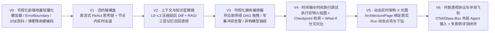

# Glass-Box Agent Studio：当前开发状态、AI 框架可视化演进构想与新会话交接文档

> **交接日期**：2026-11-26  
> **代码仓库**：`D:\software program\AI\agent-dev-workbench`  
> **本地测试仓库（用户手测用）**：`F:\tmp\demo-todo`（分支 `main`，含 `app.py`、`application.yml`）  
> **当前 Git 基线**：`master` @ `30e94ae`（本地领先 `origin/master` 3 个已验收提交，**均未 `git push`**）  
> **战略定位校准**：聚焦 **「AI Agent 框架玻璃盒可视化与交互式调试台」**（AI Agent 领域的 Chrome DevTools + Flink Web UI + Visual DAG Studio），**不再向重多用户 / 企业 SaaS 方向发散**。

---

## 一、战略定位校准：为什么聚焦「AI 框架可视化」而非多用户

本项目的核心护城河不是“又一个多租户 AI SaaS 平台”，而是**把黑盒 Agent 框架拆成可透视、可打断点、可回放、可对比、可编排的「玻璃盒」**：

- **明确聚焦（Core Focus）**：让开发者/学习者/架构师在本地单机就能**实时看见、亲手调试、量化对比**一个现代多 Agent 框架内部发生的每一件事——DAG 调度、ReAct 推理循环、上下文四级压缩、Hybrid RAG 与分层记忆召回、6 道安全安检门、反思回边、Checkpoint 状态快照与评测消融。
- **明确边界（Explicit Non-Goals）**：
  - 当前已具备的本地账号、会话认证、所有权隔离与 Top 10 安全边界已足够稳固；
  - **暂缓/不做**重型多租户组织空间、企业 RBAC/OIDC、KMS 密钥托管、外部 Jira/Linear 团队审批流等偏企业 SaaS 方向的功能，把研发精力集中投入在 **AI 框架可视化深度与交互体验** 上。

---

## 二、当前开发状态基线（2026-11-26 实机核验）

### 2.1 Git 提交与工作区状态

- 远端 `origin/master` 停在 `dbcdd56`；本地 `master` 领先 **3 个已验证提交**（工作区干净，未推送远端）：

| Commit | 类型 | 核心内容 |
| :--- | :--- | :--- |
| `30e94ae` (`HEAD`) | `fix` | 修复 `AuthService.current()` 在评测异步后台线程丢失认证上下文，解决登录态使用 BYOK 真实 Key 跑代码评测时报错 `Incorrect result size: expected 1, actual 0` 的问题；同步加固异步 BYOK 归属回归测试 |
| `13f4a11` | `fix` | 修复登录态 `CodingReflectionRunner` 临时工作区被白名单误拦（新增严格限 `tmpdir/eval-coding-*` 的内部入口）；修复 `EvalCaseDetailDrawer` 失败原因空白展示；修复 `PlanningMultiAgentRunner` 负向用例 `plan-03/04` 空指针崩溃；新增全链路登录态 E2E 测试 `AuthenticatedEndToEndWorkflowAndEvalTest` |
| `f5ae24d` | `feat` | 修复全站后端 i18n 失效（`spring.messages.basename=i18n/messages` 与内置兜底）；支持整仓（`.`）授权与默认噪音目录排除；重构任务发起交互为三档常驻授权条 `WorkspaceAuthorizationBar` 并折叠低频预算参数；支持管理员一键自动授权并导入本地 Git 仓库 |
| `dbcdd56` (`origin/master`) | `docs` | 文档收敛清理与架构基线对齐 |
| `4873bf3` | `fix` | 断点恢复检查点冲突修复、`EvalLabService` 裁判费用口径对齐、Windows 临时仓库清理、PG 16 + `pgvector` 3/3 实机通过 |

> **手测提醒**：本地 `30e94ae` 提交完成后尚未在新会话中由用户重跑真 Key 实机演示；新会话如需实机看效果，先确认已重启 `mvn spring-boot:run` 加载最新编译产物，再决定是否推送这 3 个本地提交至远端。

### 2.2 代码规模与全量门禁实测结果

- **技术栈**：Java 21 + Spring Boot 3.5.7 + AgentScope Java 2.0.4 + React 19 + Vite 6 + MUI M3 + `@xyflow/react` + Dagre + H2 / PostgreSQL 16 + `pgvector`（Flyway H2 `V1~V14`，PG `V1~V4`）。
- **代码体量**：后端 `662` 个主源码文件 / `177` 个测试文件；前端 10 个路由页、中英 1:1 国际化（`1586` 词条）。
- **最新门禁结果**：
  - 后端全量 `mvn test`：**719 用例，0 失败，0 错误**（19 个既有环境条件跳过），`ArchitectureGuardTest` **5/5 通过**；
  - 专项登录态 E2E + 权限回归：`AuthenticatedEndToEndWorkflowAndEvalTest` **1/1**、`*Auth*Test` / `*Ownership*Test` / `ArchitectureGuardTest` **34/34**；
  - 前端四步门禁（`frontend/user-workbench/`）：`format:check` / `lint` / `npm test`（**24 测试文件 / 78 用例全过**）/ `npm run build`（静态产物已输出至 `dist/`）全绿。

### 2.3 现有可视化能力盘点 vs 可视化断层诊断

这是下一阶段发力的直接抓手——**后端引擎很深，但前端只把其中约 45% 的机理真正「可视化」了出来**：

| 框架子系统 | 后端已有真实能力 | 前端现有可视化现状 | 核心可视化断层（痛点） |
| :--- | :--- | :--- | :--- |
| **多 Agent DAG 编排** | `WorkflowScheduler` 并行调度、反思回边（`RevisionEdge`）、`PlanCandidateValidator`（写集互斥/环检测） | `RunFlowGraph.jsx`（只读 React Flow 图）+ `PlanAdjustmentEditor.jsx`（纯表单编辑） | **只能看、不能在画布上编排**；反思回边与写集冲突缺乏直观图形交互；运行中节点仅有旋转态，看不到内部微进度 |
| **ReAct 推理与模型调用** | `ControlledModel` + `AgentScopeExecutor` + 完整入出参落库 | `LlmTracePanel.jsx`（结束后查看静态 Messages 列表） | **无真流式输出**，调用期间前端干等 10~30s；无 ReAct `Thought → Action → Observation` 结构化泳道；无推理模型 CoT 思考链折叠展示 |
| **四级上下文压缩（L0~L3）** | `MultiTierContextCompactor`（L1 Artifact 卸载、L2 增量摘要、L3 硬保底 + 工具对保护）+ `context_artifacts` 落库 | `ContextMeterBar.jsx`（单条 10px 静态色条 + 数字摘要） | **看不见压缩到底删/改了什么**：无多轮上下文水位演化曲线、无压缩前后左右 Diff、不能点击展开被 L1 卸载的 Artifact 原文 |
| **Hybrid RAG & 三层长期记忆** | V9 三层记忆（工作/情节/语义）+ V13 Hybrid RAG（BM25 + pgvector + RRF 融合） | `features/memory/` **目录为空**！前端几乎没有专属检索/记忆可视化 | **黑盒召回**：看不到 BM25 vs 向量各自得分、RRF 融合排名、哪些记忆/片段被选中或因预算被裁剪、代码分块边界 |
| **Checkpoint 与断点调试** | 非阻塞 `PauseYield` 断点、Flink 风格 `workflow_checkpoints` 快照、恢复继续 | `features/checkpoints/` **目录为空**；仅节点红点「断点」+ `RunReplayPanel.jsx`（线性事件列表） | **没有时间轴、不能分叉对比**：缺少并行甘特/火焰图；看不到 Checkpoint 快照内部状态；不支持从某一步改参数/换模型「What-If 分叉重跑 + 左右 Diff」 |
| **ToolGateway 6 道安检门** | 6 道安检门 + Gate 5.5 敏感路径/MCP HITL 审批 + 完整证据落库 | `ToolGatewayPanel.jsx`（右侧抽屉列表）+ `ToolApprovalDrawer.jsx` | 安检链路藏得较深，缺乏“工具请求依次通过 Gate 1 → Gate 6 关卡灯”的直觉流水线展示；代码改动缺少 IDE 级 Split Diff 视图 |
| **架构图谱（原理教学）** | 全链路 `run_events` 与模块归属清晰 | `ArchitecturePage.jsx`（4,300+ 行**纯静态** C4 架构图） | **静态死图，与真实运行割裂**；且部分静态文案已漂移（如仍写 `Flyway V12`）；首屏未懒加载拖慢主包 |
| **评测实验室（Eval Lab）** | 6 大类引擎、内置微集、Benchmark Hub、双轨裁判、A/B 消融 | `EvalLabPage.jsx`（六维雷达图 + 逐题抽屉 + A/B 对比） | 与真实工作台运行尚未形成飞轮（未打通“失败 Run 一键脱敏转成评测用例”）；缺少外部 Agent 框架的开放 Trace 接入 |

---

## 三、未来演进蓝图：All-In「AI 框架可视化」的 6 大核心方向

以下 6 个方向按 **“体感跃升 × 差异化壁垒 × 工程可行性”** 排出推荐演进顺序（`V1` → `V6`），新会话可直接任选其一作为迭代专题推进。



### V0：可视化前端地基轻量化（前置小扫除，建议 1 个短迭代完成）
> 只做直接服务于「可视化丝滑度与稳定性」的工程项，避免后期越画越卡。
1. **首屏减重与防白屏**：`App.jsx` 路由接入 `React.lazy` + `Suspense`（剥离 4,300 行 `ArchitecturePage` 首屏负载），在 `main.jsx`/`App.jsx` 外层和画布/抽屉局部增加 `ErrorBoundary`。
2. **SSE 与轮询彻底协同**：已结束的终态 Run 禁止新建 `EventSource`；SSE 连接正常期间暂停重复的 `1500ms/1800ms` REST 轮询；`RUN_EVENT` 触发的 `invalidateQueries` 增加 `250~300ms` 防抖合并。
3. **画布与长流性能**：`RunFlowGraph.jsx` 的 `FlowNode` 包裹 `React.memo` 避免无效重绘；`RunReplayPanel.jsx` 接入长列表虚拟滚动；清理 `RunFlowGraph.jsx` 残余硬编码中文（`'断点'`/`'次尝试'`/`'流程依赖'`）、将 `api/client.js` CSRF 重试改用语义错误码替代中文字符串匹配、移除废弃的 `EvaluationsPage.jsx`。

---

### V1：活的玻璃盒 —— 真流式输出 + ReAct 思考链实时泳道（🔥 推荐首推）
> **核心价值**：彻底告别“点运行后看转圈干等 20 秒”，让用户在运行当下像看示波器一样看见 Agent 正在想什么、调什么、过哪道门。
1. **后端真流式打通**：开启 `ControlledModel` 增量流式接收（兼容 DeepSeek R1 / OpenAI / Anthropic 的 `reasoning_content` 与 `content` 通道分离），通过 `RunStreamBroker` SSE 实时推送轻量 delta 事件（终态仍完整落库，不破坏证据不可抵赖原则）。
2. **ReAct 实时循环泳道（Turn-by-Turn Swimlane）**：
   - 将单节点内的执行可视化为清晰的步骤时间卡：`Turn 1 [思考链 CoT（可折叠）] → [发起工具调用 read_authorized_file] → [Gate 1..6 关卡灯依次点亮] → [工具返回结果摘要] → Turn 2 [修改决策 / 反思自检]`；
   - 画布上的 `FlowNode` 卡片在运行期显示实时微型状态条（当前 Turn、正在执行的工具或审批状态、当前上下文水位 %）。
3. **安全安检门横向流水线**：把 6 道安检门（白名单 → 参数校验 → 路径沙箱 → 预算限额 → 风险分级 → Gate 5.5 审批）做成可视化横向关卡条，一眼看清高危操作在哪一道门触发暂停或拦截。

---

### V2：上下文压缩「显微镜」+ Hybrid RAG / 三层记忆「透明召回透视」（🔥 技术深度最高）
> **核心价值**：把后端已经下重本做完的 L0~L3 压缩、V9 三层记忆、V13 Hybrid RAG 变成直观惊艳的可视化模块，填平当前最大的“前后端信息差”。
1. **上下文窗口显微镜（升级 `ContextMeterBar` → `ContextMicroscopePanel`）**：
   - **水位演化堆叠面积图**：横轴为 Turn 1..N，纵轴为 Token 占比（分 `SYSTEM / SKILLS / MEMORY / HANDOFF / TOOL_OUTPUTS / HISTORY` 6 层），叠加画出 L1/L2/L3 触发阈值红线，直观看到上下文膨胀与压缩回落过程；
   - **压缩前后左右对照 Diff（Before vs After Compaction）**：明确高亮「哪些消息被 L1 卸载为 Artifact（点击弹窗直看 `/api/context-artifacts/{ref}` 原始全文）」「哪些历史轮次被 L2 压成摘要」「哪些 `tool_call/tool_result` 被识别为原子对予以保护」；
   - 同步在后端补齐真实的只读工具 `context_artifact_read`，让模型也能按需回读被卸载的大正文。
2. **RAG & 三层长期记忆透视（正式建设 `features/memory/`）**：
   - 后端先将 V13 `KnowledgeRagService` 正式接入动态工作流（作为受控只读工具 `knowledge_search` 或 `AgentContextContributor`），并记录每次检索的 `bm25Score`、`vectorScore`、`rrfScore`、`selected/droppedReason` 证据；
   - 前端提供 **Hybrid Retrieval X-Ray 面板**：漏斗式对比「BM25 词法 Top-K」与「pgvector 语义 Top-K」如何经 RRF 融合为最终注入 Prompt 的片段，支持命中词高亮与超预算截断原因标注；
   - 提供 **三层记忆可视化图谱 & 工作区切片透视**：查看工作记忆 / 情节记忆 / 语义记忆的来源 Run、命中频次、支持人工纠偏/冻结，以及代码文件被切分出的 Chunk 边界预览。

---

### V3：所见即所得「多 Agent 可视化编排画布」（Visual Graph Composer）
> **核心价值**：让工作台从“看系统自动跑图”进化为“人类架构师亲手拖拉编排多 Agent 拓扑，并实时获得框架级合法性校验反馈”。
1. **双向可视化画布编辑器**（复用 `@xyflow/react`）：
   - 支持在任务发起/计划确认阶段直接拖入角色节点（分析 / 实现 / 审查 / 测试 / 用户私有 Agent）、连出**实线依赖边**与**虚线反思回边**（边上直接标注并可编辑 `maxRevisions`）；
   - **实时合法性视觉告警**：对接后端 `PlanCandidateValidator`，当两个并发写节点文件写集重叠或出现非法环路时，直接在画布上用红色脉冲边 + 冲突文件名徽章标红提示，彻底直观化框架的“写集互斥”与“有界反思”原则。
2. **节点级组件插拔面板**：点画布任意节点，在侧边直接挂载/切换该节点的**独立模型**（支持异构分工：如强推理模型规划 + 快模型写代码 + 独立模型审查）、**授权文件子集**、**私有 Skill** 与 **MCP 工具**，形成真正的“可视装配蓝图”。

---

### V4：执行时间轴火焰图 + Flink 风格 Checkpoint 时间旅行 & What-If 分叉调试
> **核心价值**：把工作台已经实现的非阻塞断点与 Checkpoint 机制做成业界顶级的 Agent 调试器体验（正式建设 `features/checkpoints/`）。
1. **Execution Timeline / Gantt 火焰图**（新增 Run Detail 视图 Tab）：
   - 同一条水平时间轴展开所有并行节点、模型推理耗时、工具执行耗时、L2 压缩耗时、Gate 5.5 人工审批等待段、反思打回重做段，一眼识别真正瓶颈与并行加速比。
2. **Checkpoint 状态快照检查器**：
   - 展示每个 Checkpoint 冻结的完整图状态（已完成节点、上游交接信封、当前文件指纹、累计 Token/费用、已触发记忆快照），支持对比两个 Checkpoint 或两轮反思之间的状态 Diff。
3. **What-If 分叉重跑与双轨迹对比（Fork from Checkpoint & Diff）**：
   - 在任意历史节点/断点点击「从此处分叉调试」→ 允许微调该节点的 System Prompt、更换底层模型或编辑上游 Handoff 文本 → 启动新分支 Run；
   - **左右同屏 Run Diff 视图**：同步对照主线 Run 与分支 Run 的 DAG 状态、每步输出差异、Token/耗时变化与最终代码 Split Diff（IDE 级并排语法高亮代码对比）。

---

### V5：「动态实时架构 X 光图」（Live Architecture X-Ray）
> **核心价值**：把现有的 `ArchitecturePage`（4,300+ 行精美 C4 图谱）从“静态说明文档”盘活成“会呼吸的实时框架透视仪”！
1. **绑定真实 Run 实时点亮**：在 `ArchitecturePage` 顶部增加「选择运行实例（或跟随当前活跃运行）」选择器；根据该 Run 的真实 `run_events` 与证据，动态高亮数据流经的框架组件与连线（支持回放滑块逐帧看请求在五大引擎间的流转路径）。
2. **模块级实时指标叠加与下钻**：架构图上的每个核心模块卡片（`WorkflowScheduler`、`ControlledModel`、`MultiTierContextCompactor`、`ToolGateway`、`Memory/RAG`、`WorkspaceDelivery`）直接叠加显示本次运行的真实指标（调用次数、耗时、压缩节省率、安检拦截数），点击模块直接弹出本次运行该模块的真实数据证据。
3. **顺手校准静态文档漂移**：同步更新 `architectureCatalog.js` 中仍写着 `Flyway V12` 等旧版本描述。

---

### V6：开放式 Glass-Box Trace 协议 + 评测飞轮（生态升维）
> **核心价值**：从“可视化自己的工作台”升级为“可视化任何接入协议的 AI Agent 框架”。
1. **Open Glass-Box / OTel Trace 双向互通**：
   - 导出：支持将任意 Run 导出为标准 OpenTelemetry Trace JSON / 兼容 Langfuse / Phoenix 结构；
   - 接入（Ingest API）：提供极简的外部 Trace 接收端点与轻量 Java/Python 示例埋点，开发者在本地跑自定义 Agent（AgentScope 独立程序、LangGraph、原生 Python ReAct Loop）时，可直接把节点/模型/工具/上下文事件推到本工作台画布上获得同样的高级可视化体验！
2. **Eval Flywheel（运行调试 → 评测回归闭环）**：
   - 在任意 Run 详情或失败节点上提供「一键脱敏沉淀为评测用例」按钮，自动抽取目标、初始文件夹具、断言条件并导入 Eval Lab 自定义集，后续改动 Prompt/模型/压缩策略时一键跑回归雷达对比。

---

## 四、新会话开发红线与验收命令（必须遵守）

### 4.1 铁律清单
1. **语言约定**：所有回复、说明、注释、文档**必须使用简体中文**；代码标识符保持英文，严禁拼音。
2. **密钥与隐私红线**：**绝不读取、打印、记录或提交** `config/deepseek-api-key.txt`、`config/master.key` 及 `data/` 目录下的任何文件。
3. **数据库迁移红线**：**绝不修改**历史已发布 Flyway 脚本（H2 `V1~V14`、PG `V1~V4`）；如确需新表/列，仅允许顺序追加新版本（H2 `V15__...` / PG `V5__...` 同步成对维护，并坚持 `@JdbcTypeCode(SqlTypes.LONGVARCHAR)` 禁用 `@Lob String`）。
4. **架构与安全铁律**：保持 `ArchitectureGuardTest` 5/5 全绿；Controller 不得直接依赖 JPA Repository；前端严禁 `dangerouslySetInnerHTML`；所有新前端文案必须中英 1:1 维护在 `zh-CN.json` / `en-US.json` 中，禁止硬编码中文。
5. **Git 推送红线**：除非用户明确要求 `git push`，否则**一律只做本地 `git commit`**，绝不自行推送远端。
6. **Windows 环境兼容**：PowerShell 5.1 不支持 `&&` 链式符，统一使用 `;` 或 `if ($LASTEXITCODE -eq 0)`；注意临时文件/Git 对象只读属性的清理。

### 4.2 标准门禁命令（在 `D:\software program\AI\agent-dev-workbench` 执行）
```powershell
# 1. 后端全量测试（禁用 PG 变量走 H2 全量 + ArchUnit 5/5）
$env:WORKBENCH_PG_TEST=""; mvn test

# 2. 登录态全链路端到端快速回归
$env:WORKBENCH_PG_TEST=""; mvn "-Dtest=AuthenticatedEndToEndWorkflowAndEvalTest,ArchitectureGuardTest" test

# 3. 前端四步门禁（在 frontend\user-workbench 目录）
npm run format:check; npm run lint; npm test; npm run build
```

---

## 五、新会话一键开场提示词（直接复制粘贴即可衔接）

> 下次开启新会话时，把下面这段话直接发给助手即可零损耗接棒：

```text
请先阅读交接文档 D:\software program\AI\agent-dev-workbench\docs\交接\AI框架可视化演进与新会话交接_2026-11-26.md，快速掌握项目最新代码基线（master @ 30e94ae）与战略定位。

我们的核心方向已经明确聚焦在「AI 框架可视化（Glass-Box AI Framework Studio）」，不再做重多用户/企业 SaaS 功能。
接下来我想优先推进文档中的【这里填你想先做的方向，例如：V0 前端地基轻量化 + V1 真流式 ReAct 思考链实时泳道 / V2 上下文压缩显微镜与 RAG 记忆透视 / V3 可视化多 Agent 编排画布 / V4 时间轴火焰图与 Checkpoint 时间旅行 / V5 动态实时架构 X 光图】。

请先基于该方向的现有前后端代码做一次精准勘察，给我一份可执行的技术设计与分步实施计划（含前后端数据结构、核心交互设计与测试验收点），确认后再开始编码。
```
