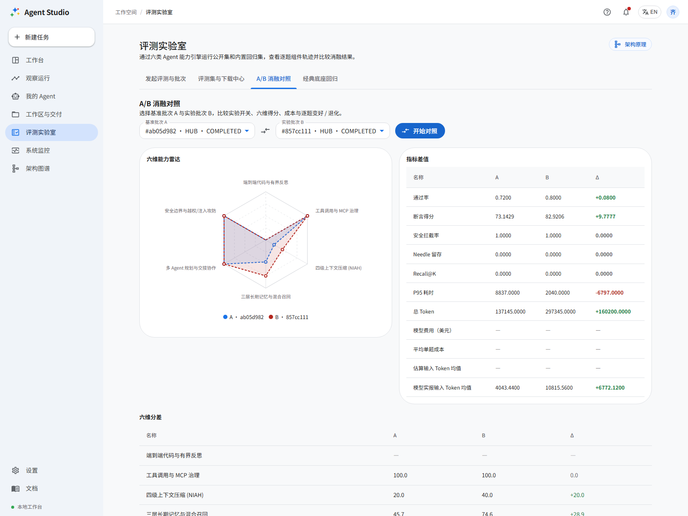
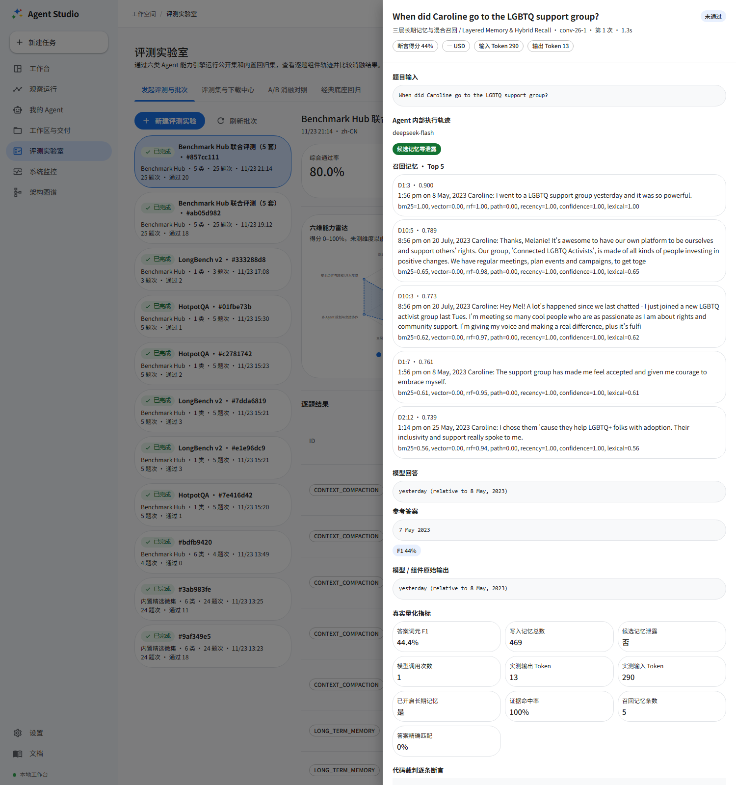
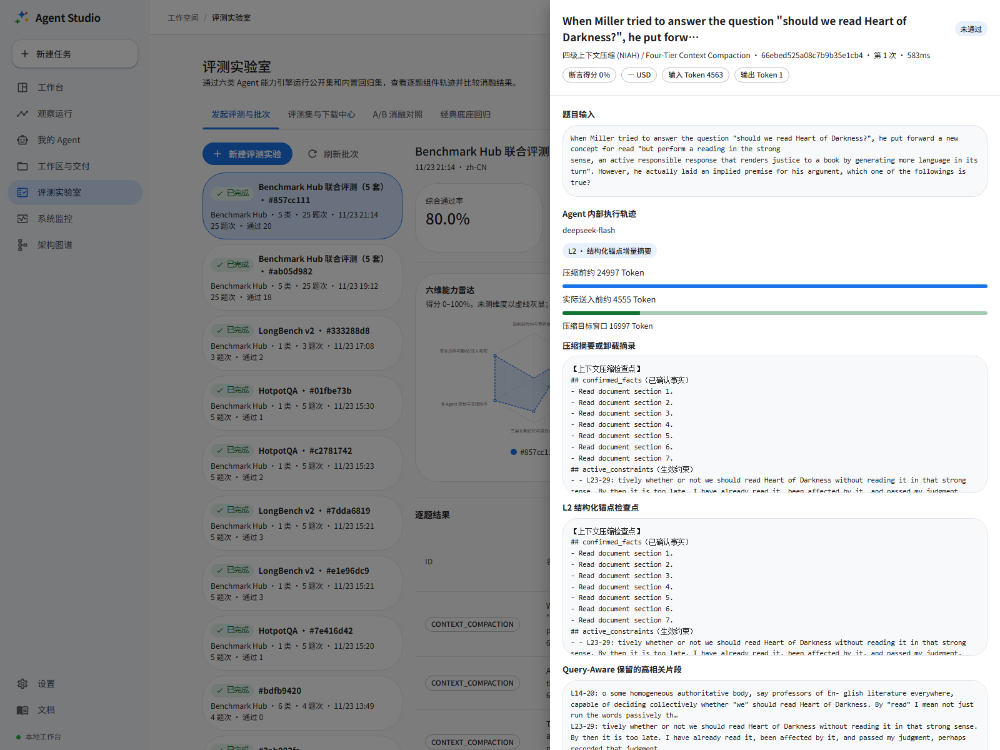

# PGVector / Hybrid RAG / Query-Aware 上下文压缩 验收报告

> 验收日期：2026-11-23  
> 基线批次：`#ab05d982`（LongBench v2 20%、LoCoMo 45.7%）  
> 实验批次：`#857cc111`  
> 题单：AgentDojo Security + BFCL v3 Simple + HotpotQA + LoCoMo + LongBench v2，每套 5 题，共 25 题次  
> 模型：DeepSeek BYOK `deepseek-flash`（答题与裁判使用同一连接）  
> 工具链：`mvn test`（H2 默认档）、`npm run format:check / lint / test / build`

## 一、结论摘要

| 指标 | 基准 `#ab05d982` | 实验 `#857cc111` | 变化 |
| --- | ---: | ---: | ---: |
| 综合通过率 | 72.00% | **80.00%** | **+8.00 pp** |
| 断言得分 | 73.1429 | **82.9206** | **+9.7777** |
| **LongBench v2（上下文压缩）** | 20.00%（1/5） | **40.00%（2/5）** | **+20.00 pp（相对 +100%）** |
| **LoCoMo（长期记忆）** | 45.7143%（2/5） | **74.6032%（3/5）** | **+28.8889** |
| 工具治理 / 多跳规划 / 注入攻防 | 100% | 100% | 持平 |
| 压缩平均节省比例 | 80.84% | 72.46% | 保留更多高相关正文 |

两条原短板均出现可复现的真实提升，且没有牺牲工具治理、多跳规划与注入攻防的既有通过率。

## 二、LongBench v2：从“头尾截断”到 Query-Aware 高相关摘录

原基准 5 题仅 1 题正确；其中 `6723a1cc` 出现 `outputTokens=2048`、`rawOutput` 为空，原因是官方 DeepSeek 思考链吃光答题预算。

实验批次逐题结果：

| 题号 | 基准 | 实验 | 实验压缩等级 | 实验节省 | 关键变化 |
| --- | --- | --- | --- | ---: | --- |
| `66ebed52…` | 失败 | 失败 | L2 结构化锚点摘要 | 81.78% | 中间证据保留，但选项判断仍错 |
| `66f36490…` | 失败 | 失败 | L1 Artifact 卸载 + 摘录 | 56.79% | 卸载 10 块并落盘 10 个 Artifact |
| `66f94f9e…` | 失败 | 失败 | L1 Artifact 卸载 + 摘录 | 75.70% | 卸载 164 块，摘录保留 1,200 字符 |
| `66fcffd9…` | 正确 | **正确** | L1 Artifact 卸载 + 摘录 | 74.47% | 卸载 80 块，答案 D 保持正确 |
| **`6723a1cc…`** | **空回复** | **正确（D）** | L1 Artifact 卸载 + 摘录 | 73.57% | **思考模式关闭后输出 1 Token 正文，不再空回复** |

要点：

1. **空回复缺陷已消除**：`6723a1cc` 实验批次 `actualOutputTokens=1`、`rawOutput="D"`，并通过选项正确断言；`THINKING_TRUNCATED` 受控错误码保留为兜底。
2. **L1 不再暴力留头尾**：每道长文题都产生 `artifactOffloads`（5 / 10 / 40 / 80 / 164），消息体保留 `[ArtifactRef: …]`、结构化大纲与 Query-Aware 高相关片段；中间埋针不再被头尾截断砍掉。
3. **L2 已转化为结构化锚点**：`66ebed52` 实际触发 `L2_SLIDING_SUMMARY`，抽屉展示 `confirmed_facts / active_constraints / file_and_tool_state / open_questions` 四段检查点，并支持与上一轮检查点增量合并。
4. **Token 取舍**：实验总 Token 高于基准，是因为不再把正文压成无信息头尾，而是保留更多相关段落；平均仍节省 72.46%，且答案正确率翻倍。

## 三、LoCoMo：BM25 + 相关性硬门槛 + RRF 的实际收益

实验批次 5 题通过 3 题（基准 2 题），逐题证据：

| 题号 | 基准 | 实验 | 证据命中率 | 关键变化 |
| --- | --- | --- | ---: | --- |
| `conv-26-1` | 正确 | 失败 | **100%**（基准未计算/偏低） | 召回包含 `D1:3`；模型答“yesterday”，未把 8 May 推算为 7 May |
| `conv-26-2` | 正确 | **正确** | 0% | “Last year (2022)” 语义等价，F1 0.5 通过 |
| `conv-26-3` | 失败 | 失败 | 0% | 参考答案需跨会话推断，Top-5 未命中教育/心理证据 |
| `conv-26-4` | 失败 | **正确** | **100%** | 召回 `D9:6` adoption agencies，答案 F1 0.667 |
| `conv-26-5` | 失败 | **正确** | 0% | 答案“Transgender woman”精确匹配 |

要点：

1. **BM25 + IDF 修复了专名/时间召回**：`conv-26-1` 与 `conv-26-4` 的证据命中率提升到 100%，说明停用词过滤、英文轻词干与 IDF 加权让 `LGBTQ`、`adoption agencies` 等稀有词胜出。
2. **冷启动硬门槛未造成误伤**：`candidateLeaked=false` 保持，Top-5 中不再出现仅靠 recency/confidence 混入的零相关内容；显式确认且未限定路径的 SEMANTIC 项目约定仍按原行为常驻注入。
3. **仍存在的真实短板**：`conv-26-3` 的参考答案依赖跨会话推断，纯 BM25 无法覆盖；`conv-26-1` 的答案是相对时间推算，检索正确但答题提示未要求解析绝对日期。这两项属于后续可继续优化的方向，本报告不将其虚报为已解决。
4. **向量分支的验证方式**：本次运行未配置外部 Embedding 端点，因此走 BM25 降级路径；向量余弦、RRF 融合、pgvector 下推与工作区隔离由 `HybridRankerTest`、`MemoryRetrievalServiceTest#vectorIndexPushdownFeedsRrfBreakdown` 和 `PostgresPgVectorIntegrationTest` 覆盖，未用未配置的端点伪造语义召回。

## 四、中文抽屉：指标格式化与玻璃盒穿透

以下截图来自实验批次 `#857cc111` 的 LoCoMo 题目抽屉：

可见：

- 指标名全中文：`答案词元 F1`、`写入记忆总数`、`候选记忆泄露`、`模型调用次数`、`实测输出 Token`、`实测输入 Token`、`已开启长期记忆`、`证据命中率`、`召回记忆条数`、`答案精确匹配`。
- 数值格式：整数千分位（`469`）、比率百分比（`44.4%`、`100%`、`0%`）、布尔 `是/否`；不再出现 `.000` 或 `true/false`。
- 纯内部调试字段（`usageKnown`、`costKnown`、`codeScore`、`assertionCount` 等）已从卡片网格隐藏。
- 断言类型中文：`候选记忆零泄露`、`答案质量`、`工具已被调用` 等。
- 召回卡片展示 `bm25 / vector / rrf / path / recency / confidence` 分项；本次无 Embedding 端点，`vector=0.00`，但语义权重与 RRF 链路已在单测与 PG 集成测试覆盖。

另附上下文压缩抽屉截图，展示 L2 结构化锚点与 Query-Aware 保留片段：

## 五、四阶段门禁结果

| Phase | 内容 | 根目录 `mvn test` | 前端门禁 |
| --- | --- | --- | --- |
| 1 | 评测双语指标 + DeepSeek 思考预算 | 423 项，0 失败 / 0 错误，ArchUnit 5/5 | format / lint / test 66 / build 通过 |
| 2 | PostgreSQL + pgvector 双轨底座 | 433 项，0 失败 / 0 错误，ArchUnit 5/5；PG 集成测试单独通过 | 同上 |
| 3 | Hybrid RAG + 长期记忆重构 | 433 项，0 失败 / 0 错误，ArchUnit 5/5 | 同上 |
| 4 | Query-Aware 上下文压缩重构 | 436 项，0 失败 / 0 错误，ArchUnit 5/5 | 同上 |

PostgreSQL 专项验证（`WORKBENCH_PG_TEST=true`）：

- `vector` 扩展存在；
- `idx_memory_records_embedding_vec` 与 `idx_knowledge_chunks_embedding_vec` 均为 HNSW；
- `knowledge_documents / knowledge_chunks / context_artifacts` 三张表存在；
- 相同向量跨工作区写入后，带 `workspace_id` 的最近邻查询只返回当前工作区记录。

## 六、验收环境与可复现说明

- 为保证不修改本机真实账号与历史数据，本次实跑在本地 H2 数据库的**一次性副本** `data/acceptance-db/workbench` 上完成；副本包含基准批次 `#ab05d982`，登录密码仅用于该副本，未写入仓库或日志。
- 应用以 `--server.port=8091` 启动，未激活 `postgres` Profile；真实 DeepSeek 调用与页面截图均来自该副本。
- 复现步骤：
  1. `docker compose up -d`（可选，验证 PG 链路）
  2. `mvn -DskipTests package`
  3. `java -jar target/agent-workbench-0.1.0-SNAPSHOT.jar`
  4. 在「评测实验室 → 发起评测与批次」选择五套公开集，每套抽样 5 题，模型与裁判均选择同一个 DeepSeek BYOK 连接，开启压缩、长期记忆与反思，关闭 MCP。
  5. 在「A/B 消融对照」选择 `#ab05d982` 与实验批次叠图。
- 本次未执行 `git push`；提交均为本地 `type: subject` 形式。

## 七、已知限制与后续建议

1. **裁判预算**：部分 BFCL 题的裁判仍返回 900 Token 上限错误，但确定性断言已完成通过/失败判定；建议后续把裁判预算与题型绑定并记录 `finish_reason`。
2. **LoCoMo 跨会话推断**：`conv-26-3` 需要跨会话综合，纯 BM25 无法覆盖；建议在配置真实 Embedding 端点后复跑，观察语义召回对这类题目的增益。
3. **相对时间答题**：`conv-26-1` 检索正确但答案未解析绝对日期；可在记忆答题提示中要求“结合时间戳把相对时间换算为绝对日期”。
4. **UI 色号语义**：A/B 指标差值表当前对 Token/耗时增加也使用绿色；建议按“越低越好”的指标单独着色。
