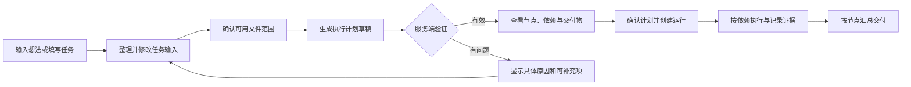

# 下一阶段 Agent 动态规划与多节点执行

> 开发交接稿。承接 [动态 Agent 框架重构概要设计](../概要设计/动态Agent与可组合工作流_重构概要设计.md)和 [任务 8 后续扩展交接](动态Agent重构后_产品开发与验收交接.md)。本文定义待实现内容，各任务以实际验收证据结项。

> **实施进度（2026-11-20）**：任务 0–3 已交付。候选计划、确认物化、节点级读写范围和运行级交付投影已接通，并用多文件冒泡排序跑完整条链；P07 必需产出缺失、P08 交付正文服务端校验和 P14 独立工作区收口已按反例修复。逐项证据和限制见[任务 0–1 交付](下一阶段_任务0基线与任务1交付_2026-11-20.md)和[任务 2–3 交付](下一阶段_任务2与任务3_交付记录_2026-11-20.md)。真实 DeepSeek 计划生成与候选页面点击未执行；无头会话中的文件下载落盘、错峰并行写入、定时快照和真实外部平台仍属后续范围。
>
> **私有 Agent 进度（2026-11-20）**：本地账号、服务端会话归属、管理员添加用户与旧 LOCAL 显式领取已实现；「我的 Skill」「我的工具」「我的 Agent」支持草稿、发布、归档和固定组件版本；私有只读 Agent 已参与候选推荐、确认和实际执行。浏览器链路、运行标识、版本与反例见[私有 Agent 交付记录](下一阶段_私有Agent与组件装配_交付记录_2026-11-20.md)。补充收口已加入仓库导入前授权、按归属统计运行概况、规划短引用固定版本、模型草稿与组件建议、`INHERIT_TASK` / `FIXED` 模型策略、确认页实际模型和混合模型预算拒绝；账号已接入 Spring Security 过滤器链、SecurityContext 桥接和 Cookie CSRF token。真实 DeepSeek 规划与真实外部平台未执行，浏览器验收使用本地规则规划器。

> **优先级更新（2026-11-20）**。从已交付的顺序多节点基线接手，下一批先做本地用户、私有 Agent、Skill 和工具配置，以及私有 Agent 参与编排。实施入口见[用户私有 Agent 与组件装配设计](../概要设计/用户私有Agent与组件装配设计.md)。第 9 节记录暂缓事项。

## 1. 接手目标与交付范围

用户已经能够输入一句想法，让工作台整理任务草稿，并为独立代码任务准备 Git 工作区。下一阶段让用户提交一个包含多个功能的大任务，先看到工作台提出的执行图，再看到多个开发节点各自执行、交接、被检查和汇合交付。

**本期交付任务 0–3。** 用一个父任务和一次运行承载多个独立的开发节点。每个节点有自己的目标、文件范围、Agent 实例、尝试、验收条件和产出记录。调度器按依赖顺序执行。同一角色定义可以在不同节点分别装配，能力依然取自注册表。

以支持手动输入数组、单步和自动播放的冒泡排序网页为例。候选图把算法和页面交互拆进两个开发节点。运行后，用户能点开两条交接，在统一交付说明中看到 `index.html`、`style.css` 和 `sort.js` 各由哪个节点产出。小任务可以继续用现有模板，或让候选计划只安排一个开发节点。

| 范围 | 本期决定 |
| --- | --- |
| 入口 | 先覆盖 `CODE`。支持从想法草稿发起，也支持已有工作区、显式文件授权的代码任务。其他入口和模拟 Bug 保持现有路径。 |
| 人工确认 | 模型规划是用户可选的显式动作。生成草稿后可调整任务输入并重新生成。提交计划前确认图、文件范围和交付物。 |
| 任务粒度 | “独立开发任务”在本期对应同一计划中的独立节点。每个节点可单独在工作台观察和验收，Git 工作区和最终交付按本次运行统一管理。 |
| 运行策略 | 单进程顺序执行，使用既有暂停、取消、预算和失败状态。普通任务仍可留空所有可选预算。 |
| 后续范围 | 并行调度、多个写工作区与合并、运行中换图、写入节点自动恢复、独立子任务单、多租户共享部署进入后续路线。 |

### 接手前核对

1. 在项目目录执行 `git log -1 --oneline` 和 `git status --short --untracked-files=all`。编写本文时提交基线为 `0366142`，共享工作区另有「学习工作台」「交付说明」「预算默认留空」「从想法创建任务」等改动。接手先核对实际版本，保留已有变更和未跟踪实现文件。
2. 阅读 [协作约定](../../AGENTS.md)、[代码开发规范](../开发规范/代码开发规范.md)、[关键流程开发与验收约定](../开发规范/关键流程开发与验收约定.md)及[任务 8 交付记录](任务8与五项缺口_交付记录_2026-11-19.md)。
3. 首期已可保存依赖图、复用同一 Agent 定义创建多个实例并顺序调度。当前代码入口走 `workspace-change` 的三个固定节点。`PlanProposalService` 调整已有节点的预算和依赖。`TaskIdeaService` 整理任务输入。模型生成新节点是本期新增的能力。
4. 当前 `WorkflowScheduler` 对允许访问工作区的节点传入任务文件范围。下一阶段增加每节点的文件子集。当前 `workflow_plans` 每个运行有一份计划，候选历史用独立数据结构存储，提交时只落一份运行计划。
5. 原冒泡排序 `0813c195-83c2-406d-86bf-3ea6cc06dd0e` 是三节点真实模型演示，可作为对照。当前端口和临时数据库随本机环境变化，正式验收使用独立数据库与新建临时仓库。

## 2. 用户路径与界面

- **任务编辑**继续沿用现有「从想法创建任务」和完整表单。为代码入口增加「生成执行计划草稿」，固定模板入口继续可用。输入、授权文件或目标工作区有实质变化时，页面立即停用旧草稿确认。新输入提交生成后，服务端将该组旧候选标为过期。
- **草稿图**复用流程图组件。节点内展示目标、依赖、读写范围、预期产物和验收项。未运行节点使用草稿状态。验证失败应定位到节点、文件或依赖。可查看上一份候选与当前版本的差异。
- **运行确认**用一个明确按钮确认已展示的候选哈希并创建运行。此路径将该确认记录为计划审批，不重复弹出相同审批。现有“先创建待确认计划”入口仍可使用已支持的模板流程。
- **运行观察**维持同一张图、节点详情和逐步回放。节点活动来自实际执行，点连线可查看上游保存的结果、接收记录及关联证据。较长原始记录折叠。
- **交付说明**根据已结算节点整理成果、文件路径和检查情况。可按文件跳转到产出节点，有实际内容的项目支持查看或下载。文件已变更时显示原回执摘要及当前状态。工作区级 Git 历史单独归属。写任务进入人工核对时，主入口仍清楚显示「查看交付说明」。

## 3. 任务 0 · 基线与实施契约

| 工作 | 完成标准 |
| --- | --- |
| 核对编排入口 | 标出草稿、任务入口、计划保存、节点认领、工具授权、交接和交付的实际类与 API。用小型固定模板跑一遍「待确认 → 执行 → 交付」。 |
| 确认可复用能力 | 列出现有 Agent 定义 ID 及版本、工具、检查器、已支持的工作区初始化和检查点边界。说明现有审查要求及每次运行单份计划约束。 |
| 建立验收样本 | 准备多个空白已跟踪文件的临时仓库，固定浏览器验收输入和预期结果。准备一份旧结构 H2 隔离副本。 |

本批交付实际基线记录、隔离样本及实施差异清单。优先引用现有证据，仅复跑受下一阶段改动影响的入口。

| 代码入口 | 本期接续位置 |
| --- | --- |
| 草稿和路由 | [TaskIdeaService](../../backend/src/main/java/dev/workbench/task/TaskIdeaService.java)、[EntryRouteService](../../backend/src/main/java/dev/workbench/domain/EntryRouteService.java)。新增模型规划用例保持与输入整理分开。 |
| 创建与编排 | [TaskCreationService](../../backend/src/main/java/dev/workbench/orchestration/TaskCreationService.java)、[PlanService](../../backend/src/main/java/dev/workbench/framework/workflow/plan/PlanService.java)、[WorkflowScheduler](../../backend/src/main/java/dev/workbench/orchestration/WorkflowScheduler.java)。 |
| 授权与证据 | [WorkspaceAuthorizationService](../../backend/src/main/java/dev/workbench/workspace/WorkspaceAuthorizationService.java)、[WorkflowExecutionService](../../backend/src/main/java/dev/workbench/task/WorkflowExecutionService.java)。 |
| 页面与持久化 | [运行观察面板](../../frontend/user-workbench/src/features/workflows/ExecutionFlowPanel.jsx)、[从想法创建任务](../../frontend/user-workbench/src/features/workflows/TaskIdeaDialog.jsx)、[迁移脚本](../../backend/src/main/resources/schema.sql)。 |

## 4. 任务 1 · 模型提出并保存候选计划

### 4.1 职责与模型输入

- 建立独立的规划用例服务，例如 `WorkflowPlanningService`。模型侧复用现有模型基础设施和结构化 JSON，不创建执行 Agent，也不签发工具授权。候选生成与任务执行采用不同的提交边界。
- 规划器接收用户已确认的任务目标、约束、验收条件、交付物和文件名白名单。已有项目还可附用户提供的接口约定与仓库摘要。首期只发送这些文字和已确认的相对路径。真实模型请求前提示发送范围。已有项目需要阅读源码的规划扩展另行设计只读证据查询。
- 模型只能建议受信角色别名、节点目标、依赖、文件子集、产物和验收条件。服务端用内置映射解析已发布的注册定义及版本。工具列表、根目录、模型凭据、检查命令和审批结果均由执行侧决定。
- 最少支持规划生成、查看、重新生成及取消。生成请求使用独立队列或执行器，浏览器轮询候选状态。模型未返回、解析失败或模型服务不可用时保留本次结果和可读原因。用户可重试或主动切回固定模板。后台失败或重启时，未结算候选按中断处理，用户决定是否再发送一次。

### 4.2 DTO 与示例

建议采用 Java record、受控枚举和长度校验。下表列出模型提议的必需字段。

| 字段 | 规则 |
| --- | --- |
| `schemaVersion` | 候选协议版本，首期为 1。未知版本拒绝。 |
| `nodes[]` | 每项含 `key`、`title`、`role`、`objective`、`dependsOn`、`readFiles`、`writeFiles`、`expectedOutputs`、`acceptanceCriteria`。 |
| `role` | 首期 `ANALYZE`、`IMPLEMENT`、`REVIEW`，映射到版本化的现有 Agent 定义。一个角色可以重复使用。 |
| `key`、`dependsOn` | 使用候选内唯一稳定键，依赖以键引用。实例 ID、节点 UUID 和尝试编号在运行创建或认领时由系统分配。 |
| `expectedOutputs` | 每项为 `TEXT` 或 `FILE`，并表明是否必需。文件项使用规范化的工作区相对路径，必须属于该节点批准的写入范围。 |
| `assumptions`、`openQuestions` | 保存可读假设和待确认项。缺少必需输入或授权时，候选无法用于创建，需要补充并重新生成。 |

示例文件范围由用户确认，表中所有读写范围都相对于同一个工作区。

| 节点键 | 角色与目标 | 直接依赖 | 写入范围 | 可核对产出 |
| --- | --- | --- | --- | --- |
| `spec` | 分析。确定排序步进接口、数据格式和交互验收条件 | 空 | 空 | 接口与验收说明 |
| `engine` | 开发。生成一轮一轮的比较与交换结果 | `spec` | `sort.js` | 排序模块及边界说明 |
| `ui` | 开发。按约定接入输入区、柱状图、播放控制 | `spec` | `index.html`、`style.css` | 网页与样式 |
| `review` | 审查。汇合两个开发节点的产物和证据 | `engine`、`ui` | 空 | 审查结论、核对项及未验证项 |

首期用户编辑任务输入、授权文件和约束后重新生成图。候选图的可视化自由编辑可单独增加，服务端验证保持同一套规则。

### 4.3 校验规则

1. 校验协议版本、必填字段、节点键唯一、直接依赖存在、无自环、无重复边、无环。稳定拓扑顺序用于展示与顺序调度。
2. 前端可见的文件范围从服务端归一化的授权快照计算。每个节点满足 `writeFiles ⊆ readFiles ⊆ taskAuthorizedFiles`。只读角色没有写文件集合。使用既有路径字面匹配、符号链接处理及目录撤权规则。
3. 首期两个写节点的写文件集合必须互斥。要处理共同文件时，合并为一个写节点或要求用户调整计划。读后写的数据依赖由图显式表达。
4. 每个写节点的必需文件与交付条件完整，最终审查节点直接依赖每个写节点，能收到每份交接和证据。首期审查节点沿用已有无文件工具的独立审查角色，读写集合均为空。普通步骤只能使用已注册且符合本次授权的能力。
5. 用户填写的预算需要校验并纳入快照。留空表示未设置。节点数、字段长度、响应大小可有明确的计划结构容量，超出时说明原因，不自动截断已请求的节点，也不写入新的默认执行预算。
6. 经验证的候选才计算规范化 `candidateSha256`。摘要覆盖排序后的节点与依赖、节点目标和产出、角色映射后的定义版本、批准的任务输入和授权摘要。用明确的协议和编码版本做兼容。

### 4.4 状态、存储和入口

| 项目 | 建议契约 |
| --- | --- |
| 生成入口 | `POST /api/plan-candidates` 接收任务输入快照、客户端请求标识及可选前一候选 ID，返回候选 ID、输入版本与 `GENERATING`。同归属同请求标识重试返回同一候选。请求标识相同而内容不同则返回冲突。 |
| 读取与取消 | `GET /api/plan-candidates/{id}` 返回归一化候选、状态、原因及已记录的模型信息。使用 `POST /api/plan-candidates/{id}/cancel` 取消，晚到模型结果不会改写取消状态。 |
| 状态 | `GENERATING → READY / INVALID / FAILED / CANCELLED / INTERRUPTED / STALE`，已准备的候选可变为 `STALE` 或 `CONSUMED`。服务端为同一组输入记录稳定标识和递增版本。同组重新生成与确认互斥，保留旧候选和来源。候选生成完成时按版本做条件结算，保留失败原因和可重试信息。 |
| 持久化 | 增加 `plan_candidates`，保存归属键、组标识、输入版本和快照、可选来源候选、协议版本、候选摘要、归一化数据、验证结论、创建和结算时间、模型标识及有记录的用量。保存用于复核的业务依据，凭据和模型隐藏推理不进入候选记录。候选模型消耗单独归属，避免冒充实际节点调用。 |
| 兼容 | 保留旧 `plan_adjustments` 的接口和语义。新候选表保存运行创建前的版本历史，最终运行仍保存一份固定计划及来源候选标识。 |

本批交付规划 DTO、归一化验证器、模型适配、候选 API 与持久化、可查询的草稿图、错误定位，以及固定多节点样例。任务 1 验收止于可审阅草稿，创建运行在任务 2 接通。

## 5. 任务 2 · 把候选变成真实运行

### 5.1 确认与物化

- 增加 `POST /api/plan-candidates/{id}/runs`，请求提交 `expectedCandidateSha256`、`expectedInputSha256` 及确认的输入版本。后端从保存的候选取任务输入和文件授权。确认时核对候选归属、当前输入版本、审批所见摘要、定义版本和当前权限。
- 对已有工作区校验工作区及文件授权。用于规划的路径、基线或用户文件版本变化时返回过期原因。工具使用时仍按当前权限和预期文件版本处理。
- 对独立交付复用 `/workspaces/from-idea` 背后的受控工作区创建逻辑，给本次候选绑定可重用的专用工作区。持久化创建操作标识和 `PREPARING` 状态后执行 Git，再记录 `READY` 及工作区 ID。同候选并发确认只能准备一个工作区。Git 完成而记录保存失败时按操作标识核对实际结果，同候选安全重试复用已确认工作区。进程异常后仍无法核对时进入 `UNKNOWN`，等待人工处理。已有工作区继续由用户明确选择。
- 任务、首运行、流程图、节点规格、用户确认、来源候选和消费标记在 `TaskCreationService` 的创建事务中落库。失败整体回滚，提交后才派发。重复确认返回已有运行。过期或失去授权的候选拒绝创建。
- 保留 `PlanService` 的既有登记、依赖和独立审查规则，增加接收已校验图的入口。新计划使用服务端来源标识和新的图摘要协议，旧模板计划继续使用历史摘要算法。摘要包含节点目标和文件范围，当持久化规格被改动时运行必须停止并显示校验原因。

建议在 `workflow_plans` 添加可空的 `source_candidate_id` 和有明确默认值的图摘要版本。新节点规格可保存到以 `plan_node_id` 为主键的 `plan_node_specs`，归属于同一个已保存计划，存目标、归一化文件集合、验收项和产出契约。持久化时使用明确类型和有版本的编码。旧计划继续按已有字段和摘要读取。用状态条件、外键及消费唯一约束保证写入顺序和归属。

### 5.2 节点授权与执行

- 复用 `WorkflowScheduler`、`WorkflowExecutionService` 与 `RunControl`。每个新节点仍认领独立尝试。执行器收到任务的全局约束、**该节点的目标与验收**以及实际已结算的直接依赖结果。
- 扩充运行时请求的文件授权表达，例如类型化的 `NodeFileScope`。读、搜索使用批准的读集合，写入使用更窄的写集合。工具装配与调用时共同取当前任务授权、节点文件集合及 Agent 定义能力的交集。历史节点沿用既有任务级行为，新候选缺少节点授权记录时停止并显示原因。
- 写入继续要求实际读取得到的文件版本及条件更新。工作区改动、授权撤回、冲突或写入结果未知时，沿用已有阻塞与人工核对状态。保存已发生的尝试和回执，禁止静默重放可能已产生的代码变更。
- 每个必需产出有明确来源。文件交付以该节点尝试对应的成功写入回执、文件路径和摘要为准。独立交付文件须与空白基线有变化，正文可读。预期文件缺失时记录具体原因并阻断依赖该成果的节点。写入成功但审查失败时，报告保留现有变更和证据。
- 复用已有按 `run_seq` 的事件分页和节点详情。事件中携带运行、计划、节点、尝试及调用引用。运行读取已激活的节点快照。写入恢复沿用现有的人工核对边界。

本批交付一次确认创建真实运行、节点级授权、同角色多实例交接、模型来源追溯、事件和图详情、历史模板兼容与迁移记录。

## 6. 任务 3 · 多节点交付和端到端验收

- 增加统一的运行级交付投影，按实际节点列出完成情况、文本结果、产物和核对项。文件优先从写入回执投影，关联节点及尝试。历史记录缺少版本时标记未记录。
- 交付说明保留查看和下载路径。下载前复验授权、文件名与当前摘要。内容已变化时提示证据过期，保留历史结果，避免把工作区新版本标成旧运行的交付。
- 在现有的图和回放里显示两个独立开发节点的真实交接。最终审查区分工作台记录、模型判断和人工浏览器验收。系统检查由已注册检查器执行，审核 Agent 的文本结论无法代替测试证据。
- 用隔离环境完成一个多文件可运行样本。自动化回归可使用确定性模型。若有真实模型调用授权，再跑一条可读的小样本，记录调用及文件证据。实际浏览器打开产物并用人工或 Playwright 检查交互。

本批交付可运行的示例产物、运行 ID、独立节点写入证据、流程图与交付说明截图、集中回归结果及已知限制。例程需能依靠交付文件重新打开。

## 7. 多租户扩展位置

当前部署继续采用个人本地模式。新增规划和确认入口使用一个类型化的执行归属，例如 `ExecutionScope(ownerScopeKey, actorKey)`，通过应用入口内部获得。本期固定本地作用域 `LOCAL`，同一作用域贯穿规划、确认、节点证据和报告。

| 本期预留项 | 约定 |
| --- | --- |
| 作用域解析入口 | 提供一个窄接口或现有入口处可替换的解析方法。HTTP 客户端提交的 `tenantId`、自定义 Header 或模型输出不能直接决定执行归属。以后由已认证会话、成员关系和项目权限解析。 |
| 持久化归属 | 新建独立聚合如 `plan_candidates` 保存非空 `owner_scope_key`。派生节点、产物等子记录通过候选或运行的持久化归属关联。旧运行经兼容读取归入本地作用域并保留既有 ID。 |
| 服务接口 | 需要授权的数据读取、确认和下载从同一归属上下文取得。新增按 ID 的候选查询同时核对作用域。工作区和文件以既有存储映射及授权逻辑定位。 |
| 审计与后台任务 | 新动作记录内部 actor 和归属。异步规划任务收到提交时已解析的作用域，避免依赖线程里临时获取的 Web 请求。 |

**后续共享部署前置**包括身份与组织、资源迁移、数据库和文件分区、凭据与模型策略、事件及报告隔离、队列与预算归属、跨租户负面验收。当前版本不开放多租户开关或租户管理页，验收只记录预留是否实际接入本期入口。

## 8. 集中验收清单

| 编号 | 场景 | 验收结果 |
| --- | --- | --- |
| P01 | 小任务选择现有代码模板，冒泡排序整页单文件 | 仍可用固定三节点完成交付，已有 HTTP 字段与操作保持兼容。 |
| P02 | 提交多功能网页目标，生成候选图并刷新 | 图中有至少两个独立开发节点、不同读写范围、明确依赖与各自产出。草稿阶段没有执行节点调用或代码写入。 |
| P03 | 候选含未知角色、缺失依赖、重复节点或依赖环 | 服务端拒绝进入确认态，页面能定位原因。未创建运行。 |
| P04 | 两个节点申请同一文件写权限，或申请任务授权外文件 | 校验拒绝。有效计划中，从工具入口尝试读取其他节点专属文件或写入只读文件，授权拒绝，原文件摘要保持一致，该调用没有成功写入回执。 |
| P05 | 同组提交修改后的目标、撤销授权或改变定义版本，再确认旧候选 | 旧候选过期或被拒绝。并发双确认只创建一个运行和一套节点，派发一次。 |
| P06 | 两个开发节点顺序完成，最终审查 | 有两个独立实例、两套尝试和各自的调用与产出。最终审查的交接包含两份来源，顺序与依赖匹配。 |
| P07 | 一支未写出必需文件，或出现未知写入结果 | 缺口与原因可见，依赖该成果的审查不会成功，已落地变更和证据保留，未知写入不自动重试。 |
| P08 | 查看交付并修改此前产出文件 | 当前版本一致时能查看、下载及定位节点。修改后提示过期，保留历史回执。 |
| P09 | 执行中刷新或断线后重连 | 同一计划与节点正确恢复显示，交接及事件按原顺序，无重复追加。 |
| P10 | API 直接传伪造作用域，或用测试作用域解析器读取另一归属的候选 | 归属以服务端解析为准，越权候选不可读取、确认或下载。该用例验证接口边界。 |
| P11 | 隔离旧 H2 连续启动两次，并读取历史计划 | 迁移幂等，旧图、已审批记录与旧预算可读。暂停、取消和允许的恢复继续工作。 |
| P12 | 真正打开多文件网页 | 浏览器验证数组输入、单步比较、自动播放与暂停、最终排序。页面和报告能定位实际产出。模型验收结果单独记录。 |
| P13 | 草稿生成中取消或重新生成，然后放行旧模型响应 | 首个候选保持取消或过期。当前草稿摘要来自新候选，模型响应无法创建运行。 |
| P14 | 独立工作区准备完成后注入运行入库失败，再重试同一候选 | 首次失败无可执行运行，重试核对并复用同一工作区，再创建并派发一次。工作区结果未知时等待核对。 |

任务 0 先建立 P01 基线。任务 1 验收 P02、P03、P13。任务 2 验收 P04–P07、P10、P11、P14。任务 3 复核主链路并覆盖 P08、P09、P12。

每批完成后集中回归一次，覆盖正常入口和表中相关反例。Docker 可用且涉及容器路径时记录实际执行情况。保留实际运行 ID、数据库或 API 记录、关键截图和失败边界。提交说明列出「已通过」「部分通过」「未实现」「未验证」对应的项目。

## 9. 后续路线与开发约定

从已验收的顺序多节点基线接手。下一阶段先实现本地账号、私有 Agent、Skill 和工具配置，以及私有 Agent 参与计划。详细设计、实施顺序与验收见[用户私有 Agent 与组件装配设计](../概要设计/用户私有Agent与组件装配设计.md)。

继续使用 Controller → Service → Spring Data JPA Repository 分层。复用现有计划、工具网关、运行控制、流程图和旧 H2 迁移。每完成一个功能闭环做一次集中回归，以实际运行和证据更新交付记录。

### 暂缓事项

按本轮优先级更新顺序。以下事项保留设计与验证记录，后续按使用需要决定起点。

| 事项 | 待补能力或证据 |
| --- | --- |
| 只读并行 | 就绪节点并发认领、共享预算原子预留、分支失败和取消传播、汇合、多焦点及重连。 |
| 并行写入、返工与运行中改图 | 每节点写入隔离、冲突与合并验证、计划新版本、旧产物复用、独立子任务及父子生命周期。 |
| 规划与执行验收 | 读源码的规划扩展、候选节点编辑；真实 DeepSeek 候选经浏览器确认到多节点交付；普通测试入口执行受信测试、逐用例证据，以及人工接手后的重新验证。 |
| 记忆与上下文 | 动态模板接入已授权记忆、过期和撤权传播、可验证压缩与检索评测。 |
| 可靠恢复 | 定时快照、跨进程故障演练、连续恢复、写入或外部结果未知时的对账。P14 的准备工作区复用已有独立证据。 |
| 外部平台与产品深化 | 真实 Issue、托管 Git 和分支保护、真实项目修复评测、外部通知、历史对比、正式发布验收。 |
| 共享部署 | 组织和团队授权、跨租户数据隔离、配额治理和运营管理。首期本地账号按本轮私有资源设计实现。 |
| Docker MySQL 适配 | 待办，未排期。配置、建表、真实 MySQL 验收及可选的 H2 历史迁移见[迭代计划](../迭代计划/1.1及以后_扩展方向.md#docker-mysql-适配)。 |

### 历史任务 0–3 的接手提示

> 先阅读本交接文档、仓库协作约定和关键流程验收约定，在当前已验收的工作区接手。按任务 0–3 开发，优先完成「一句话需求 → 受控候选图 → 多个独立开发节点顺序执行 → 同一工作台交付」。复用现有 Spring Data JPA、AgentScope、计划与事件接口。确认前讲清每个节点的任务、文件范围和交付物。完成一个功能闭环后集中回归一次，记录实际运行 ID、节点交接、写入证据和浏览器结果，然后继续下一项。按第 7 节预留执行归属，多租户共享部署和并行写入另行交接。
