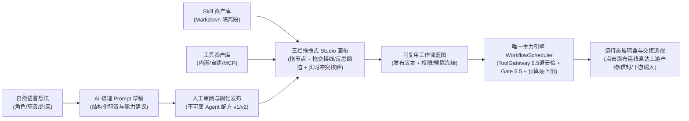

# V7 未来演进方向：可视化拖拽 Agent 工坊与工作流工作室（Agent Builder & Visual Workflow Studio）

> **文档状态**：未来演进规划草案（仅作立项与设计基线，**当前收尾阶段暂不实施**）  
> **撰写时间**：2026-11-28  
> **前置基线**：完成「玻璃盒 V0–V6 + 收口包 G-1/G-2 + 收口包 H（统一 `WorkflowScheduler` 主力引擎、按 `runId` 分段锁、MCP 逐工具准入漏斗、结构化上下文分段、查询下推与冷数据清理、Docker/CI 基座）」之后启动。  
> **定位红线**：始终坚守「单机 AI Agent 框架玻璃盒可视化与调试工作台」定位；**不做**重型多租户 SaaS、企业 IAM/OIDC 或微服务拆分；**任何自定义 Agent / 工具 / 工作流均不得绕过平台硬权限、预算上限与 `ToolGateway` 6.5 道安检门**。

---

## 一、核心愿景：从「透明看 Agent 跑」升级为「可视化搭 Agent 跑」

目前平台已完整跑通「**可透视、可断点、可对照、可追溯**」的运行态玻璃盒，但用户自定义构建私有 Agent 与多 Agent 团队的体验仍分散在表单弹窗与单次候选图中。

**V7 的核心目标**是提供一个所见即所得的**可视化拖拽工作室（Visual Studio Canvas）**，让用户像搭积木一样完成整条闭环：

1. **AI 辅助梳理私有 Agent**：用户用自然语言描述想要构建的主 Agent 或子 Agent 的职责、风格与边界，后台 AI（类似现有「想法整理」）帮其梳理成结构化、合格的 System Prompt 与技能/工具建议；用户审阅修改并确认发布后，固化为带 SHA-256 指纹的不可变 Agent 配方文件/版本。
2. **可视化配置 Skill、工具与权限**：用户通过勾选或拖拽，为私有 Agent 挂载 Markdown Skill、内置受控工具、自建声明式/HTTP 工具或已授权 MCP 工具，并清晰看到每一项能力的权限边界与风险分级。
3. **拖拽拼装多 Agent 工作流蓝图**：在可视化画布上拖拽多个主/子 Agent 组成 DAG 工作流，直接拖线建立「数据交接边」与「审查驳回反思回边」，并将平台已有的鉴权、写集冲突校验、单节点预算、Gate 5.5 人工审批与断点控制全部无缝装配进去，发布为可反复复用的工作流蓝图。
4. **交接处全链路玻璃盒可视化（核心亮点）**：无论是设计态还是运行态，**每一个 Agent 之间的交接处都完全透明可视化**——点击任意一条连线即可看清「上游交出了什么 → 平台做了哪些权限收窄/校验/断点控制 → 下游实际收到了什么」。

---

## 二、当前代码底座盘点（已具备 vs 待补齐）

截至当前基线，底层已有约 **70%** 核心能力就绪，无需推翻重构，可在现有清晰分层上直接叠加：

| 能力域 | 现有真实底座（已落地） | V7 待补齐的关键拼图 |
|---|---|---|
| **AI 生成 Prompt 与私有 Agent 固化** | `PrivateAgentDraftService` 已支持「一句话 → AI 草稿（推荐已发布 Skill/Tool）→ 审核发布不可变版本（SHA-256）」；前端已有 `AgentsPage` / `AgentDraftDialog` | ① 开放受控 `CODER` 角色（当前仅限 `ANALYST`/`REVIEWER`）；② 支持版本 Diff 与导出/预览为标准声明文件（Markdown / JSON）；③ 支持一站式勾选内置工具、自建工具、MCP 工具与节点默认模型/预算 |
| **Skill 与自定义工具** | `PrivateSkillService`（Markdown + `<untrusted_skill_playbook>` 隔离）、`PrivateToolConfigService`（只读 `READ`/`SEARCH` + 扩展名过滤）、MCP 外部工具与逐工具准入漏斗（`McpToolDecision`） | ① 按 L1/L2/L3 明确自定义工具安全分级；② 扩展声明式受控单文件写原语与受控 HTTP Webhook 工具（复用 `OutboundUrlGuard` + `SecretCipher` + Gate 5.5） |
| **多 Agent 编排画布** | `PlanComposerCanvas`（`@xyflow/react` + Dagre）已支持写集冲突红框、环路检测、读写范围校验与乐观锁落库（`PlanCandidateRevisionService`） | ① 从「附着于单次候选图的表单微调」升级为「左资产库拖拽 + 中画布自由连线 + 右节点/连线双态检查器」；② 抽离为可持久化、可版本化、可一键启动的**自定义工作流蓝图** |
| **交接控制与运行态玻璃盒** | `WorkflowScheduler` 唯一执行引擎、`ToolGateway`、`CostService`、上下文显微镜、真流式 ReAct 泳道、断点与 What-If 分叉已全面闭环 | ① 设计态点击连线即可配置「交接契约」（必交产物、下游可见范围、交接前断点开关）；② 运行态丰富结构化交接信封，点击画布连线直接弹出「交接全链路透视抽屉」 |

---

## 三、核心架构设计与安全边界

### 3.1 私有 Agent 配方升级（声明与权限严格分离）
- **角色放开但不放权**：私有 Agent 允许选择 `ANALYST` / `CODER` / `REVIEWER`；但私有 Agent 自身只保存「能力声明与工作方法（Prompt + Skill + 工具清单 + 推荐预算）」，**不具备绕过运行授权的能力**。真正执行时，仍由工作流节点白名单、`AgentAssemblyPlanner` 最小权限裁剪、`McpToolAdmission` 角色准入和 `ToolGateway` 6.5 道安检门实施硬拦截。
- **Prompt 文件化体验**：每次发布生成不可变快照，同时提供可读的「Agent 配方文件视图」（含角色、System Prompt、隔离 Skill、工具列表、默认预算、SHA-256 摘要），支持一键复制、导出与版本对比。

### 3.2 「用户自建工具」的三级安全模型
绝不允许在宿主机 JVM 进程内直接 `eval` 用户脚本。自定义工具按风险分为三档：
1. **L1 · 声明式工作区工具（默认推荐，零 RCE 风险）**：基于平台受控原语（`READ` / `SEARCH` / 受控 `WRITE`）组合路径/扩展名白名单、自定义参数 Schema 与输出摘要格式；全部经过 `GatewayAgentTool` 与 `ToolGateway`。
2. **L2 · 受控 HTTP / MCP 接入工具**：用户声明目标端点、JSON Schema 与加密 Header/凭据，底层强制复用 `OutboundUrlGuard`（防 SSRF + 禁重定向）与 `SecretCipher`（AES-256-GCM），写/外发类操作固定定级 `HIGH` 并进入 Gate 5.5 人工审批。
3. **L3 · 容器沙箱脚本工具（远期可选）**：若允许用户编写 Python/Node 脚本作为工具，强制复用现有 Docker 强隔离沙箱（`--network=none`、`--read-only`、non-root、CPU/内存/超时硬配额），不挂载 `config/` 与 `data/`。

### 3.3 三栏拖拽式 Studio 画布与工作流蓝图
- **左栏（资产抽屉）**：已发布的私有 Agent（区分主协调/分析/开发/审查）、内置角色模板、已发布 Skill、工具与 MCP 集合，支持直接拖入画布创建节点，或拖放到已有节点上挂载能力。
- **中栏（DAG 画布）**：
  - 节点卡片实时呈现：角色色标、绑定私有 Agent 名称与版本号、模型标签、读写权限徽章（只读 / 写授权 / 需审批）、单节点预算摘要、是否挂断点；
  - 端口拖线支持两种边：**实线 = 数据交接边（`dependsOn`）**、**虚线 = 审查驳回反思回边（`revisionEdge`，带 `maxRevisions` 标签）**；
  - 实时接入服务端图校验器：环路检测、并行写集冲突红框脉冲、缺失独立审查告警、越权挂载拦截。
- **右栏（双态属性检查器）**：
  - **选中节点**：编辑节点目标、绑定私有 Agent 版本、读/写文件子集、单节点预算（最大轮次/工具数/模型覆盖）、断点开关、查看实时「预期工具权限漏斗预览」；
  - **选中连线（交接边）**：配置交接契约——预期交接产物清单、下游可见上下文范围、权限变化对比（如 `CODER[可写] → REVIEWER[只读+禁外部MCP]`）、是否在此交接处开启「人工检查断点」。
- **蓝图持久化与运行物化**：新增独立蓝图实体与版本表（未来实施时严格通过双库增量 Flyway 脚本，绝不修改历史迁移），支持 `DRAFT → VALIDATED → PUBLISHED`；启动任务时选择已发布蓝图，直接冻结物化为标准 `WorkflowPlan` 交给唯一主力引擎 `WorkflowScheduler` 执行。

### 3.4 交接处玻璃盒全透明透视（设计态 ↔ 运行态统一画布）
- 补齐 `WorkflowScheduler` 在节点交接处的结构化交接信封（关联上游 `attemptId`、工具证据回执、产物 SHA-256、系统检查结果与交接摘要）；
- 在 `RunDetailPage` 运行态画布中，连线可点击且随执行进度动态点亮：
  - 点击任意交接线，打开**「交接透视抽屉」**，同屏展示三列真相：
    1. **上游交付**：上游节点的完整产出摘要、改动文件与工具调用证据；
    2. **平台闸门**：交接处的权限收窄对照（上游授予 vs 下游授予）、系统检查门结论、断点放行记录；
    3. **下游接收**：下游节点实际注入 Prompt 的 `dependencies` 段落内容及其在上下文显微镜中的 `HANDOFF` Token 占比。

---

## 四、分阶段实施建议（待当前收尾彻底完成后启动）

为严守小步稳健交付与零回归原则，建议将 V7 拆分为 3 个独立迭代包推进：

| 迭代包 | 目标范围 | 核心验收标准 |
|---|---|---|
| **V7-1：私有 Agent 工坊升级** | 放开 `CODER` 受控角色；私有 Agent 支持勾选内置/私有/MCP 工具与默认预算；AI 生成 Prompt 审阅、版本 Diff 与配方文件预览/导出；L1/L2 自定义工具安全表单 | 通过真实运行验证私有 `CODER` Agent 仍被写白名单与 Gate 5.5 严格拦截；前后端中英 i18n 1:1；全量门禁全绿 |
| **V7-2：拖拽式 Studio 画布与工作流蓝图** | 三栏拖拽式 `@xyflow/react` 工作室；拖节点、拖交接线与反思回边；节点/连线双态检查器；蓝图草稿/校验/发布版本与一键启动 `WorkflowScheduler` | 拖拽拼装「私有分析 → 私有开发 → 私有审查（带反思回边）」并发布蓝图，一键运行完整走通并行校验、写集冲突拦截、预算冻结与审批闭环 |
| **V7-3：交接处全链路玻璃盒透视** | 丰富工作流结构化交接信封；运行态点击画布连线弹出「交接透视抽屉」（上游产出 + 平台权限收窄与检查门 + 下游实际接收内容） | 端到端集成测试与前端组件测试验证每个交接点的真实证据可追溯、零伪造；与现有上下文显微镜和工具漏斗口径 100% 一致 |

---

## 五、立项前待拍板清单（启动 V7 前用 `/grill-me` 对齐）

1. **蓝图与任务的绑定关系**：启动蓝图时，节点读/写文件路径是采用「启动任务时按工作区动态映射」，还是支持「相对目录模式匹配（如 `src/**`、`docs/**`）」？
2. **自定义工具首期范围**：V7-1 先聚焦「L1 声明式工作区工具（含受控写）+ L2 受控 HTTP/MCP 工具」，还是同步纳入 L3 Docker 沙箱脚本工具？
3. **主 Agent 与子 Agent 的组织方式**：首期采用平铺 DAG（一个协调/规划节点 + 多个并行子 Agent + 汇聚审查节点），还是需要嵌套子图（Sub-Workflow）折叠展开？
