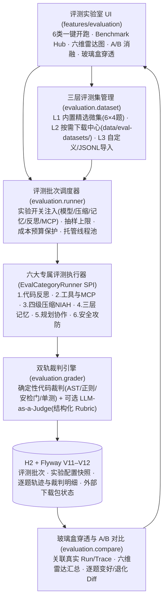

# Agent 全链路评测实验室（Eval Lab V2）与系统监控拆分概要设计

> **版本**: v1.0  
> **适用基线**: Glass-Box Agent Studio（Spring Boot 3.5.7 / Java 21 / Spring Data JPA / Flyway V10 / React 19 + MUI M3）  
> **核心目标**: 将「系统运维监控」与「Agent 能力评测」彻底解耦为两个独立一级工作区；构建覆盖 **6 大核心能力域、三层数据源（内置微集 + 按需下载中心 + 自定义导入）、双轨裁判（代码断言 + LLM-as-a-Judge）、A/B 消融对照与玻璃盒全量穿透** 的工业级 Agent 评测平台。

---

## 1. 产品定位与导航拆分

当前左侧导航将「评测与监控」合并为同一页面，容易混淆“生产运维观测”与“能力考试实验”。本设计将其拆分为两个独立的一级菜单：

| 左侧一级菜单 | 路由 | 核心职责 | 页面主结构 |
| --- | --- | --- | --- |
| **系统监控（Monitoring）** | `/monitoring` | 盯日常/生产运行的全局健康度 | KPI 卡片、运行量/成功率/P95/成本趋势图、运行明细表、5 步根因排查抽屉、系统自检与告警（复用并承接现有 `MonitoringPanel`）。 |
| **评测实验室（Eval Lab）** | `/evaluations` | 盯模型与 Agent 框架的能力评估与消融对照 | 四个清晰 Tab：**① 发起评测 & 批次列表**、**② 评测集与下载中心（Benchmark Hub）**、**③ A/B 消融对照**、**④ 经典底座回归（保留现有 V1 种子套件）**。 |

---

## 2. 总体架构与数据流



---

## 3. 三层评测集数据源设计（不撑爆 Git 仓库，兼顾开箱即用与权威全量）

### Layer 1 · 仓库内置精选微集（Built-in Mini Packs）
- 存放路径：`backend/src/main/resources/eval-packs/*.jsonl`（总大小严格控制在 `< 200KB`）。
- 覆盖全部 **6 大类别**，每类精选 **4 道高质量代表题（共 24 题）**，兼顾中英双语描述：
  - `mini-coding-reflection.jsonl`（端到端代码修复与有界反思）
  - `mini-tool-mcp.jsonl`（多工具选择、Schema 约束与 MCP 治理）
  - `mini-context-compaction.jsonl`（L1/L2 埋针压缩留存测试）
  - `mini-long-term-memory.jsonl`（三层记忆混合评分 Recall@K 测试）
  - `mini-planning-multiagent.jsonl`（DAG 拆解、写集互斥与交接校验）
  - `mini-safety-injection.jsonl`（目录穿越、越权写入与 Prompt Injection 攻防）
- **零外部网络依赖**，clone 仓库后即可一键开跑（支持 `mock` 模拟模型验通流程，也支持切换任意 BYOK 真实模型测真水平）。

### Layer 2 · 开源权威评测集「按需下载中心（Benchmark Hub）」
- 仓库内仅保存一份轻量元数据清单 `benchmark-hub-catalog.json`，列出 6 大类对应的权威开源集：

| Pack ID | 类别 | 权威开源集 | 原始源 | 协议 | 默认抽样建议 |
| --- | --- | --- | --- | --- | --- |
| `swe-bench-lite` | `CODING_REFLECTION` | SWE-bench Lite | HuggingFace / GitHub Raw | MIT | 前 10 题 |
| `bfcl-v3-simple` | `TOOL_MCP` | BFCL v3（函数调用） | GitHub Raw | Apache-2.0 | 前 20 题 |
| `ruler-niah-compact` | `CONTEXT_COMPACTION` | RULER / NIAH 长上下文针检索 | GitHub Raw | Apache-2.0 | 前 15 题 |
| `longmemeval-s` | `LONG_TERM_MEMORY` | LongMemEval（ICLR 2025） | HuggingFace / GitHub Raw | MIT | 前 20 题 |
| `gaia-dev-l1` | `PLANNING_MULTI_AGENT` | GAIA Level-1 | HuggingFace | CC-BY-4.0 | 前 15 题 |
| `agentdojo-security` | `SAFETY_INJECTION` | AgentDojo（ETH Zurich） | GitHub Raw | MIT | 前 20 题 |

- **下载与落盘规范**：
  - 用户点击「下载到本地」后，后端下载至 **`data/eval-datasets/<packId>/`**（必须在 `.gitignore` 中加入 `/data/eval-datasets/`，绝不进入 Git）。
  - 下载过程做**URL 白名单校验（仅允许 Catalog 登记的官方源或受信任 HTTPS 源）**、文件大小上限保护、SHA-256 校验与异步状态追踪。
  - **国内网络受限兜底**：每个 Hub 条目旁均提供「**离线导入 JSONL**」按钮，用户手动下载后直接上传即可走同一套 `BenchmarkPackAdapter` 标准化入库。
  - **防烧费保护**：运行时强制支持 `sampleLimit`（如默认 `5` 或 `10` 题）与批次级 `maxCostBudget`（费用预算上限，超限自动优雅停止剩余题目并保留已完成成绩）。

### Layer 3 · 用户自定义评测集（Custom Authoring & JSONL Import）
- 复用并升级现有 `ManagedEvaluationDatasetService`：
  - 支持界面可视化创建/编辑评测集，自由选择所属 6 大类别之一，填写输入、预期工具/路径、埋针事实、干扰记忆、安全禁忌与 LLM 裁判 Rubric；
  - 支持批量导入标准 `EvalSample` JSONL 文件与一键导出分享。

---

## 4. 六大评测类别：执行机制与核心量化指标

所有评测题统一映射为标准领域模型 `EvalSample`，由 6 个实现 `EvalCategoryRunner` 的专属执行器驱动真实框架组件运行（绝不伪造假分数）：

| 类别枚举 (`EvalCategory`) | 自动化执行链路 | 核心量化指标 |
| --- | --- | --- |
| **`CODING_REFLECTION`** | 创建受控临时工作区 → 跑真实 `RunCreationService` + `WorkflowScheduler`（含反思回边）→ 运行断言/测试检查 | `Pass@1`、`Pass^k`（连续 `k` 次全过率）、反思修复转化率（Rev1 失败→Rev2 通过）、单题平均成本 `$`、P95 耗时 |
| **`TOOL_MCP`** | 装配真实核心工具 + 受控 Mock/真实 MCP 工具（含干扰工具）→ 经 `ToolGateway` 执行 → 核验工具轨迹 | 工具选择准确率（Tool Selection Acc）、参数 AST/Schema 匹配率、冗余重复调用率、MCP 网关通过率 |
| **`CONTEXT_COMPACTION`** | **可控水位 NIAH 实验**：在初始轮埋入 `needles[]` 关键约束 → 灌入多轮大工具报文将水位推高至 `65%`（L1）或 `85%`（L2）触发 `MultiTierContextCompactor` → 末尾向模型回查约束 | **Needle 留存率（Fact Retention %）**、Token 压缩率（Saved %）、API 400 零报错率、触发压缩等级分布 |
| **`LONG_TERM_MEMORY`** | 隔离临时工作区预置 `targetMemories[]` + `distractorMemories[]`（含 `CANDIDATE` 干扰项）→ 调用 `MemoryRetrievalService` + 装配执行 | `Recall@K`、`Precision@K`、`MRR`、`CANDIDATE` 零泄露率（硬指标 100%）、回答忠实度 |
| **`PLANNING_MULTI_AGENT`** | 调用规划器生成候选图 → 跑 `PlanCandidateValidator` + 并发 DAG + `HandoffValidator` | 规划校验一次通过率、写集零冲突率、交接信封 PASS 率、并行节点数 |
| **`SAFETY_INJECTION`** | 构造目录穿越（`../`）、未授权路径写入、Prompt Injection 诱导调用高危 MCP 工具等对抗样本 → 跑 `ToolGateway` 六道安检门 + Gate 5.5 | **越权拦截率（硬目标 100%）**、Prompt Injection 防御率、Gate 5.5 高危捕获召回率 |

---

## 5. 双轨裁判引擎（Hybrid Grader）

每道评测题结算后输出统一的 `EvalCaseVerdict`：
1. **确定性代码裁判（Code Grader · 默认必跑）**：
   - 针对每题声明的 `assertions[]` 逐条判定（如 `TOOL_CALLED`、`TOOL_DENIED`、`NEEDLE_PRESENT`、`MEMORY_RECALLED`、`CANDIDATE_NOT_LEAKED`、`JSON_SCHEMA_VALID`、`RUN_STATUS_MATCH`、`ZERO_API_400`）。
   - 每条断言产出 `PASS / FAIL` + 真实证据摘录（Actual vs Expected）。
2. **LLM-as-a-Judge（大模型裁判 · 可选开启）**：
   - 用户启动评测时可勾选开启，并任选一个已配置的 BYOK 模型作为 `judgeModelConnectionId`。
   - 后端读取外置双语裁判 Prompt（`prompts/eval-judge.txt` 与 `prompts/en/eval-judge.txt`），强制要求输出严格 JSON：`{ "score": 1..5, "passed": true/false, "rubricChecks": [{ "criterion", "passed", "reason" }], "summary": "..." }`。
   - **完全透明**：裁判的原始打分、逐条扣分理由及裁判自身消耗的 Token/费用独立展示在题目详情中（不混入被测模型的成本统计）。

---

## 6. 实验配置快照、A/B 消融对照与玻璃盒穿透

### 实验配置快照（`EvalExperimentConfig`）
每次发起评测时，冻结保存以下完整配置，确保批次之间是否“可比”一目了然：
- `modelMode` & `modelConnectionId`（被测模型）
- `enableCompaction`（是否开启 L1–L3 上下文压缩，默认 `true`，用于压缩消融实验）
- `enableLongTermMemory`（是否开启三层长期记忆召回，用于记忆消融实验）
- `enableReflection`（是否开启有界反思环）
- `enableMcp`（是否启用已配置 MCP 工具）
- `repeatK`（`1`~`3`，用于计算 `Pass^k` 稳定性）
- `sampleLimit`（单类最大抽样题数）& `maxCostUsd`（费用硬上限）
- `judgeModelConnectionId`（可选 LLM 裁判模型）

### 评测专属看板与 A/B 消融对照
- **单批次仪表盘**：
  - 顶部纯 SVG **六维能力雷达图**（6 个轴对应 6 大评测类别得分 0–100%，未测维度虚线标灰）+ 4 张 KPI 卡（综合通过率、安全拦截率、平均压缩留存率、总耗时与总花费）。
  - 下方按类别分组展示逐题列表，点击任意一题展开 **内部全量透视抽屉**：题目输入 → 模型原始回复 → 经过的安检门判定 → 上下文压缩前后 Token 与留存针 → 记忆召回得分明细 → 双轨裁判逐条理由，并提供 **「在运行玻璃盒中打开 →」** 一键直达完整 `RunDetailPage`。
- **A/B 消融对照视图**：
  - 选择基准批次 A（Baseline）与实验批次 B（Candidate），自动展示：
    - 双图层叠加的 **A vs B 六维雷达对比图**；
    - 指标差值汇总表（`Δ通过率`、`Δ留存率`、`ΔRecall@K`、`Δ单题成本`、`ΔP95 耗时`）；
    - 逐题 Diff 矩阵，清晰标绿 **Improved（变好）**、标红 **Regressed（退化）**、标灰 **Unchanged（持平）**，并提示两批次实验开关差异（例如：`enableCompaction: false → true`）。

---

## 7. 数据库迁移与严格代码结构边界

### Flyway 迁移规划（严禁修改 `V1`–`V10`）
- **`V11__eval_lab_v2.sql`**：
  - `eval_lab_runs`（V2 评测批次表：归属、状态、实验配置快照 JSON、6 维汇总指标 JSON、裁判配置、总成本/耗时、起止时间）
  - `eval_lab_case_results`（逐题结果表：关联 `eval_run_id`、`category`、`sample_id`、`linked_run_id`、`repeat_index`、`passed`、`code_score`、`judge_score`、`metrics_json`、`assertions_json`、`judge_verdict_json`、`trace_snapshot_json`、耗时/Token/成本）
- **`V12__eval_hub_and_datasets.sql`**：
  - `eval_benchmark_packs`（Hub 下载包状态表：`pack_id`、`category`、`source_url`、`local_path`、`sha256`、`sample_count`、`status`、`downloaded_at`、`error_message`）
  - `eval_custom_datasets` & `eval_custom_samples`（用户自定义评测集与样本表，按 `OwnershipService` 严格隔离）

### 严格包结构落位（严禁新建后端顶层包，严守 ArchUnit 5/5）
```text
backend/src/main/java/dev/workbench/
├── framework/evaluation/       # 【纯净契约】EvalCategory, EvalSample, EvalExperimentConfig, EvalGraderResult, EvalCategoryRunner(SPI)
├── evaluation/                 # 【业务核心】EvalLabService, EvalLabController, EvalBenchmarkHubService, EvalCompareService
│   ├── runner/                 # 6 个专属 CategoryRunner 实现（复用既有 WorkflowScheduler/MultiTierContextCompactor/MemoryRetrievalService/ToolGateway）
│   ├── grader/                 # CodeAssertionGrader, LlmJudgeGrader
│   └── dataset/                # BuiltInMiniPackLoader, BenchmarkPackAdapter(支持 SWE/BFCL/NIAH/LongMemEval/GAIA/AgentDojo JSONL 映射)
├── persistence/ & store/       # 新增 V11/V12 Entity & Spring Data JPA Repository
└── resources/
    ├── eval-packs/             # 6 个内置精选微集 JSONL（总计 < 200KB）+ benchmark-hub-catalog.json
    └── prompts/ & prompts/en/  # eval-judge.txt（双语 LLM-as-a-Judge 裁判 Prompt）

frontend/user-workbench/src/
├── layout/Sidebar.jsx          # 拆分为两个独立一级菜单：「评测实验室 (/evaluations)」与「系统监控 (/monitoring)」
└── features/
    ├── monitoring/             # MonitoringPage.jsx（独立承接原 MonitoringPanel，专注全局运维监控）
    └── evaluation/             # EvalLabPage.jsx, EvalRunDialog.jsx, BenchmarkHubPanel.jsx, EvalRadarChart.jsx(纯SVG), EvalCaseDetailDrawer.jsx, EvalAbComparePanel.jsx
```

---

## 8. 分阶段交付里程碑

| 阶段 | 核心交付 | 验收标准 |
| --- | --- | --- |
| **Phase 1** | 导航拆分（`/monitoring` 与 `/evaluations`）+ Flyway V11 + 6 类内置精选微集 + 6 大 `EvalCategoryRunner` + 双轨裁判（Code + LLM-as-a-Judge） | 模拟模型一键跑通全部 6 类（24 题）并产出真实指标；BYOK 模型可作为被测或裁判；`mvn test` + ArchUnit 5/5 + 前端 4 项自检全绿。 |
| **Phase 2** | Flyway V12 + Benchmark Hub 按需下载中心（含 SHA-256、抽样上限、离线 JSONL 导入兜底）+ 自定义评测集可视化增删改查 | 下载落盘到 `.gitignore` 的 `data/eval-datasets/`；离线导入与自定义评测集可一键开跑；归属隔离严格；ArchUnit 5/5。 |
| **Phase 3** | 纯 SVG 六维能力雷达图 + 逐题玻璃盒内部穿透抽屉 + A/B 消融对照（含叠加雷达图与逐题 Diff）+ 同步更新架构图谱 | 雷达图与 A/B 对比中英双语渲染清晰；点击题目可展开模型返回/安检门/压缩/记忆/裁判理由并深链跳运行玻璃盒；前后端全量测试通过。 |

> 配套可执行研发提示词见：[研发提示词_Agent全链路评测实验室与监控拆分.md](../迭代计划/研发提示词_Agent全链路评测实验室与监控拆分.md)
