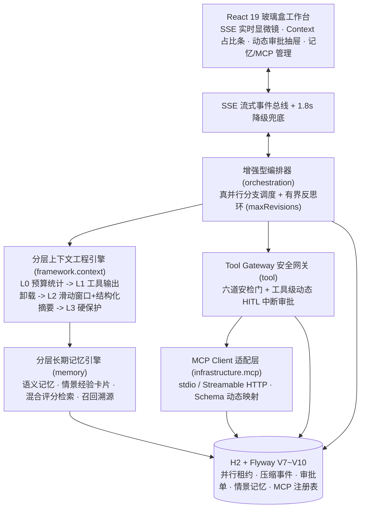

# 下一代 Agent 框架能力升级概要设计

> **版本**: v1.0  
> **适用基线**: Glass-Box Agent Studio（Spring Boot 3.5.7 / Java 21 / Spring Data JPA / Flyway V6 / AgentScope Java 2.0.4 / React 19 + MUI M3）  
> **目标定位**: 在严守「玻璃盒全量可观测」「ArchUnit 零循环依赖」「最小权限默认拒绝」三大核心红线的前提下，将工作台从**基础多节点串行 DAG 编排器**演进为具备**行业前沿工程水准的现代 Agent 运行时与学习平台**。

---

## 1. 升级背景与总体蓝图

当前版本已具备扎实的工程底座（外置双语 Prompt、装配配方快照、Tool Gateway 六道安检门、Handoff 证据校验、BYOK 加密与费用账本、Grafana 风格监控与架构图谱）。面向生产级 Agent 工程与深度教学，仍存在六项关键框架代差：

| 编号 | 能力域 | 当前基线 | 行业较优/最优目标方案 | 归属阶段 |
| --- | --- | --- | --- | --- |
| **M1** | 编排与调度 | 串行认领节点 + 严格无环纯 DAG | **写集互斥真并行 DAG + 有界反思环（Bounded Reflection / Critic Loop）** | Phase 1 |
| **M2** | 上下文工程 | 显式组装 + 超长静态截断 | **四级分层上下文管理（L0 Token 观测 / L1 工具结果卸载 / L2 滑动窗口+结构化摘要 / L3 硬兜底）** | Phase 1 |
| **M3** | 实时流式观测 | 1.8s 定时游标轮询 | **SSE 实时事件与 Token 流式推送（`Last-Event-ID` 断线续传 + 自动降级轮询）** | Phase 2 |
| **M4** | 人机协同（HITL） | 计划前确认 + 静态节点断点 | **工具级动态审批中断（Tool-Level Interrupt：放行 / 改参放行 / 拒绝并回传理由）** | Phase 2 |
| **M5** | 长期记忆体系 | 手动静态项目记忆片段 | **三层记忆（语义 + 情景 + 程序）+ 混合召回评分 + 玻璃盒注入溯源 + 用户确认入库** | Phase 3 |
| **M6** | 工具协议生态 | 内置 4 工具 + 私有只读配置 | **标准 MCP（Model Context Protocol）客户端接入，强制收口至 Tool Gateway 六道安检门** | Phase 4 |

### 总体演进架构图



---

## 2. 六大模块行业最优详细设计

### 2.1 M1 · 真并行分支调度与有界反思环（Parallel DAG + Bounded Reflection）

#### 行业实践选型
- **不采用**：简单无上限的 `while` 重试（易引发成本爆炸与死循环），或无锁多线程并发写同一工作区。
- **采用方案**：**受控并行（Disjoint Write-Set Parallelism）+ 有界批评-修正闭环（Bounded Critic-Revision Loop）**。

#### 核心设计
1. **写集互斥真并行调度**：
   - 依赖 `PlanCandidateValidator` 已有的“并行开发分支写集互斥”静态约束。
   - `WorkflowScheduler` 每次调度循环一次性查询所有「全部前置依赖均已 `COMPLETED`」的就绪节点集合（不再只取第 1 个）。
   - 受控并发上限 `workbench.orchestration.max-parallel-nodes`（默认 `3`），统一提交至 Spring 托管的 `ThreadPoolTaskExecutor`（严禁 `new Thread()`）。
   - **并发安全**：节点认领采用数据库乐观锁/原子状态更新（`PENDING -> RUNNING` WHERE `status = 'PENDING'`）；`RunCostLedgerService` 已有行锁预留天然支撑并发模型计费；事件写入使用单调递增序列号或数据库自增序保序。
2. **有界反思环（Bounded Reflection Loop）**：
   - 在 `WorkflowPlan` / 节点边定义上引入可选的 **反思回边（`RevisionEdge`）**，仅允许 `REVIEW` / `SYSTEM_CHECK` 节点指向其直接上游 `DEVELOP` / `ANALYZE` 节点，且必须显式声明 `maxRevisions`（默认 `2`，上限 `5`）。
   - **结构化评审契约（`ReviewVerdict`）**：审查节点除正文外输出结构化结论：`APPROVED` 或 `REVISE_REQUIRED`，附带 `defects[]`（每条含 `severity`、`filePath`、`summary`、`suggestedFix`）。
   - **执行流转**：
     1. 审查节点判定 `REVISE_REQUIRED` 且 `currentRevision < maxRevisions`。
     2. 编排器记录 `REVISION_TRIGGERED` 事件，为上游目标节点派生新一次尝试（`attemptIndex + 1`），并将本轮 `ReviewVerdict` 作为高优先级 `CRITIC_FEEDBACK` 上下文注入。
     3. 上游修复完成并重新通过 Handoff 校验后，自动重新触发审查节点。
     4. 若达到 `maxRevisions` 仍未通过，自动停止反思并转为 `WAITING_HUMAN_REVIEW`（由用户决定手动修改、接受或终止），绝不失控循环。

---

### 2.2 M2 · 工业级四级分层上下文工程（Multi-Tier Context Engineering）

#### 行业实践选型
- **不采用**：粗暴截断最早消息（会丢失系统约束和任务目标）或每次全量重摘要（破坏 KV Cache 与近期细节）。
- **采用方案**：参考 Claude Code / Anthropic Context Engineering 的 **四级分层压缩策略（L0 → L1 → L2 → L3）**，兼顾**保真度、Token 经济性与玻璃盒可解释性**。

#### 分层策略定义

| 等级 | 触发水位（相对模型上下文上限） | 处理动作 | 保护区（绝不触碰） |
| --- | --- | --- | --- |
| **L0 · 透明观测** | 全程（0%–100%） | 按段精确统计 Token 构成：`SYSTEM`、`SKILLS`、`MEMORY`、`HANDOFF`、`TOOL_OUTPUTS`、`HISTORY`，随每次 `ModelCall` 持久化。 | — |
| **L1 · 工具输出卸载（Offloading）** | ≥ 60% | 扫描**非最近 2 轮**的大体积 `TOOL` 返回结果（如 > 1,500 chars 的文件全文或长搜索结果），保留头 200 字 + 尾 100 字 + **证据指针占位符**（`[Offloaded: toolCallId=xxx, path=..., lines=..., use workspace_read if needed]`）。 | System Prompt、任务目标、最近 2 轮完整工具结果 |
| **L2 · 滑动窗口 + 结构化摘要（Compaction）** | ≥ 78% | 保留 **Pinned Anchor（System + 任务目标 + 约束 + 当前计划）** 与 **Recency Window（最近 N=4 轮完整消息，确保 tool_call 与 tool_result 成对保留不拆散）**；将中间历史段压缩为固定结构的 **Checkpoint Summary**（`已确认事实` / `已修改文件与回执` / `排除的假设` / `当前待办`）。 | Pinned Anchor + 最近 N 轮成对消息 |
| **L3 · 紧急硬保护（Hard Guard）** | ≥ 92% | 若 L2 后仍超限，按优先级裁剪低分记忆与旧交接正文（仅留结构化摘要），确保绝不因上下文溢出导致 API 400 崩溃，并记录 `CONTEXT_HARD_TRIMMED` 告警事件。 | System Prompt + 任务目标 + 最近 1 轮 |

#### 玻璃盒可视化设计
- 每次触发 L1/L2/L3 必须落库一条 `CONTEXT_COMPACTED` 事件，载荷含：`tier (L1/L2/L3)`、`beforeTokens`、`afterTokens`、`savedPercent`、`offloadedToolCallIds[]`、`summaryPreview`。
- 前端「模型 I/O」与「装配配方」面板新增 **Context Window 堆叠占比条（纯 SVG/CSS 分段条）**，鼠标悬停显示各段精确 Token 与百分比。

---

### 2.3 M3 · SSE 实时流式透视（Real-Time Streaming + Fallback）

#### 行业实践选型
- **不采用**：纯 WebSocket 双向重协议（与现有 REST + CSRF 体系割裂），或直接废除轮询（在企业代理/缓冲环境下易断流）。
- **采用方案**：**单向 SSE（Server-Sent Events）主通道 + `Last-Event-ID` 断点续传 + 自动降级 1.8s 轮询**。

#### 核心设计
1. **后端流式端点**：`GET /api/runs/{runId}/stream`（`MediaType.TEXT_EVENT_STREAM_VALUE`），走现有 `OwnershipService` 归属校验。
2. **事件分级**：
   - **持久化事实事件**（`RUN_EVENT`）：带数据库全局单调 `eventSeq` 作为 SSE `id`，断线重连携带 `Last-Event-ID` 时先补发遗漏事件，做到**零丢失**。
   - **瞬态流式片段**（`MODEL_DELTA` / `GATE_CHECKING`）：仅在运行中实时推送用于前端打字机与安检门逐门点亮，不写高膨胀碎表；节点结算后由最终 `ModelCall` 完整载荷兜底。
3. **资源防护**：使用 `ConcurrentHashMap<String, CopyOnWriteArrayList<SseEmitter>>` 管理订阅，单运行连接数上限保护 + 15 秒心跳注释（`: keepalive`）防超时，运行进入终态后优雅关闭流。
4. **前端无缝降级**：`useRunExecution.js` 优先连接 `EventSource`；若连接失败 3 次或浏览器不支持，静默回退到现有 1.8s React Query 轮询，用户体验零中断。

---

### 2.4 M4 · 人机协同工具级动态审批中断（Tool-Level HITL Interrupt）

#### 行业实践选型
- **不采用**：所有工具调用都弹窗确认（体验极差），或遇高危工具直接 `DENY` 导致任务白跑。
- **采用方案**：参考 LangGraph `interrupt` 与 OpenAI Agents SDK Approval，在 `ToolGateway` **门 5（授权复验）与门 6（受控执行）之间**插入 **风险评估与动态挂起审批闸门（Gate 5.5）**。

#### 风险分级与审批状态机
- **风险分级（`ToolRiskLevel`）**：
  - `LOW`：只读读取、代码搜索、模拟只读工具 → 自动放行。
  - `MEDIUM`：已显式授权范围内的常规代码写入 → 默认按策略放行，可配置为需审批。
  - `HIGH`：敏感路径修改（如 `pom.xml`、`package.json`、安全配置）、外部 MCP 写操作/网络副作用工具 → **强制触发动态中断**。
- **中断与恢复流程**：
  1. `ToolGateway` 创建持久化审批单 `tool_approval_requests`（状态 `PENDING`，含 `runId`、`nodeId`、`toolName`、`originalArgsJson`、`riskLevel`、`riskReason`、`expiresAt`）。
  2. 节点进入 `WAITING_TOOL_APPROVAL` 状态，通过 SSE 实时推送审批卡片到前端。
  3. 用户在界面有 **3 种决策**：
     - **批准放行（`APPROVE`）**：原参数进入门 6 执行。
     - **改参放行（`APPROVE_WITH_EDITED_ARGS`）**：用户修正参数 JSON → **重新执行门 5 文件授权交集复验（防绕过！）** → 进入门 6 执行，并记录 `editedArgsJson`。
     - **拒绝（`REJECT` + 理由）**：记录 `DENY`，将用户填写的拒绝理由作为结构化 `ToolResult` 回传给模型，让 Agent 据此调整方案继续运行。
  4. **线程安全要求**：等待审批时**绝不长时间阻塞业务线程池工作线程**（严禁 `Thread.sleep` 死等）；采用**状态持久化挂起 + 审批回调触发异步续跑**（或有界短等待 + 检查点续跑），确保服务重启后待审批单依然有效。

---

### 2.5 M5 · 分层长期记忆体系（Layered Long-Term Memory）

#### 行业实践选型
- **不采用**：强依赖外部 Milvus/Qdrant 向量库（破坏单进程零运维定位），或未经核验自动将 Agent 幻觉写入长期记忆（导致记忆投毒）。
- **采用方案**：**三层记忆分类 + 混合评分检索（零重依赖 + Embedding SPI 可插拔）+ 人工确认入库 + 玻璃盒召回溯源**。

#### 三层记忆模型
1. **语义记忆（`SEMANTIC`）**：项目架构约定、编码规范、目录边界（平滑兼容现有工作区项目记忆）。
2. **情景记忆（`EPISODIC`）**：每次运行结束后，系统（基于规则或低成本模型）自动提炼 1–3 条「经验候选卡片」（如 *“触发问题 / 根因 / 避坑策略 / 关联路径”*），初始状态为 `CANDIDATE`，**必须经用户一键“采纳”才转为 `ACTIVE`**，彻底杜绝幻觉污染。
3. **程序记忆（`PROCEDURAL`）**：高频采纳的经验支持一键「晋升为私有 Skill 草稿」，与现有「我的 Agent → 我的 Skill」生态打通。

#### 混合检索评分算法（内置零依赖 + SPI 扩展）
在 `MemoryRetrievalService` 中计算每条 `ACTIVE` 记忆的综合得分（Top-K=5，低于阈值不注入）：
$$\text{Score}(m, q) = 0.45 \cdot \text{Lexical}(m, q) + 0.30 \cdot \text{PathOverlap}(m, q) + 0.15 \cdot \text{RecencyDecay}(m) + 0.10 \cdot \text{Confidence}(m)$$
- 若配置了可选 `MemoryEmbeddingProvider` 实现，可将向量余弦相似度平滑并入权重。
- **玻璃盒溯源**：每次装配注入记忆时，在 `AgentAssemblySnapshot` 中记录每条命中记忆的 `memoryId`、`memoryType`、`score`、`matchedReason`，在前端「装配配方」中清晰展示**为什么召回了这条记忆**。

---

### 2.6 M6 · MCP 客户端接入与 Tool Gateway 统一治理

#### 行业实践选型
- **不采用**：让 AgentScope 或模型直连外部 MCP Server（会完全绕过你的配额、防死循环与文件安全边界）。
- **采用方案**：**MCP 作为受控工具源（`McpToolProvider`）接入 `framework.tool` 契约，100% 路由经过 `ToolGateway` 六道安检门 + 动态审批闸门**。

#### 核心设计
1. **MCP Server 注册表**：支持用户在「设置 / 我的 Agent → MCP 工具源」配置私有 MCP Server（按 `OwnershipService` 隔离）：
   - 支持传输协议：`STDIO`（本地受控子进程，严格校验可执行白名单与环境变量隔离）与 `STREAMABLE_HTTP`（远程 HTTP/SSE JSON-RPC 2.0，敏感 Header 走现有 `SecretCipher` AES-256-GCM 加密存储）。
   - 支持「一键探测（`initialize` + `tools/list`）」缓存工具清单，并对每个暴露出的工具标注默认风险等级（只读 `LOW` / 写入或外部副作用 `HIGH`）。
2. **统一网关收口**：
   - `McpToolAdapter` 将外部 MCP 工具包装为标准 `AgentTool`，名称带清晰命名空间 `mcp::<serverSlug>::<toolName>`。
   - 运行时执行流程：`ReActAgent` → `ToolGateway`（门 1 白名单 → 门 2 取消态 → 门 3 配额 → 门 4 重复熔断 → 门 5 服务器/作用域校验 → 门 5.5 高危 HITL 审批 → 门 6 `McpClient.callTool()` 执行 + 超时熔断 + 结果截断与全量玻璃盒落库）。

---

## 3. 数据库迁移规划（Flyway V7 ~ V10）

严守 Flyway 版本化迁移规范（严禁修改已有 `V1`–`V6`，关闭 Hibernate 自动建表）：

| 迁移脚本 | 对应阶段 | 新增/变更核心表结构 |
| --- | --- | --- |
| `V7__parallel_reflection_and_context.sql` | Phase 1 | `plan_revision_edges`（反思回边与 `max_revisions`）；`node_attempts` 增加 `revision_index`、`critic_verdict_json`；`model_calls` 增加 `context_breakdown_json`、`compaction_tier`。 |
| `V8__tool_approval_interrupts.sql` | Phase 2 | `tool_approval_requests`（工具级动态审批单：状态、原参数、修改后参数、风险等级、审批人、决策理由、时间戳）。 |
| `V9__layered_long_term_memory.sql` | Phase 3 | 扩展工作区记忆表（或新增 `memory_entries`）：增加 `memory_type`（`SEMANTIC`/`EPISODIC`/`PROCEDURAL`）、`status`（`CANDIDATE`/`ACTIVE`/`ARCHIVED`）、`source_run_id`、`path_patterns`、`confidence`、`hit_count`、`last_hit_at`。 |
| `V10__mcp_server_registry.sql` | Phase 4 | `user_mcp_servers`（归属、传输类型、端点/命令、AES-256 加密头/凭据、启用状态）；`user_mcp_tools`（缓存的工具 Schema、风险等级、单工具启停开关）。 |

---

## 4. 严格的代码结构与 ArchUnit 守卫约束

为防止项目演进过程中代码分散或架构腐化，所有新增代码**必须严格落位到现有顶层包**，**严禁随意新建顶层包**，并持续通过 `ArchitectureGuardTest` 全部 5 项守卫：

```text
backend/src/main/java/dev/workbench/
├── framework/                  # 【纯净契约层】严禁引入 Spring / JPA / AgentScope / MCP SDK
│   ├── context/                # ContextBudget, ContextCompactionPolicy, CompactionTier, ContextBreakdown
│   ├── workflow/plan/          # RevisionEdge, ReviewVerdict, ReviewDefect
│   ├── tool/                   # ToolRiskLevel, ToolApprovalDecision, McpToolDescriptor
│   └── memory/                 # MemoryType, MemorySearchQuery, MemoryMatch, MemoryEmbeddingProvider(SPI)
├── orchestration/              # 【编排调度层】WorkflowScheduler(并发认领), ReflectionCoordinator(反思环)
├── control/                    # 【控制与上下文】MultiTierContextCompactor(L0-L3 实现)
├── tool/                       # 【安全网关层】ToolGateway(接入 Gate 5.5), ToolApprovalService
├── memory/                     # 【长期记忆层】MemoryRetrievalService, EpisodicMemoryExtractor
├── observability/              # 【流式观测层】RunStreamBroker(SSE 广播与心跳), RunStreamController
├── infrastructure/             # 【外部适配隔离圈】唯一允许引入第三方 SDK / HTTP / 子进程
│   ├── agentscope/             # AgentScope 流式回调桥接
│   └── mcp/                    # McpClientManager, StdioMcpTransport, HttpMcpTransport, McpToolProvider
├── persistence/ & store/       # 【数据访问层】新增 Entity / Spring Data JPA Repository / Store
└── app/                        # 【装配与配置】AsyncConfiguration(并行节点线程池与 SSE 线程池)

frontend/user-workbench/src/features/
├── runs/                       # RunDetailPage(SSE接入), ToolApprovalDrawer(动态审批), glassbox/ContextMeterBar.jsx
├── workspaces/                 # WorkspaceMemoryPanel(升级三层记忆 + 情景候选采纳)
├── settings/                   # McpServerPanel.jsx & McpServerDialog.jsx(紧邻 ModelConnectionPanel)
└── architecture/               # 同步更新 architectureCatalog.js 与 SVG 架构图，保持图谱与代码 100% 一致
```

---

## 5. 分阶段交付路线图与验收标准

| 阶段 | 包含能力 | 核心验证指标 |
| --- | --- | --- |
| **Phase 1** | M1 真并行 + 有界反思环 & M2 四级分层上下文压缩 | 写集互斥双节点实测并发耗时缩短；模拟 Reviewer 打回 1 次→自动修复→通过、超限转人工；L0/L1/L2 压缩单测与玻璃盒占比条渲染；Flyway V7 + ArchUnit 5/5。 |
| **Phase 2** | M3 SSE 实时流式透视 & M4 工具级动态审批中断 | 断线携带 `Last-Event-ID` 补发零丢消息；网络断开自动降级轮询；高危工具挂起→改参放行二次过门 5→拒绝理由回传模型；Flyway V8 + ArchUnit 5/5。 |
| **Phase 3** | M5 分层长期记忆体系 | 运行结束自动生成情景候选卡；未确认不注入；确认后按混合评分召回并在装配配方显示得分与理由；支持一键转 Skill 草稿；Flyway V9 + ArchUnit 5/5。 |
| **Phase 4** | M6 MCP 客户端接入与六道安检门治理 | Mock MCP Server 注册探测；工具全部过六道安检门 + 高危审批；凭据 AES-256 加密零明文回显；Flyway V10 + ArchUnit 5/5。 |

> 落地实现与验证基线见：[项目总览与最新技术架构](../项目总览_产品需求与技术架构.md) · [Top 10 安全止血与核心 P0 修复验收](../交接/Top10安全止血与P0修复_验收记录.md)
