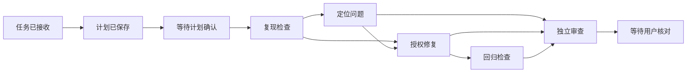

# 任务执行流程可视化与接口设计

## 1. 产品目标

任务详情以**执行流程图**为主视图。用户从提交任务开始，应能随时回答五个问题。

1. 系统打算做哪些步骤，各步骤为什么要等。
2. 当前走到哪里，正在执行哪个实际动作。
3. 哪些动作已经执行，产出了什么，有什么证据。
4. 哪里被阻塞、为什么、是否在等自己处理。
5. 接下来系统能做什么，自己现在可以做什么。

一条运行的计划图覆盖已确认的业务节点。接收任务、保存计划、等待确认、暂停、恢复、交付等发生在整个运行上的变化，显示为流程两端的状态或运行级事件。节点中的模型请求、工具调用、系统检查、前后交接和重试按实际记录逐层展开。页面用真实操作与证据解释过程，模型输出里的推断标为模型结果。

本设计承接[动态 Agent 重构概要设计第 11 节](动态Agent与可组合工作流_重构概要设计.md)和[0.5 用户工作台计划](../迭代计划/0.5_用户交互.md)，明确产品交互与读取接口。**状态为待实现设计**。

## 2. 用户会看到什么

以模拟 Bug 修复为例。图中连线表示已保存的依赖。定位、修复与回归的详细顺序以该次运行的计划版本为准。



| 页面区域 | 默认展示 | 用户可做的事 |
| --- | --- | --- |
| 运行状态 | 当前步骤、实际动作、安全摘要、等待原因和是否已断线；在途活动可有多个 | 定位当前节点，查看待处理事项，使用当下可用的控制 |
| 任务流程图 | 阶段、节点、依赖、状态；突出正在执行或阻塞的步骤 | 选择任意节点查看计划职责与实际执行。已完成和未来步骤仍可查 |
| 节点详情 | 目标、权限范围、前置结果、尝试、实际动作、耗时、用量、结果与可查看的证据 | 展开模型或工具调用摘要、检查结果、交接来源与产物 |
| 运行历史 | 不属于单一节点的审批、排队、停止与恢复事件，以及父子运行关系 | 展开时间线，查看恢复来源或切换历史运行 |
| 用户处理区 | 需要用户决定的具体对象、原因、范围及可用操作 | 确认计划、暂停、继续、取消、从安全检查点恢复。补充信息和人工接手待业务实现后接入 |

任务提交到返回运行标识前，页面只显示表单提交状态。收到运行标识后跳转同一任务的运行详情。后端尚未提交计划时，显示已知准备状态。需要计划确认时，用户已经能查看实际保存的图；首个节点启动前无调用。计划确认省略时，状态按已发生的事件推进。任何一类模板都使用相同的流程视图。

例如「定位问题」节点高亮时，节点详情可显示「尝试 1 · Agent 已启动 → 已接收复现证据 → 正在读取授权文件」。工具返回后更新真实结果；模型若仅给出原因假设，按推断呈现。回归结果已经失效时，历史上通过及当前证据过期分别可见；任务可能仍等待用户验收。图可提供易读的列表呈现，状态使用文字与图标，键盘可选择节点及查看细节。

## 3. 数据和显示口径

| 对象 | 权威来源 | 前端规则 |
| --- | --- | --- |
| 任务和运行 | 任务、运行状态和停止原因 | 区分执行结束、等待审批、暂停、失败、取消、受限、中断及待人工核对 |
| 计划及依赖 | 持久化计划版本、节点和依赖表 | 节点身份用 `runId + planVersionId + nodeId`，排布用依赖与稳定顺序；同一定义的节点各自显示 |
| 实际执行 | 节点尝试、Agent 实例、系统检查、模型和工具调用记录 | Agent 按尝试展开；重试创建新尝试并保留失败记录；系统检查独立显示，无 Agent 实例时留空 |
| 阻塞与上下游 | 运行控制、已结算节点、检查结果、审批对象 | 展示未满足的依赖和确切原因；下游未启动显示未执行。后端没记录具体阻塞节点时，在运行层报告原因 |
| 交接、产物和证据 | 接收记录、工具或检查结果、文件版本、审查记录 | 有归属和访问授权才展示；区分实际调用、模型摘要、未验证及过期；历史字段缺失标为未记录 |
| 恢复与预算 | 恢复来源、节点复用关系、调用台账 | 复用节点指向历史来源，子运行新调用与继承消耗各自展示；未报告用量显示未知 |

待审批属于计划级状态，计划节点仍可能全是待执行。现有数据可显示「已排队」「运行中」「正在等待某工具」「检查失败，阻塞下游」等有依据的文字。界面进度可计数，例如「4 个计划节点，2 个已完成、1 个运行中」；原有调用量、测试通过情况、验收决定独立显示。没有实时进度的外部调用只显示正在执行和已知耗时。

## 4. 查询接口与事件

### 4.1 当前可复用的接口

- `GET /api/runs/{id}?includeEvents=false` 已提供运行、计划、节点、尝试、检查、交接、装配和调用等数据。
- `GET /api/runs/{id}/events?after={cursor}&limit={n}` 已提供运行级事件游标。历史事件主要含运行标识、类型、消息与时间，节点挂靠需要新增结构化引用。
- 现有 `POST /api/runs/{id}/plans/{planVersionId}/approve`、`/pause`、`/resume`、`/cancel`、`/recover/{checkpointId}` 继续处理写操作，复用后端权限和版本校验。

### 4.2 推荐只读投影

新增 `GET /api/runs/{id}/execution-view`，聚合现有权威数据，提供画流程图和判断当前可用操作所需的最小字段。详情较多时，展开节点再调用 `GET /api/runs/{id}/execution-view/nodes/{nodeId}`。同一节点的完整历史按尝试或分页查询，避免在运行轮询中重复传输整个会话。保留旧 API 和历史页。

| 对象 | 建议契约 |
| --- | --- |
| 顶层 | `schemaVersion`、`taskId`、`runId`、`runStatus`、`plan`、`nodes`、`edges`、`focus`、`blocking`、`availableActions`、`recovery`。未产生或历史缺失的对象用空值或明确字段状态 |
| 计划 | 计划标识、计划版本、模板标识和模板版本、审批状态。旧兼容计划没有持久化版本时明确记录缺失 |
| 节点 | `id`、`key`、`label`、`kind`、`phase`、`status`、必要的时间及安全摘要；依赖用 `edges[].{fromNodeId,toNodeId}` |
| 焦点与阻塞 | `focus.active[]` 指向在途节点、尝试或检查，可带当前动作与实体 ID；`blocking[]` 含稳定原因编码、简明解释、适用对象和未满足条件，允许整次运行阻塞 |
| 节点详情 | 尝试和检查的结果、模型和工具调用摘要、交接、证据和产物引用，注明来源、用量及新鲜度。需要核对原始资料时通过授权的来源接口打开 |
| 操作 | 稳定 `actionCode` 与目标标识，例如 `APPROVE_PLAN` 绑定计划版本，`RECOVER` 绑定检查点。操作是否允许由后端返回；提交时再次复查，拒绝后刷新状态 |
| 恢复 | 父运行、来源检查点、复用关系及已继承消耗。没有经验证的来源时明确未知 |

下列是展示出「定位问题正在读取授权文件」所需的字段节选。

```json
{
  "schemaVersion": 1,
  "runId": "run-id",
  "runStatus": "RUNNING",
  "plan": { "id": "plan-id", "version": 1, "templateId": "bug-fix", "templateVersion": 2 },
  "nodes": [
    { "id": "reproduce-id", "kind": "SYSTEM_CHECK", "label": "复现检查", "status": "COMPLETED" },
    { "id": "analyze-id", "kind": "AGENT", "label": "定位问题", "status": "RUNNING" }
  ],
  "edges": [{ "fromNodeId": "reproduce-id", "toNodeId": "analyze-id" }],
  "focus": {
    "active": [
      { "nodeId": "analyze-id", "attemptId": "attempt-id", "activityKind": "TOOL_CALL", "activityId": "tool-id" }
    ]
  },
  "blocking": [],
  "availableActions": [{ "actionCode": "CANCEL", "runId": "run-id" }]
}
```

### 4.3 节点事件与刷新

- 给既有持久化事件附加可空的 `planVersionId`、`nodeId`、`attemptId`、`agentId`、`checkId`、`modelCallId`、`toolCallId` 及 `reasonCode`。引用按发生的动作择用。旧事件继续可读，只有已证实的关联才挂到对应节点。
- 记录可被用户验证的状态转移，例如计划确认、节点认领、模型请求与结束、工具执行或拒绝、证据接收、检查、重试、暂停、终态、恢复。与状态同属本地事务的事件随事务提交，失败回滚时不会显示成已完成；外部结果未知单独表达。
- 首版沿用受控轮询。加载或刷新时，读取持久化快照并补取事件。新事件用于刷新相关节点详情，最终状态以新快照为准。断线期间保留上次视图并标明更新时间，重连补取历史后再同步快照。
- 以服务端游标分页和去重，分页读尽再显示已同步，切换运行时隔离旧请求。现有事件号在不同运行间会跳号，不能靠数字连续性判断缺失。开发时验证同一运行里的事件可见顺序与游标匹配；若有晚提交事件可能落在游标之前，为该运行增加按提交可见顺序分配的游标，保留旧接口兼容。
- 后续可用 SSE 输送同一种事件和游标；连接方式变化不改变图数据、快照与重连行为。

## 5. 扩展约定

- **新增模板或 Agent 定义**时，默认直接复用流程图。前端凭节点类型、显示名、依赖和稳定状态渲染，业务规则留在后端；模板和角色名称无需逐项加入页面分支。
- **新增节点类型**时，实现对应业务执行器并接入通用节点投影。适配器说明状态、摘要、动作和证据引用的来源；暂无专用详情时用通用节点卡片显示可用字段。执行器未实现时，服务端拦截并给出原因。
- **新增检查、工具和证据类型**时，在现有调用或检查记录上增加结构化分类和证据引用。通用详情先支持状态、耗时、摘要和证据入口；特殊展示，例如代码差异或测试摘要，可按证据类型扩展。未知类型保留可读的后端摘要。
- **新增人工关卡与计划版本**时，继续使用版本化操作、阻塞原因和关系引用。补充信息、人工接手和计划变更的写入行为由各自业务设计实现；旧图和证据在历史运行中保持可查。
- 流程视图只返回当前访问权限允许的摘要和证据标识。模型内部推理、原始凭据和无权查看的数据不进入接口；工具输出与模型文本按不可信内容显示。所有用户操作仍从现有后端授权链路进入。

## 6. 交付顺序和验收

| 顺序 | 实现 | 完成时可观察到的结果 |
| --- | --- | --- |
| 1 | 接通投影和结构化关联，覆盖现有 Agent 及系统检查节点 | 用真实双视角和模拟 Bug 运行校对计划、实际尝试、检查与调用；等待审批时可见图且零调用；旧记录照常可读 |
| 2 | 工作台以流程图为主视图，接入焦点、节点下钻和已有控制 | 模拟 Bug 从确认计划、复现、定位、修复、回归到待审查，用户能逐节点确认实际行为。检查阻塞时能定位原因和未开始的下游。新模板不为图另加角色或文件名判断 |
| 3 | 验证刷新、重连、异常及恢复 | 轮询中断后重新同步，事件不少也不重复，节点选择与历史仍可检查。限流重试展示多次尝试；取消和预算停止清楚可见；恢复子运行明确区分历史复用与新调用 |

至少用前端实际操作核对一个成功案例、一个系统检查阻塞案例、一个重试或取消案例、一个恢复子运行，对照落库轨迹和 API。交付者须提供运行标识、测试步骤和观察结果。每个功能闭环完成后集中回归一次，记录未验证范围。当前步骤只定义展示和接口扩展点，流程编辑器、运行中改图及并行调度沿用各自的后续规划。
