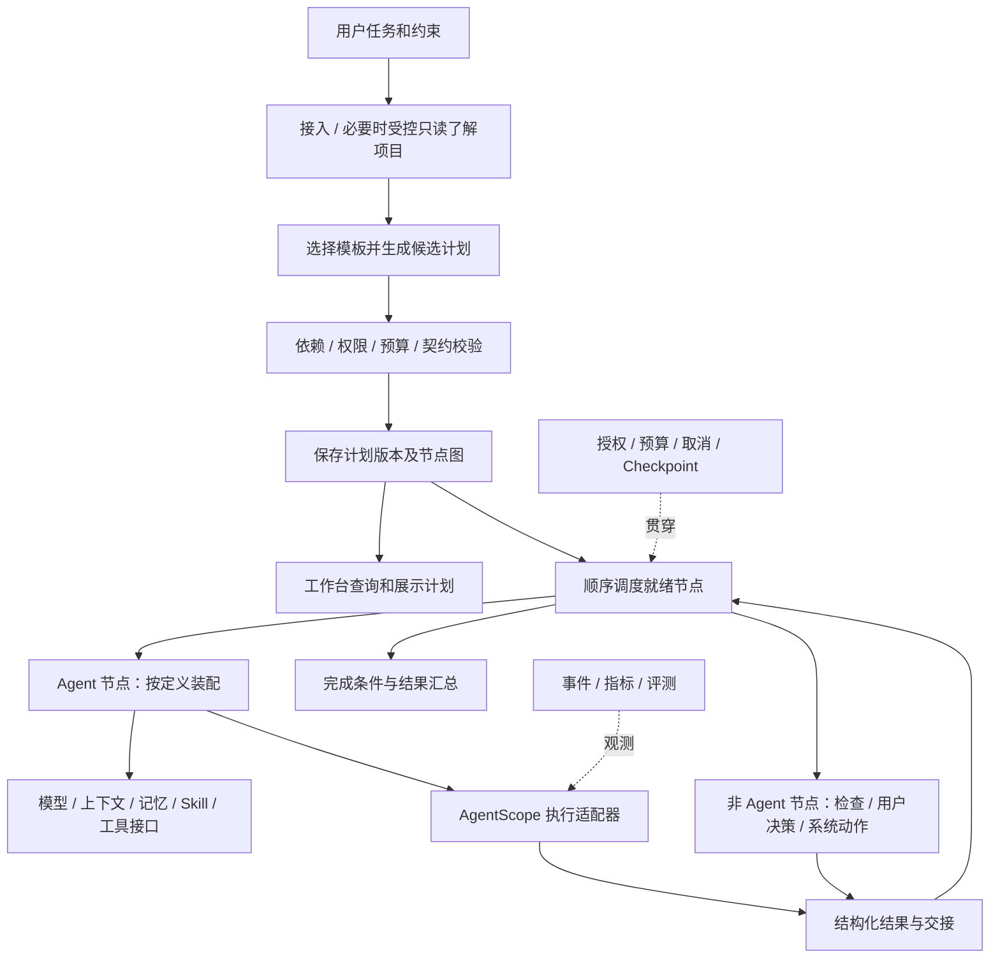
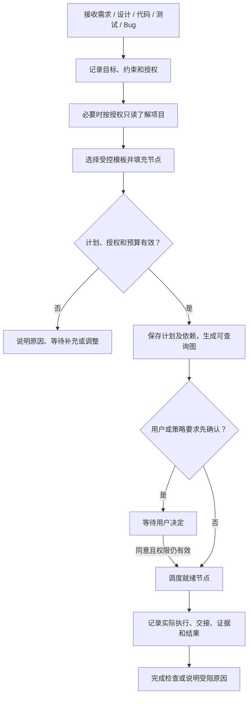
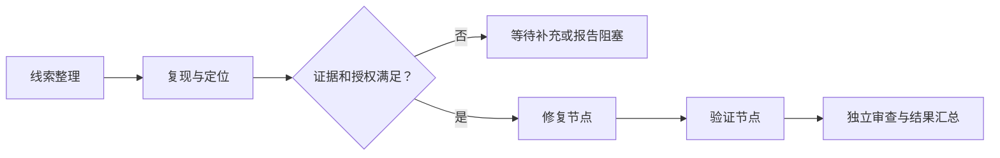
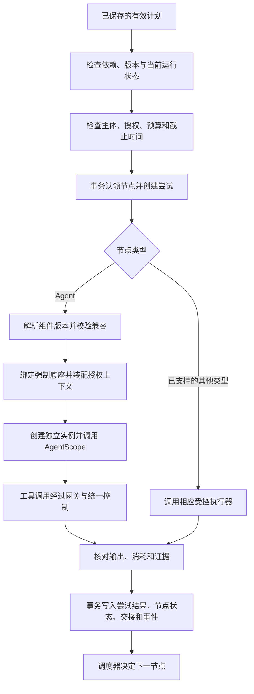

# 动态 Agent 与可组合工作流：重构概要设计

> 文档状态：设计方案，2026-11-17。本文描述拟建设的目标和分期，不代表相应代码已经实现或通过验证。
>
> 阅读范围：本次聚焦 Agent 内部框架，以及为理解运行所必需的控制台数据。具体 Git、文件、测试工具和完整多租户后台不在本次重构范围内；已有具体工具保留兼容，新增工具以扩展接口为边界。
>
> 上位资料：[Agent 内部系统概要设计](<C:/Users/Qi/Desktop/个人项目/可视化代码开发Agent/Agent内部概要设计/Agent内部系统概要设计.md>)；当前工程内资料：[Agent 框架模块化与扩展边界](首期_Agent框架模块化与扩展边界.md)、[多 Agent 任务图依赖持久化设计](首期_多Agent任务图依赖持久化设计.md)、[概要设计实现状态](../开发记录/概要设计实现状态.md)。上位文档中的固定角色设计作为原方案保留；本文件是本次重构的设计增量。

> 本版整理了后续讨论：**先按任务形成并保存可展示的计划，再由通用调度器执行计划；Agent 由受控组件装配，阶段只是组织工作的一种方式。** 强制运行底座、状态转换、扩展契约和首期验收均属于这次重构；并发、语义记忆等后续能力只预留必要边界。本文是重构目标，不代表这些能力已经全部实现。需要掌握整体路线时先读第 1—4、6、7 章；理解实现与复用时看第 5、8—18 章。

## 1. 设计目标与边界

### 1.1 需要解决的问题

现有系统已经接入 AgentScope，并可执行分析、开发和审查三个固定角色。问题是同一组名称同时承担了**工作阶段、Agent 身份、计划节点、交接方向和数据库唯一键**，导致：

1. 一个运行无法正常建立两个同角色节点，也不能为每个节点分别创建实例。
2. 任务图虽能保存多个前置节点，实际协调流程仍按固定角色顺序执行。
3. 增加职责需要修改角色枚举、计划生成、交接方向、数据库约束、预算及页面显示等多个位置。
4. 模型、记忆、Skill、工具、权限与预算还不能基于一份明确的 Agent 定义进行组合和追溯。

目标是将“分析、实现、审查”从固定 Agent 分类改成按需选择的阶段或节点用途；系统先根据任务选择受控模板，形成、校验并保存任务计划，再按照节点依赖创建 Agent 实例，交由统一的 AgentScope 适配器执行。用户可以从需求、设计、代码、测试或 Bug 等入口进入；各入口的具体业务实现分期推进，不能因为模板存在就声明这些流程已完成。

这次要从“代码里写死下一个角色是谁”转向“计划描述下一项工作，调度器依据计划选择执行方式”。本次先建设可供开发者维护的组合机制，不要求用户自己拖拽节点，也不让模型任意创造组件或权限。将来用户配置工作流可以建立在这个底座之上，但需要另行实现编辑、校验、权限和发布。

### 1.2 本次重构要达到什么

| 编号 | 目标 | 可检查结果 |
| --- | --- | --- |
| R01 | 分开工作流、阶段、节点、Agent 定义和实例 | 一个 Agent 定义可用于多个节点；同一阶段可包含多个节点。 |
| R02 | 引入定义与能力装配 | 实例记录实际定义版本、模型、上下文、记忆、Skill、工具声明与运行策略。 |
| R03 | 以节点 ID 组织任务图 | 依赖引用节点而非角色；允许一个定义出现多次；能检测缺失、重复和环。 |
| R04 | 用统一调度执行受支持的图 | 第一交付只支持受控顺序执行，并有两个同定义节点的真实运行示例。 |
| R05 | 通用结构化交接与证据追溯 | 发送方、接收方、节点、实例、来源、结果及未验证项可核查。 |
| R06 | 将控制、检查点与观测接入每次执行 | 能按运行、节点、实例查看状态、耗时、调用与预算，故障按已支持边界恢复。 |
| R07 | 兼容现有任务与数据 | 旧固定流程有兼容模板；旧记录不伪造新字段，旧检查点按原规则处理。 |
| R08 | 先规划、可查看，再执行 | 保存校验通过的计划和依赖，用户可查看计划图及实际运行状态；是否等待用户确认由显式策略决定。 |
| R09 | 模型和能力可组合 | Agent 定义通过版本化引用选择模型、工具列表、上下文、记忆等组件；未配置的可选组件不强制创建。 |
| R10 | 完成本次后端代码结构重构 | 生产 Java 源码统一到 `backend/src/main/java`，按 Agent 框架、业务、接口和基础设施等职责组织；已有功能和数据保持兼容。 |
| R11 | 为每次执行提供不可绕过的公共底座 | 身份归属、授权、运行控制、事件与审计由系统注入；组件缺失或无法施控时禁止执行。 |
| R12 | 明确状态、上下文和扩展契约 | 节点、尝试与实例的转换可核验；组件按版本装配，交接、上下文和证据保留来源；未支持扩展明确拒绝。 |

### 1.3 明确不在首个重构交付中承诺

- 模型自由生成或发布任意 Agent、执行任意代码、自动获取新权限。
- 多实例并行写入、分布式调度、跨服务事务或端到端恰好一次执行。
- 新的具体 Git、文件、命令或第三方工具；工具只定义受控接入契约。
- 任意位置的 AgentScope 会话恢复、所有外部副作用回滚、自动学习长期记忆。
- 在没有身份系统的本地模式下声称多租户隔离或公开部署安全。

## 2. 概念模型：阶段、节点与 Agent

### 2.1 五个核心对象

| 对象 | 表达什么 | 生命周期和关系 |
| --- | --- | --- |
| 工作流模板 `WorkflowTemplate` | 可复用的流程配方，说明有哪些阶段、节点模板和校验规则。 | 模板发布后版本不可变；任务创建计划时引用一个版本。 |
| 阶段 `Stage` | 一组工作的业务含义与展示分组，例如“分析”或“审查”。 | 一个阶段可以包含零个或多个节点；不自动等于一个 Agent 或一种角色。 |
| 计划节点 `PlanNode` | 一个有目标、输入、前置依赖、执行者选择与验收条件的工作单元。 | 节点 ID 在计划版本内唯一；可以引用同一个 Agent 定义多次。 |
| Agent 定义 `AgentDefinition` | 一份可版本化的执行者装配说明，不代表已经运行。 | 包含职责、可选组件引用及可请求的能力上限；本身不授予权限。 |
| Agent 实例 `AgentInstance` | 绑定某次节点尝试的实际执行者，拥有独立会话和调用记录。 | 一个节点可因重试产生多个实例；每次实例和尝试单独留痕。 |

此外，`Task` 是用户目标及约束的持久化对象；`Run` 是任务的一次运行；`PlanVersion` 是某次运行采用的不可变计划版本；`NodeAttempt` 是一个节点的一次尝试。计划说明**打算做什么**，实例、调用和证据说明**实际发生了什么**。

节点是工作单元，不必都是 Agent。按执行责任至少区分：`AGENT` 节点由 AgentScope 适配器执行；`CHECK` 节点按明确规则检查结果与证据；`USER_GATE` 节点等待用户作出必要决定；`SYSTEM` 节点负责不需模型参与的受控系统动作。具体类型以首期实现范围为准，不能给没有执行器的类型伪造完成状态。一个 Agent 节点内部还可以有多轮模型和工具调用，它们是该节点的一部分，不等同于新增计划节点。

### 2.2 组合原则

- 一个阶段可以组织多个独立节点；调度顺序由节点依赖和显式阶段关卡共同决定，阶段名称本身不自动制造全局依赖。
- 一份定义可在不同阶段、不同节点使用。第一交付默认**每个节点尝试创建新的 Agent 实例和会话**；一个实例跨节点复用属于后续能力，不能仅因为定义相同就共享会话。
- 不以“每个运行只能出现一次同一 Agent 定义”作为限制：定义是可复用的配置，实例和会话才承载本次执行状态。同一定义的不同节点可顺序执行，分别创建实例、会话和调用记录；并行仍需单独完成预算、工作区等隔离设计。
- 独立会话只是上下文隔离的一部分：共享的长期记忆、缓存、工作区和服务必须按归属与权限访问；跨节点信息通过经授权的结构化交接或受控记忆显式引入。重试默认新建实例与会话，仅经策略核验后引入旧尝试摘要；Checkpoint 恢复不等于任意复用旧会话。
- 同一节点可在受控重试时创建新尝试，但旧尝试、结果和消耗必须保留。重试不是把失败改写成成功。
- 写入任务若策略要求独立审查，审查节点必须使用与实施节点不同的实例；是否需要不同模型或定义由评测和风险策略决定，不能只用不同名称冒充独立审查。
- 阶段、定义名称与用户自定义标签是开放标识或文本；节点状态、审批状态、动作风险等由系统控制的稳定取值使用枚举，不把所有字段笼统设计成字符串。

### 2.3 不同动态能力的边界

| 类型 | 说明 | 首个交付 |
| --- | --- | --- |
| **装配时动态** | 系统从已注册、受控、版本化的定义中选择组件，创建独立实例。 | 实现；定义来源先为受信任的内置配置，节点可重复使用定义。 |
| **规划时动态** | 规划器或用户提出节点、依赖和执行者候选。 | 先支持受控计划输入与校验；模型生成仅作为后续候选，必须通过相同校验。 |
| **运行中扩展** | 执行过程中新增节点、子 Agent 或修改依赖。 | 后续实现；要产生新计划版本、校验预算与权限，不能静默修改正在执行的计划。 |
| **动态加载插件代码** | 运行时加载外部代码。 | 不在本次范围；接口扩展不等于不受信代码可以直接执行。 |

## 3. 总体结构和责任



| 模块 | 责任 | 不应承担 |
| --- | --- | --- |
| 任务接入 | 固定目标、约束、来源、授权及验收候选。 | 将模型推断写成用户已授权的事实。 |
| 模板与定义目录 | 提供版本化工作流、Agent 定义及可用组件清单。 | 因定义中声明了能力就自动授予该能力。 |
| 计划服务 | 创建、校验、版本化和保存节点及依赖。 | 直接执行节点或绕过调度控制。 |
| 调度器 | 根据已保存状态与依赖选择就绪节点，申请执行并汇总结果。 | 自行放宽权限、预算、验收或审批。 |
| Agent 装配器 | 根据定义、节点和授权选择模型及模块，生成实际装配记录。 | 将用户不可信内容当成系统权限指令。 |
| AgentScope 适配器 | 创建受控 ReActAgent，会话和调用通过项目包装接入控制。 | 假定框架内部状态与项目业务状态天然原子一致。 |
| 交接与证据 | 保存结构化输入、输出、归属及证据引用。 | 以模型文字代替真实动作和测试证据。 |
| 运行控制与恢复 | 提供预算、时间、暂停、取消、检查点及恢复前校验。 | 声称可以撤销已经发生的外部副作用。 |
| 观测与评测 | 用真实状态和事件提供轨迹、指标、对照与质量验证。 | 把计划节点数当作实际调用次数。 |

## 4. 关键设计决策

| 项目 | 本设计采用的方案 | 原因与限制 |
| --- | --- | --- |
| 框架 | 延续项目已接入的 AgentScope Java；项目负责业务编排、权限、持久化和验收。 | 具体 API 能力以锁定版本及实现验证为准，不假设上游全部内建。 |
| 模型 | 沿用受控提供者机制；模拟模型用于回归，DeepSeek 为现有真实模型选项。 | 本设计不要求更换模型或调用真实 API。 |
| Agent 定义 | 注册的版本化定义；第一交付由受信任配置提供。 | 定义 ID 可扩展，不能依赖分析／开发／审查枚举。 |
| 计划来源 | 第一交付使用内置模板和服务端构建的受控图。 | 模型输出在后续只作为待校验的计划候选。 |
| 调度 | 第一交付单进程、顺序调度；节点创建、认领和终态采用持久化条件更新。 | 后续并行需先完成共享预算、隔离、汇合和租约设计。 |
| 实例 | 一个节点尝试默认一个独立实例。 | 保持会话、预算、结果归属清晰；未来再审慎支持实例跨节点复用。 |
| 阶段 | 流程分组和用户理解层；阶段关卡由模板或策略显式声明。 | 不默认所有阶段全局串行，避免阻止独立分支。 |
| 数据 | 项目目前以本地 H2 为基线；迁移采用增量扩展与版本化。 | 面向 PostgreSQL 等的兼容性需另测，不能宣称已支持。 |
| 租户 | 先保留所有者／租户上下文接口，个人本地模式有明确本地归属。 | 未实现认证和查询隔离前不能声称多租户可用。 |
| 计划展示与启动 | 持久化已校验计划后可供查询；普通任务可按策略自动启动，必要审批或显式计划审阅时等待。 | 页面展示和后台执行可并行，不能保证用户已看到计划；需要先审阅时必须设置明确等待状态。 |

### 4.1 所有 Agent 共有的底座与可选能力

装配分两部分：运行底座由系统创建并强制绑定；业务能力由定义选择。即使一个 Agent 不使用记忆、工具或 Skill，也必须遵守底座控制。模型候选或受信任组件不能通过修改定义取消保护。

| 能力 | 本次执行要求 | 缺失时的行为 |
| --- | --- | --- |
| 任务、运行、节点、尝试与实例身份 | 每次 Agent 执行绑定真实归属，校验关联和计划版本。 | 拒绝启动，记录原因。 |
| 服务端主体与资源授权 | 本地模式使用明确的本地归属，工具执行按任务、资源和策略再次授权。 | 拒绝访问或进入受支持的等待状态；不相信模型自报身份。 |
| 预算、截止时间与取消句柄 | 执行前绑定运行和实例的适用限制，调用前检查；累计已发生消耗。 | 无法确定或无法施控时不启动需要该控制的调用。 |
| 必要上下文和输出契约 | 含当前任务、硬约束、节点目标、可用证据及输出要求；标识来源与信任级。 | 缺少不可或缺内容时阻塞或等待补充。 |
| 事件、基础审计与结果记录 | 记录启动、结束、拒绝、失败和关键信息的受控引用；禁止记录密钥。 | 关键事务不能持久化时不伪装执行成功；外部动作可能已发生的转未知。 |
| 可选业务能力 | 模型按 Agent 节点配置；工具列表、Skill、项目记忆和压缩策略按需要选择。 | 可选项不配置即不可用；必需版本缺失则拒绝，不静默替换。 |

这里的“底座”是服务端的控制合同，不是允许用户为每个 Agent 自由关闭的监控插件。项目按单机模式实现本次基础；正式共享部署还需要认证、租户隔离和审计保护。

### 4.2 AgentScope 的复用和项目责任

以下以当前工程锁定的 AgentScope Java 2.0.4 和仓库代码为观察基线，不把尚未验证的上游功能当作已接入。

| 能力 | 当前可观察的使用 | 本次项目职责与验证 |
| --- | --- | --- |
| Agent 循环与消息 | `AgentScopeExecutor` 创建 `ReActAgent`，使用 `agent.call` 和 `Msg` 获取结果。 | 继续复用循环；项目创建节点实例、构造受控输入、校验输出和记录真实状态。 |
| 模型与工具 | 当前通过 `ControlledModel`、提供者注册和 AgentScope `Toolkit` 组合。 | 确认所有已启用模型、工具入口均经过项目控制；无法验证拦截的入口不开放。 |
| 会话存储 | 当前使用 AgentScope `AgentStateStore` 与实例会话 ID。 | 验证隔离与持久化行为；不把会话存储当作项目长期记忆或任意位置 Checkpoint 恢复。 |
| 轮次、重试与取消 | 当前构建配置了框架最大迭代与重试，并通过 future 和项目控制检查停止。 | 核对框架内部次数、项目账本、超时及取消的实际交互，避免重试漏计或宣称在途请求必然停止。 |
| 多 Agent 协作 | 当前项目通过固定流程创建不同实例并保存交接。 | 任务图、节点身份、依赖、授权、交接和验收由项目负责；不假定框架已为本项目实现通用动态编排。 |

适配层升级或替换时，运行框架契约检查：模型和工具确实走控制、会话隔离、调用失败和取消可记录、用量未知可表达。自动回归使用受控模拟；真实提供者调用仅在独立、授权的验证中进行。

### 4.3 本次实现与后续扩展边界

| 方向 | 本次必须有实际行为 | 后续预留什么；本次不声称实现 |
| --- | --- | --- |
| 计划和调度 | 受控模板、保存后顺序调度、依赖检查与安全终止。 | 计划候选和版本边界供模型规划、运行中改图使用；不开放自由改图或并行。 |
| Agent 装配 | 定义解析、必要的兼容校验、能力交集、独立实例及装配快照。 | 组件引用、注册与版本契约供新模型、Skill、可信工具或记忆策略扩展；不动态加载不受信代码。 |
| 上下文与记忆 | 经授权的现有上下文／记忆来源可装配且可追溯；缺少硬约束时阻塞。 | 来源和压缩策略边界供后续长期记忆、语义检索、压缩或遗忘接入；不存在实现时明确不可用。 |
| 工具 | 现有工具经统一可控路径执行、限额与结果记录；不新增具体业务工具。 | 工具提供者、开放标识及版本契约支持后续受信工具；不预设插件沙箱或外部动作自动对账。 |
| 控制与恢复 | 运行、节点和实例的基本身份、预算、停止及现有安全恢复边界；保留历史兼容。 | 恢复适配与动作核对边界供周期快照、并发恢复与外部对账扩展；未实现时拒绝或人工核对。 |
| 观测与评测 | 真实计划／节点／实例／调用轨迹、必要指标和可重复回归案例。 | 评测样本和事件版本边界支持版本比较、告警与后台；完整评测平台和自动质量告警另期实现。 |
| 多租户 | 数据对象保留明确归属与权限上下文；本地模式有明确所有者。 | 身份／策略接入边界供后续共享部署；不声称字段预留即完成隔离。 |

预留是指**明确谁调用、输入输出、版本和不支持时的行为**；对首期已有接入场景必须实现并验证真实路径，不以空接口、空表或目录充当能力完成。

## 5. 核心数据契约

### 5.1 类型约定

- 实体 ID 用 UUID；业务可扩展的模板／定义编码使用长度受限的标识类型，不将其封闭为角色枚举。名称、目标和摘要是有长度上限的文本。
- 版本使用正整数；时间使用带时区的 `Instant`；耗时以毫秒整数记录；Token 和次数使用非负整数。可能未知的用量用可空或显式未知标志，不能写为零。
- 系统控制的节点状态、实例状态、交接类型、证据类型和停止原因使用稳定枚举编码；数据库不使用枚举序号。
- 引用版本、权限与证据的集合采用不可变拷贝。数据 Schema 有版本；未知版本、未知必需字段或来源无法核实时拒绝推进或标记不可用，不静默替换成默认成功。

### 5.2 定义、计划和运行对象

| 对象 | 核心字段 | 关键约束 |
| --- | --- | --- |
| `AgentDefinition` | `definitionId`、`version`、`name`、职责说明、模型策略引用、上下文／记忆／Skill／工具引用、能力上限、输出契约引用。 | `(definitionId, version)` 唯一；发布版本不可变；工具声明不等于授权。 |
| `WorkflowTemplate` | `templateId`、`version`、阶段列表、节点模板、依赖规则、关卡与默认策略。 | 模板内容版本化；阶段可选；禁止引用不存在的定义或依赖。 |
| `PlanVersion` | `planId`、`version`、`taskId`、`runId`、模板及版本、计划来源、创建时间、状态及摘要。 | 一个运行同一时刻只有一个已激活计划；修改产生新版本。 |
| `Stage` | `stageId`、`planId`、名称、显示顺序、关卡策略引用。 | 阶段用于归组；关卡对执行的约束必须显式配置。 |
| `PlanNode` | `nodeId`、`planId`、`stageId?`、节点类型、标题、目标、输入引用、输出契约、依赖节点 ID、执行配置、节点预算与权限申请。 | 节点 ID 唯一；Agent 类型引用定义和版本，非 Agent 类型引用相应执行策略；允许同一个定义多次出现；依赖只指向同版本计划中的节点。 |
| `NodeAttempt` | `attemptId`、`nodeId`、尝试序号、状态、开始／结束时间、结果和错误分类。 | `(nodeId, attemptNo)` 唯一；不得覆盖旧尝试。 |
| `AgentInstance` | `instanceId`、`attemptId`、`definitionId/version`、AgentScope 会话引用、状态、实际装配快照与时间。 | 首期一个尝试至多一个实例；不存在的实例不能伪造调用。 |
| `AgentExecutionRequest` | 运行、节点、尝试、实例、定义快照、输入上下文引用、已核准能力和控制句柄。 | 使用强类型对象；请求中不直接携带密钥，执行前重新校验归属和策略。 |

`stageId?` 表示节点可以不归属某个展示阶段；节点所属阶段不改变其依赖。模型提出的临时职责文本可作为节点输入，不可直接变成具有新工具权限的已发布定义。`NodeAttempt` 同样适用于非 Agent 节点；只有实际执行 Agent 的尝试才关联 `AgentInstance`，关卡和系统节点不能虚构 Agent 调用。

### 5.3 通用交接 `HandoffEnvelope`

| 字段 | 类型 / 来源 | 规则 |
| --- | --- | --- |
| `handoffId`、`schemaVersion` | UUID、正整数；系统生成 | 版本可识别，重复接收按 ID 和接收状态处理。 |
| `taskId`、`runId`、`planVersionId` | UUID；运行上下文 | 必须与节点和实例归属一致；跨运行引用仅允许经验证的历史来源。 |
| `senderNodeId`、`senderInstanceId` | UUID 或协调器来源标识 | 发送节点与实例必须真实存在；协调器交接使用显式来源类型。 |
| `recipientNodeId`、`recipientInstanceId?` | UUID；接收实例可在启动时生成 | 接收节点必须属于计划并符合依赖及读取权限。 |
| `intent`、`constraints` | 明确的目标与约束 | 按接收者最小必要范围传递；不改变原有授权。 |
| `facts`、`inferences`、`openQuestions` | 类型化条目列表 | 每项标明来源和可信程度；模型推断不自动转成事实。 |
| `artifactRefs`、`evidenceRefs` | 有类型的持久化引用 | 校验所属运行、版本和读取权限；摘要不等于证据正文。 |
| `outcome`、`limitations` | 稳定状态与未验证说明 | 未执行、失败、未知、成功分别表示；不能以模型自述代替验证。 |
| `createdAt`、`acceptedAt?` | UTC 时间 | 接收记录只能证明系统记录了接收，不能证明模型已理解或遵循内容。 |

交接正文应限制大小；超长内容以受保护的附件引用传递。展示与日志默认使用必要摘要；敏感信息与提示注入内容按低可信数据处理。历史 `Handoff` 记录通过版本化适配读取，缺少的节点或实例信息保持未知，不推测补齐。

### 5.4 Agent 定义的装配边界

实际能力集合 = **系统允许范围 ∩ 用户／任务授权 ∩ 节点申请范围 ∩ Agent 定义能力上限 ∩ 当前策略**。其中任何必要项缺失或不兼容都要明确拒绝或进入等待，不能用“空集合”默认为全部允许。模型、Skill、记忆和外部文本都不能扩大该交集。

实例装配记录至少包含：定义与版本、提示及 Skill 的版本／摘要、模型提供者及受控配置引用、上下文来源引用、工具契约版本、授权决策摘要、预算策略版本。快照不保存明文密钥；完整提示与会话若按策略保存，需设置读取权限和保留期限。

### 5.5 上下文、证据与装配快照

| 契约 | 必要字段 | 使用规则 |
| --- | --- | --- |
| `ContextPack` 上下文包 | 任务／运行／节点／尝试归属、目标版本、按序片段、来源版本、可信级、预算及裁剪记录。 | 只包含当前节点被授权读取的内容；系统硬约束不可被低可信片段覆盖；无法容纳必要内容时阻塞。 |
| `ContextFragment` 上下文片段 | 类型、内容或受控引用、来源、版本、作用域、大小、时间及信任级。 | 内容过大可返回引用，但必须能在授权范围内回查；摘要不替代原始证据。 |
| `EvidenceRef` 证据引用 | 类型、来源任务与运行、资源版本／摘要、创建时间、结果状态和权限范围。 | 引用必须可验证；资源变化时按策略标记过期；测试未执行不能标成通过。 |
| `AssemblySnapshot` 装配快照 | 定义、模型、提示／Skill、工具契约、上下文／记忆引用、授权决策及预算策略的实际版本或摘要。 | 快照是实际选用的组件，不是候选清单；敏感内容和密钥不写入快照。 |

事实、推断、未决问题分别保留来源；交接目标变化、权限撤销或证据版本不匹配时，接收方阻塞或明确报告未验证。不同节点不默认共享整个 AgentScope 会话；对同一次重试允许使用哪些旧失败摘要和证据，由策略显式选择并校验。

### 5.6 扩展契约与兼容校验

本次建立下面的**逻辑边界**；名称是设计示例，最终 Java 类型以详细设计为准。至少一个现有真实路径应接入每个首期必需边界，不能只创建空接口。扩展调用仍由统一底座约束。

| 扩展边界 | 输入 → 输出 | 不兼容／未支持 |
| --- | --- | --- |
| 定义与组件解析 | 受控标识、固定版本、运行归属 → 不可变定义／组件元数据。 | 不存在、撤销、版本不兼容时明确拒绝；不静默切到最新版。 |
| 模型提供者 | 模型策略与受控配置引用、上下文及控制句柄 → 模型适配能力。 | 不能满足工具调用、取消或配额等必需能力时拒绝该组合；模型费用与隐私政策单独校验。 |
| 上下文来源／记忆 | 身份、任务、节点、授权范围与大小预算 → 有来源的上下文片段。 | 没有权限、源不可用或必要数据缺失时显式拒绝／阻塞；可选来源可按策略跳过并记录。 |
| 上下文压缩策略 | 有来源的片段、不可丢约束及预算 → 压缩片段、来源与损失说明。 | 本次只在存在真实调用需求时接入实现；无策略或关键约束无法保留时不能假装压缩成功。 |
| 工具提供者与网关 | 受控工具引用、输入、运行身份与授权 → 统一结果／证据引用和用量。 | 工具不在已授权集合、Schema 不兼容或无法施控时拒绝；不执行自动猜测参数。 |
| 节点执行器 | 固定版本计划中的节点、尝试、上下文与控制句柄 → 可校验的节点结果。 | 首期只注册实际支持的节点执行器；未知类型不能执行、不能虚构 Agent。 |
| 恢复判定与动作核对 | 快照版本、运行归属、已结算消耗、在途动作记录 → 可恢复、拒绝或需核对。 | 本次仅支持已经验证的安全边界；无可用核对器的未知外部动作不得自动重试。 |
| 事件／评测输出 | 真实事件、节点／调用引用和策略版本 → 可查询的轨迹、统计及评测结果。 | 未记录或未知内容保持未知；不能把模型陈述当作实际工具证据。 |

发布／装配时检查组件 ID 和版本、必需输入输出契约、能力兼容、权限和作用域；每次运行固定装配版本。未来扩展并发、远程服务和不受信插件时，还要单独设计隔离、兼容与发布机制，不由这些接口自动保证。

## 6. 工作流模板与阶段

### 6.1 先形成计划，再按计划推进

一次任务首先形成可查询的计划：接收任务与已获授权的项目资料；必要时在明确只读权限内了解项目；选择与入口匹配的受控模板；根据任务约束确定节点、前后依赖和能力申请；校验并保存计划。随后调度器按依赖执行，不再直接根据“分析完成就必然创建开发角色”推进。

这里的“规划”是项目负责的计划构建过程，首期可以由规则和模板完成，不要求另建一个规划 Agent，也不意味着模型可以随意编排。前置只读了解项目如果发生，同样要记录授权、调用和结果；没有授权或无法获得必要信息时，应等待补充或表明计划受限，不能假装已经理解仓库。用户要求审阅计划或策略要求审批时，保存后进入等待；其他任务可自动继续。无论哪种方式，计划的保存必须先于计划节点执行，但自动继续不保证用户已经在屏幕上看到该图。



### 6.2 入口决定候选流程，不强制套用同一组角色

| 任务入口 | 候选节点示例 | 边界与预期结果 |
| --- | --- | --- |
| 需求 | 澄清目标 → 拆分需求 → 检查缺口 | 形成需求结果和待确认问题；不默认修改代码。 |
| 已有概要设计 | 理解设计 → 拆解实现范围 → 校验约束 | 产出可执行的后续计划；是否进入开发由任务目标与授权决定。 |
| 开发任务 | 分析变更 → 实施 → 检查及审查 | 只有具备相应能力和写授权才执行写入；检查失败应反映出来。 |
| 测试任务 | 确定范围 → 执行可用检查 → 汇总证据 | 未配置的测试执行能力显示不可用，不把建议当成测试结果。 |
| Bug 任务 | 整理线索 → 尝试复现与定位 → 修复 → 验证与审查 | 无复现证据、写授权或验证能力时可阻塞或标记未验证。 |

上述节点是说明模板如何适配不同任务，不是承诺每种业务能力首期均已实现；可执行能力以注册表、权限和实际交付为准。原有“分析 → 实现 → 审查”作为兼容模板保留，分析和审查可以用于只读任务；阶段内还可按任务拆分多个节点。

### 6.3 示例：处理一个 Bug

用户提交 Bug 描述并授权访问项目后，系统形成一份计划：先核实现象和已有线索，再尝试复现和定位；如果需要且具备写入权限，进入修复；之后执行可用的验证与必要审查，最后汇总变更、证据、未验证项。项目资料不足、无法复现或缺少权限时，计划节点可以进入阻塞，不必继续后面的修复节点。



这些方框代表计划中的职责或关卡，不要求每个框都是独立 Agent；是否使用测试工具由已注册能力和权限决定。模型说“已修好”不是通过证明，执行失败或尚未执行的测试必须如实展示。修复不自动代表已合并代码。

### 6.4 阶段关卡

关卡是显式配置的判断，不由阶段名自动决定。可配置项包括：必需节点是否结束、必需产物是否存在、证据是否有效、是否需要用户审批、失败时阻塞或允许有限返工。关卡判定记录输入版本、结果、原因与决策者。没有定义关卡时，只依据节点依赖推进；不能把“阶段已结束”视为用户已验收。

## 7. 计划、动态实例与执行流程

### 7.1 从任务到可运行计划

1. 接收目标、入口、用户约束、可用项目和授权；持久化任务版本及创建来源。
2. 按任务类型选择受支持的模板，或接收服务端构建的候选图。后续模型可提出候选，但候选不是执行许可。
3. 为每个节点分配稳定 ID、目标、定义版本、输入引用、依赖、候选预算和验收规则；同一定义允许被多次引用。
4. 校验节点数量、ID 唯一、依赖归属、环、阶段关卡、定义版本和输出契约；检查权限申请、预算是否超父级及支持的调度方式。
5. 校验通过后，在单一数据库事务中保存计划版本、节点和依赖，记录计划创建事件。需要用户确认的计划保持待确认；未确认不能通过计划本身开启额外权限。
6. 激活计划，调度器从持久化状态计算就绪节点。`READY` 可作为计算视图；第一版不必单独持久化以避免与依赖状态分歧。按显式策略需要确认的计划，在确认且重新校验前不激活；不需要确认的计划可自动激活。

### 7.2 一次节点执行

1. 读取当前有效计划和节点，确认运行未终止、节点待执行、依赖及阶段关卡满足。
2. 计算实际授权交集和剩余预算；对于 Agent 节点，还检查所引用的定义版本。版本或授权发生变化时停止并要求重新校验。
3. 在同一事务中以条件更新认领节点、创建尝试并写入开始事件；Agent 节点还创建实例记录。失败时整组回滚，单进程内不允许同一节点被重复认领。
4. 对 Agent 节点，事务提交后装配模型、上下文、记忆、Skill 及已授权工具，保存装配引用；实际注册与声明不符时失败，不能记录为装配成功。其他节点由对应执行器处理，不创建虚构的 Agent 实例。
5. Agent 节点通过 `AgentExecutor` 调用 AgentScope；模型和工具调用必须通过运行控制，消耗记入本实例及父运行。检查节点运行已支持的确定性检查；用户关卡等待真实决定；系统动作执行器只执行已授权动作。
6. 保存真实结果、受控输出及证据引用；按输出契约校验完整性与归属。模型返回文本本身不自动证明节点验收成功。
7. 在事务中结算尝试、相关实例状态、节点结果和必要事件；调度器据此计算下一批就绪节点。达到终点后按策略执行关卡和结果汇总。

### 7.3 运行中变更与回环

- 第一交付不修改已激活计划。后续用户补充要求或规划器提出新节点时，形成新的计划版本，列出新旧差异、已执行节点、拟复用结果及授权变化。
- 在受控边界校验并激活新版本；已经开始的节点不得被静默抹去。新版本能否引用旧产物，要验证目标、上下文、权限和证据版本。
- 普通重试创建新的 `NodeAttempt`。需要再次执行之前节点的返工通过受限新节点／新计划版本或明确的迭代策略表达，避免在静态 DAG 中塞入无边界循环。
- 并行和多写者属于后续实现：需先具备原子预算预留、工作区隔离、截止时间、冲突检测、汇合规则以及失败取消传播。

### 7.4 贯穿示例：两个分析节点

用户提出一个涉及登录和用户资料的只读问题。计划产生 `N1=分析登录`、`N2=分析资料`、`N3=综合审查`。N1 和 N2 可以引用同一 `AgentDefinition v1`，但分别创建实例 `A1`、`A2`，并分别记录输入、上下文、耗时和结果；N3 依赖 N1、N2，并接收各自的事实、推断与证据引用。

第一交付中 N1、N2 可按稳定顺序执行，即使二者没有依赖也不声称并行。只有 N1、N2 都满足约定的完成条件时，N3 才可启动；N2 失败时保留 N1 的结果和消耗，N3 不被标为成功。后续并行能力交付前，还需验证预算、取消和数据隔离。

### 7.5 Agent 之间实际如何协作

首期通过调度器和持久化交接协作，不依靠 Agent 直接互相调用、互相共享完整会话或随意创建下一位执行者。发送节点完成后产生结构化结果和证据引用；调度器确认依赖、接收权限与输出契约；接收节点启动时只装配完成本节点所需的信息。多个前置节点汇合时，要分别保留来源；未满足必需依赖不得启动汇合节点。


例如定位节点交付“已观察现象、复现记录、待验证原因”，修复节点接收可访问的相关引用；验证节点再接收变更范围与验证目标。它们不需要共享全部对话，也不把某个 Agent 的推测直接升级成事实。交接接收记录只能证明系统记录了接收，不能证明模型已经理解或完成工作。

每个节点内部的多轮推理和工具调用属于其自身执行轨迹；后继节点由调度器根据计划启动。将来如允许 Agent 建议新增节点，它也只能提交候选变更，由系统验证并生成新计划版本，不能直接调起拥有额外权限的实例。

### 7.6 一次节点从装配到交接的完整路径



图中的各次数据库事务不包含模型与外部工具调用。执行前校验失败应给出拒绝或等待原因；若进程在外部调用后、结果记录前退出，必须按结果未知处理。输出契约检查失败不能继续当成节点成功，所有消耗和已知证据仍按实际保留。

## 8. 模型、记忆、Skill 与工具扩展

### 8.1 模型与 AgentScope

- 模型提供者按受控标识与版本解析；实例快照记录实际选择。模型调用前检查权限、预算、超时和取消；调用后记录可获得的用量、错误分类和耗时。
- AgentScope 负责实际 Agent 推理、消息和注册工具的执行；项目适配器负责将其接入系统的身份、状态、上下文和运行控制。不能以框架可能提供某功能为由跳过版本核查。
- 模拟模型是可重复的测试适配器，不能被当成真实模型能力评测。真实模型调用有数据外发和计费边界，自动测试默认不读取 API Key。

### 8.2 上下文与记忆

上下文按稳定顺序从任务契约、被授权的记忆、依赖交接和证据来源装配；每个来源输出带来源类型、版本、作用域、可信等级和大小的片段。系统指令、硬约束、待执行目标和必要的证据引用需预留空间；超过模型上下文预算时，按策略裁剪／压缩，并记录被引用内容和压缩结果，无法满足硬约束时阻塞而非静默丢弃。

短期会话绑定实例及尝试；长期项目记忆须有来源、版本、有效范围、用户授权和写入策略。第一交付只复用当前用户确认项目背景和框架会话记录，不声称已实现语义检索、自动提取、压缩质量验证或跨实例共享记忆。低可信内容不得覆盖系统指令和权限。

### 8.3 Skill 与工具

Skill 是有标识、版本、摘要和用途的方法指导；需要的工具应单独声明并经过授权。工具扩展只保留注册、能力声明、输入输出 Schema、版本、副作用分类、预算和网关调用的契约；本次不增加具体工具。

现有提供者接口仅适用于可信代码，且当前工具类型仍受枚举和数据库约束限制。要实现开放类型，后续必须设计稳定工具 ID、版本兼容、权限策略、持久化与迁移，并让框架统一包装调用；扩展接口不能被表述为已经实现不受信插件沙箱。

### 8.4 定义如何组合为一个具体 Agent

一个定义应包含：标识及版本、职责和输出契约、模型策略引用、上下文来源列表、记忆策略及来源列表、Skill 引用列表、工具引用列表、预算策略与能力上限。这里的列表是独立组件的引用，不将工具类写死在 Agent 类型里；不需要某项能力时可配置空列表或禁用相应可选模块。上下文供应、记忆检索和工具访问是不同能力，不能因接入了其中一项就默认启用全部。

组装过程是：读取节点引用的固定定义版本 → 查找各组件与版本 → 校验输入输出契约和依赖 → 与任务授权、系统策略及预算求交集 → 按声明顺序构建上下文 → 用受控工具列表装配 AgentScope → 固化实际装配摘要 → 执行。必要组件缺失或权限不满足时失败或等待授权；不能静默换用另一个模型、额外工具或更大权限。冲突的上下文来源按显式优先级处理，并记录被丢弃或压缩的内容，不允许低可信来源覆盖硬约束。

例如只读分析节点可以组合“模型 + 项目上下文 + 会话记忆 + 已授权的只读工具引用”；审查节点可以选择另一份定义，或同一份定义的新实例，并获得不同的上下文与工具权限。一个节点不需要长期记忆时不装配长期记忆；需要的节点也只能读取其授权范围内的数据。上述是目标形态，当前注册机制尚不等于这些组合已全部实现。

### 8.5 会话、长期记忆与上下文压缩

短期会话默认属于一次实例尝试，保存本次交互的必要消息；节点重试或新建实例时是否引入旧记录，需要明确选择并标识来源，不能因为定义相同就自动共享。长期记忆应与项目、所有者及用途绑定，包含来源、更新时间、可信度和可访问范围；写入、更新、过期、删除由策略控制，未经核验的模型猜测不能直接成为长期事实。

上下文装配器对任务约束、相关交接、已授权记忆和证据按策略选择。压缩或裁剪要保留目标、硬约束、证据引用与不确定性；过期记忆或超长输入不能静默替代新证据，关键内容无法保留时应报告。AgentScope 的会话能力可复用；项目级长期记忆治理、压缩质量检查和跨组件恢复仍需单独设计与验证，不能因为依赖框架就视为已具备。

### 8.6 工具扩展边界

首期不开发新的具体工具：保留工具提供者、注册、调用网关及统一结果契约，并将现有实现适配到统一路径。一个工具由独立组件声明稳定标识、版本、用途、输入输出 Schema、权限、超时、副作用类型；定义中配置的是工具引用列表。工具调用先校验节点身份、参数、授权、预算和取消状态，再通过受控网关执行；执行结果统一携带状态、可展示摘要、输出／证据引用、耗时、错误类别和结果是否确定。敏感参数不应直接进入日志或模型上下文。

无论工具由项目组件提供还是通过 AgentScope 注册，实际调用都必须经过可强制实施策略的包装或拦截路径；如果当前 API 无法保证覆盖，就暂不允许该接入方式，不能仅靠提示词约束。外部动作超时而结果未知时，不应默认失败或直接重复写入。后续开发 Git、测试等具体工具时再分别定义能力和副作用，不在此次重构里假装已经实现。

### 8.7 上下文装配与记忆生命周期的分期

本次装配顺序采用：系统和安全硬约束 → 已确认任务目标及用户约束 → 当前节点目标和输出要求 → 授权内的前置交接及证据 → 已授权项目记忆 → 当前实例会话和必要工具结果。实现可以按模型消息结构调整排列，但必须保证硬约束的权威性、每个片段的来源和最低必要内容，不让仓库文件、记忆或工具输出提升自身权限。

上下文预算应为硬约束、目标和必要证据保留空间；超出预算时按可配置优先级选择、截断或使用**已实现并通过校验**的压缩策略，并标记处理结果。不可丢失的目标、授权边界和证据引用放不下时，停止并返回原因；不能默认存在可用压缩器。大输出按允许范围保存原文或引用，日志和 UI 只展示可授权的摘要。

当前的项目背景记忆由用户确认；本次保留其作用域、版本与引用追踪，不自动将模型推断写成事实。项目长期记忆的自动写入、语义索引、冲突合并、过期与删除传播在后续实现，但 `ContextPack` 和来源契约须预留来源、版本、作用域与失效状态；无实现时不提供虚假的检索或压缩结果。

首期在本地明确用户／项目归属并检查能否读取具体来源；未来共享部署还需要在数据访问、缓存和索引全链路验证租户权限，不以一个标识字段替代隔离。上下文压缩作为内部策略并不自动成为模型可主动调用的工具；如以后要开放，仍需经过工具授权与网关。

## 9. 运行状态、控制与错误

### 9.1 状态层次

| 层级 | 状态建议 | 说明 |
| --- | --- | --- |
| 运行 `RunStatus` | `PENDING`、`RUNNING`、`WAITING_INPUT`、`WAITING_APPROVAL`、`PAUSED`、`COMPLETED`、`BLOCKED`、`FAILED`、`CANCELLED`、`LIMITED`、`INTERRUPTED` | 非全部状态在当前代码中已经实现；新状态需兼容旧接口。取消／暂停请求可单独记录为控制意图。 |
| 节点 `NodeStatus` | `PENDING`、`RUNNING`、`COMPLETED`、`REUSED`、`BLOCKED`、`FAILED`、`CANCELLED`、`LIMITED`、`INTERRUPTED`、`SKIPPED` | `READY` 是依赖计算结果；`REUSED` 不代表本运行重新执行。 |
| 尝试 `AttemptStatus` | `PENDING`、`RUNNING`、`SUCCEEDED`、`FAILED`、`CANCELLED`、`LIMITED`、`INTERRUPTED`、`UNKNOWN` | `UNKNOWN` 用于无法确认的结果；不得推断成成功或未发生。 |
| 实例 `InstanceStatus` | `CREATED`、`ASSEMBLING`、`RUNNING`、`COMPLETED`、`FAILED`、`CANCELLED`、`INTERRUPTED` | 实例与节点不同；实例完成不自动意味着任务验收。 |

终态不可被旧回调改回运行中；恢复或重跑创建新运行／新尝试，保留来源。状态更新使用期望状态和版本条件；关联的状态、关键事件和结果引用在同一数据库事务中提交。

### 9.2 预算与阈值

系统设置运行总预算、节点／实例预算，以及模型轮次、工具次数、时间、并发和可获取 Token／费用限制。子节点上限不得超过父预算剩余量；实例重建不能使已产生的运行消耗倒退。失败调用和已开始的重试按实际口径计数。

第一交付继续支持已实现的单进程限制；已报告 Token 阈值在响应后判断，不能保证一次请求不超额。后续严格预算需对请求上限、可用 Token 估算、供应商用量缺失和并发预留分别设计，并标明估算与实际口径。费用只有价格和计费规则有可靠来源时才计算，不把未知标为零。

### 9.3 暂停、取消、失败和循环

- 暂停停止分配新节点，在途模型／工具按各自能力协作停止或结束；暂停位置、未决动作和是否可恢复必须分开记录。
- 取消向运行、节点、实例及支持取消的调用传播；已发生或结果未知的外部动作需要核对，不能声称全部撤销。
- 错误至少区分输入／契约错误、授权拒绝、预算超限、可重试暂态错误、不可重试错误、人工介入和结果未知。只在合同、剩余预算、截止时间和副作用状态允许时有限重试并退避。
- 防循环结合总轮次、相同输入、同一节点返工次数、进展证据和目标一致性；语义无进展检测是后续评测能力，不能只凭模型自评。

### 9.4 运行、节点、尝试和实例的状态规则

下表定义本次要实现的状态语义；具体状态编码和接口兼容需在详细设计及迁移中落定。`WAITING_*`、`PAUSED` 是可继续的停顿；`COMPLETED`、`FAILED`、`CANCELLED`、`LIMITED`、`INTERRUPTED` 和本方案中结束当前运行的 `BLOCKED` 是当前运行终态。终态后需重新执行或恢复时创建有来源的新运行／尝试；不原地抹去历史。取消或暂停请求是控制意图，在途动作收束后才确认对应结果。

| 层级 | 允许的主要转换 | 守卫及副作用 |
| --- | --- | --- |
| 运行 | `PENDING → RUNNING`；运行中可进入 `WAITING_INPUT`／`WAITING_APPROVAL`／`PAUSED`，条件满足后回 `RUNNING`；或进入明确终态。 | 计划保存且校验通过才可启动；等待只因真实缺输入或策略要求审批；终态拒绝旧回调改回运行。 |
| 节点 | `PENDING → RUNNING → COMPLETED`；也可按情况结束为 `FAILED`、`CANCELLED`、`LIMITED`、`INTERRUPTED` 或 `BLOCKED`。未执行节点只有在明确策略下标记 `SKIPPED`／`REUSED`。 | 依赖和关卡满足、条件认领成功后才开始；下游依赖是否接受复用由契约规定。 |
| 尝试 | 创建尝试 → `RUNNING` → `SUCCEEDED`、`FAILED`、`CANCELLED`、`LIMITED`、`INTERRUPTED` 或 `UNKNOWN`。 | 每次尝试编号唯一；失败后可由策略新建尝试，不能覆盖旧结果；结果不确定使用 `UNKNOWN` 并阻止盲目重复。 |
| Agent 实例 | `CREATED → ASSEMBLING → RUNNING → COMPLETED`，或进入 `FAILED`／`CANCELLED`／`INTERRUPTED`。 | 只有 Agent 节点创建实例；装配失败不能报成运行成功；实例结束不自动证明节点验收通过。 |

状态变更以期望状态、版本和持久化条件更新实现；节点认领、尝试创建、关键事件和适用的实例记录在同一数据库事务提交。该事务不包括外部模型和工具本身。等待输入／审批必须记录问题或决策对象、版本、接收人和失效条件；首期未实现某种等待处理时明确阻塞，不伪造自动继续。

**重试**只对被分类为可重试、仍有预算且副作用确定安全的失败进行；每次重试创建新尝试和默认新实例，保留消耗与前次证据。超时后外部状态未知时，不视为可重试。框架内部自动重试必须进入同一限制与记录，无法覆盖时降低配置或禁止该路径。

**晚到回调**不得改写终态或重新启动下游；在途调用的可确认结果和已报告用量仍应按权限与账本策略记录，标明发生时间和当前运行状态。暂停并不保证外部调用瞬间中止，恢复前必须核对在途状态和剩余预算。

### 9.5 预算、配额与工具的联合控制

运行层维护累计账本，节点／实例引用本次申请上限，任何一次重试或恢复都不能让累计消耗倒退。每次调用在项目控制边界依次检查归属、授权、停止状态、剩余时间及适用次数；模型／工具完成后再结算已知消耗并记录结果。若供应商没有提供 Token，用量和费用标记未知；能够估算的数值标明估算来源，不写成实际费用。

单次调用可能在响应前超过剩余额度，因此首期“已报告 Token 响应后停止阈值”不是严格硬上限。将来需要硬额度时，另行实现请求上限、预留／结算和用量缺失策略；并行情况下还需原子预留，本次不假装具备。

工具控制依次执行：解析已注册版本 → 参数和 Schema 校验 → 任务／节点／资源授权 → 风险和审批策略 → 调用次数、超时和取消 → 真实调用 → 统一结果、耗时和证据记录。用户未授权、参数错误、失败、取消及结果未知是不同结果；回调和日志只保存必要内容。注册到 AgentScope 的工具必须保证无法绕过该路径，否则禁止该接入方式。

## 10. Checkpoint、恢复与一致性

### 10.1 系统内部状态

Checkpoint 是**Agent 系统内部状态的有版本快照**，不是 Git 提交，也不要求每次快照与 Git 绑定。快照候选字段：运行／计划版本、阶段及节点状态、当前尝试和实例引用、已提交交接位置、上下文／记忆／定义版本引用、已结算及未决预算、审批状态引用、事件游标、快照版本与完整性摘要。

不同组件的权威来源分别是：业务状态与事件在事务数据库；AgentScope 会话在其配置的状态存储；外部工具结果以外部系统和动作台账核对；工作区和 Git 内容以实际状态及受控摘要核对。一个引用存在不代表多方快照在同一事务中一致。

### 10.2 本次交付与后续

第一交付只在已支持、无在途不确定动作的安全边界创建可恢复快照，继承运行总预算，并验证计划版本、定义版本、权限及证据来源；保留现有的只读边界。涉及写入、Bug、框架会话中途或未知副作用时，沿用保守阻塞／人工核对，不新增未经验证的自动恢复。

后续周期性保存需定义协调屏障、在途调用分类、快照原子提交、大小与保留策略、校验失败和版本迁移；动态计划切换时必须绑定计划版本。并发恢复需租约／执行代次和存储端拒绝过期执行者等机制，并以故障测试证明，不能直接声称达到 Flink 或端到端恰好一次语义。

### 10.3 恢复支持矩阵和扩展点

| 边界 | 本次设计的处理 | 之后扩展的前提 |
| --- | --- | --- |
| 尚未启动 Agent／工具 | 沿用当前已验证的启动前恢复边界，重新检查归属、版本、授权和累计预算。 | 动态计划版本及其依赖需通过新路径测试。 |
| 受支持的只读节点完成后 | 仅在现有条件允许时引用已验证结果和工作区摘要；条件不满足则拒绝。 | 扩展更多节点边界前，需要定义状态与证据一致性并做故障注入。 |
| 模型或 AgentScope 会话执行中 | 不声称能从模型内部精确续跑；按支持规则中断、创建新尝试或拒绝恢复。 | 必须验证上游状态能力、项目账本以及会话与计划的一致性。 |
| 写入或外部调用在途、结果未知 | 保存已知信息并标记待核对；没有可靠核对方式时停止或转人工。 | 外部动作台账、幂等协议与核对器逐工具设计并验证。 |
| 同一快照并发恢复或周期快照 | 不承诺多进程安全恢复与跨组件一致性。 | 需要持久化认领、租约、执行代次、快照屏障及故障演练。 |

授权、目标、证据或资源版本在创建快照后发生变化，恢复前需重新检查；不能用旧审批或旧证据自动授权新动作。快照、Git 状态和外部动作各有权威来源，记录引用不等于这些对象已经原子回滚。

## 11. 交互、观测与指标

### 11.1 用户工作台需要的数据

工作台按“任务 → 计划版本 → 阶段 → 节点 → 尝试 → Agent 实例”逐层展示。对每个节点显示依赖、当前状态、实际实例、输入摘要、交接、产物和失败／阻塞原因；同一 Agent 定义被多次实例化时分开显示。图中的计划节点没有调用记录时标为未执行，历史复用标明来源。

展示分两层：计划视图显示预计节点、连线、职责与依赖；执行视图在同一图上叠加真实状态，点击节点后查看实际尝试、装配摘要、交接、工具调用、耗时、用量和证据。计划完成后即使没有实例，计划也可以独立查询；实时更新应使用事件或受控轮询，并能按游标补取、刷新后恢复，断线不能把状态清空或误标成功。预算未知、测试未运行和正在等待的信息须明确展示。这里定义数据和交互要求，不要求本次重做视觉风格。

动态运行中需能看到计划版本变化、等待输入／审批、已产生的部分结果、预算及恢复来源；用户动作是否可用以服务端策略为准。页面只显示经允许的数据，不展示模型不可获得的内部推理。完整 UI 重设计与多用户协作不属于本次首个交付。

### 11.2 建议保留的指标和口径

| 层级 | 指标 / 记录 | 口径与注意 |
| --- | --- | --- |
| 运行 | 总数、状态、排队／运行时长、停止原因、恢复次数 | 运行与尝试区分；时间是否包含暂停需注明。 |
| 节点与实例 | 计划节点、实际启动、等待、执行、完成／失败、重试次数和耗时 | 定义复用不代表实例复用；不把未执行节点计入实际调用。 |
| 模型 | 调用次数、成功／失败、排队和供应商请求时长、输入／输出 Token | 未报告用量标记未知；价格未知时不输出伪精确费用。 |
| 工具 | 类型、调用／拒绝／失败次数、耗时和副作用分类 | 不在指标标签中放路径、参数正文或敏感数据。 |
| 控制 | 限额触发类别、取消传播结果、重复调用和未知结果数量 | 对跨节点／恢复运行的累计口径单独说明。 |
| Checkpoint | 创建／跳过／恢复／失败数量与耗时，跳过原因 | 快照是否可恢复与已保存要分开统计。 |
| 交接与评测 | 交接准备、接收、失败及延迟；案例结果与证据完整性 | 不将接收确认当作模型理解；评测标注样本和定义版本。 |

运行／节点／实例 ID 用于受控事件或 Trace 的关联，不作为 Prometheus 等聚合指标的高基数标签。平台监控与用户任务视图读取不同粒度的数据；多租户隔离与安全审计需在开放共享部署前单独实现。

### 11.3 事件、日志、指标、审计与评测的分工

事件记录已经发生的受控事实并关联计划、节点、尝试与实例；日志帮助定位技术故障且默认脱敏；指标聚合次数、耗时、停止原因和已知用量；审计记录主体、资源、授权决策和关键操作；评测保存样本、断言、版本与真实证据。它们可通过受控关联标识查询，不互相冒充。

本次提供用户可查询的计划与实际轨迹，以及节点／实例级基础监测；未知用量、未调用工具和未执行检查如实表达。平台级告警、复杂分布式链路和共享后台操作通过事件／查询边界扩展，尚未交付的内容不在界面标成已实现。Grafana 只展示采集到的指标，不自动证明 Agent 产出质量。

## 12. 评测与验收

### 12.1 评测维度

1. **结构和装配**：定义有效性、版本绑定、组件兼容、未授权能力拒绝、同一定义多实例隔离。
2. **规划和执行**：节点／依赖合法、顺序正确、实际调用与计划一致、多节点汇合、失败后未执行节点不伪造成功。
3. **交接质量**：任务和来源归属、事实／推断分离、证据有效性、上下文最小必要性和接收状态。
4. **控制和安全**：节点与全局预算、取消传播、重复与有限重试、越权／提示注入、敏感信息不进入不必要的日志。
5. **恢复和一致性**：安全边界恢复、预算累计、损坏快照、版本变化、在途结果未知、重复认领和失败注入。
6. **观测和体验**：节点／实例／模型／工具计数与真实记录一致，时间口径明确；工作台和报告可追溯。

### 12.2 最小验收案例

| 编号 | 场景 | 通过条件 |
| --- | --- | --- |
| A01 | 只读兼容模板 | 分析与审查顺序运行；每个节点和实例独立记录；旧调用行为不回退。 |
| A02 | 写入兼容模板 | 仍需明确写授权和独立审查；未验证时不报告任务已验收或自动合并。 |
| A03 | 同一定义两个节点 | 两个节点及实例 ID 不同、上下文和记录独立，总预算共享且不重置。 |
| A04 | 两个前置节点汇合 | 任一未完成或失败时汇合节点不启动；全部满足后最多成功认领一次。 |
| A05 | 无权限装配 | 定义或候选计划请求未授权能力时拒绝；模型、Skill 和提示不能扩大权限。 |
| A06 | 中断与恢复 | 支持的安全边界创建新运行并继承消耗；不支持场景明确拒绝，不伪造成功。 |
| A07 | 未知外部动作 | 不自动重复写入；状态标记未知，按支持的对账或人工流程处理。 |
| A08 | 历史兼容 | 固定角色任务、交接与已验证旧检查点保持可读；缺失字段显示未知。 |
| A09 | 交接与指标 | 能从节点追到实际实例、调用和证据；未发生的调用不进入计数。 |
| A10 | 故障注入 | 节点认领、装配记录、交接或终态写入中途失败时，事务边界内不出现部分成功。 |
| A11 | 规划先于执行 | 首个节点开始前已保存可查询的有效计划；要求审阅时确认前没有启动节点；自动执行不假称用户已经看过页面。 |
| A12 | 节点类型 | 检查或用户关卡由对应执行器处理，不创建虚构的 Agent 实例；不支持的类型不能执行。 |
| A13 | 组合与隔离 | 同一定义选择不同授权工具列表或可选记忆时装配结果可追溯；不同实例不会无意共享会话或越权读取。 |
| A14 | 任务差异 | 只读需求任务不强制生成写入节点；Bug 任务缺复现证据、权限或验证能力时显示阻塞或未验证。 |
| A15 | 轨迹可视化 | 页面刷新或事件断线后可根据已保存计划和运行记录恢复展示；计划、调用、等待和复用的统计不混淆。 |
| A16 | 强制底座 | 某个定义未配置记忆和工具时仍有归属、授权、预算、取消和事件；关键控制缺失时不能启动执行。 |
| A17 | AgentScope 接入 | 使用受控模型和已有工具实际经过模型／工具控制路径；验证框架内重试计数、隔离与取消边界，不能仅检查接口存在。 |
| A18 | 装配兼容 | 组件缺失、版本冲突或能力不匹配时拒绝并记录；不会静默切换最新版本或授予更多工具。 |
| A19 | 节点重试 | 可重试失败创建新尝试／实例并累计先前消耗；不可重试或副作用未知时不自动重试。 |
| A20 | 状态与晚到结果 | 已取消／失败的运行不被旧回调恢复为运行中；实际已发生调用和已知用量按规则保留。 |
| A21 | 上下文与证据 | 跨节点只传授权信息；关键约束超预算时阻塞，过期或无权限证据不能被当成有效输入。 |
| A22 | 工具控制链 | 验证参数错误、越权、超额、取消、超时及未知结果的区分；不能绕过网关或将拒绝计为执行成功。 |
| A23 | 恢复支持矩阵 | 已支持边界恢复继承消耗并校验版本；会话中途和未知外部动作等未支持场景显式拒绝或等待核对。 |
| A24 | 组件快照 | 结果可以关联实际定义、模型、上下文、Skill、工具及策略版本；不输出密钥。 |
| A25 | 指标与结果口径 | 未调用、未知用量、失败、取消及未执行检查分别表达；计划数不冒充实际调用数。 |
| A26 | 源码迁移 | Maven 仅以约定的后端源码根编译生产 Java；扫描、测试、静态资源、旧接口和持久化兼容通过检查。 |

每项验收记录样本版本、运行环境、定义／计划版本、执行方式及观察结果。自动化测试以隔离数据库和模拟模型为默认；真实模型或 Docker 验证单独记录范围和结果。

评测分组件、执行轨迹、任务结果及安全／恢复四层。报告分别统计首次通过、重试后通过、需人工、失败、未执行与环境无效；每个比率说明样本分母、预算与模型／组件版本。测试断言基于可验证状态和证据，模型自述只能作为待核查输入。初期先扩充可重复种子与故障用例，完整版本化数据集和质量告警平台按后续计划实现。

## 13. 数据、接口与迁移概要

### 13.1 新结构建议

在实施前以正式迁移脚本和字段设计确认命名；下表是逻辑结构，不要求仅靠新建空表完成重构。

| 存储 | 建议键与内容 | 索引 / 一致性 |
| --- | --- | --- |
| Agent 定义版本 | `(definition_id, version)`，不可变内容和摘要 | 唯一约束；运行引用固定版本。 |
| 模板版本 | `(template_id, version)`，阶段和策略快照／引用 | 唯一约束；不可静默覆盖已发布版本。 |
| 计划版本与阶段 | `plan_version_id`、`run_id`、阶段 ID 和状态 | 单运行激活版本唯一由事务／约束实现；版本变更可追溯。 |
| 计划节点 | `node_id`、计划版本、阶段、定义引用、状态、输入／输出引用 | 移除对“同运行角色唯一”的新模型依赖；节点 ID 独立于定义 ID。 |
| 节点依赖 | `(plan_version_id, node_id, prerequisite_id)` | 校验同计划、无重复、自环及无效引用；多前置条件在更新时再次检查。 |
| 尝试与实例 | `attempt_id`、`node_id`、序号、`instance_id`、状态和装配版本 | 节点与尝试序号唯一；条件认领；一尝试一个实例的首期约束。 |
| 交接与证据 | `handoff_id`、发送／接收节点及实例、Schema 版本、证据引用 | 校验运行、计划、授权及引用归属；历史旧格式保留。 |
| 预算／Checkpoint | 运行和实例预算账本、快照引用、版本和校验摘要 | 账本不能因恢复倒退；未知和未决分开。 |

当前 `plan_nodes` 仍有 `UNIQUE(run_id, role_code)`，`task_role_budgets` 和交接校验也绑定固定枚举。实施时必须处理这些实际约束，单独增加 `nodeId` 字段并不能支持同定义多节点。新结构应有明确的权威来源和迁移版本，避免旧表与新表长期双写后互相矛盾。

### 13.2 服务契约建议

| 契约 | 输入 | 输出 / 失败 |
| --- | --- | --- |
| 定义目录查询 | 授权上下文、定义 ID / 版本 | 可用定义和组件声明；不存在或无权时拒绝。 |
| 创建计划 | 任务版本、模板版本、节点与授权申请 | 已保存的计划版本及校验问题；候选不直接运行。 |
| 查询计划与运行 | 任务／运行／计划版本、调用方身份 | 阶段、节点、依赖、实例和事件分页；保留历史未知值。 |
| 调度认领 | 运行 ID、计划版本、节点 ID、期望状态和执行代次 | 成功创建尝试与实例，或冲突／未就绪；不得重复启动。 |
| 节点交接 | 版本化交接、来源和目标引用 | 已保存／已接收状态，或归属、权限、Schema、证据错误。 |
| 暂停／取消／恢复 | 运行 ID、期望版本、操作上下文 | 已受理、当前终态或不支持原因；结果未知不能用成功代替。 |

这些是服务边界，不等于所有 REST 路由现已存在。未来 HTTP 接口需补齐请求／响应 DTO、幂等键、错误码、分页、身份鉴权、兼容策略与 OpenAPI；平台管理与完整用户交互另行设计。

### 13.3 迁移和回退

1. 为当前未提交的工作保留可恢复基线；在隔离旧库副本上记录结构、行数和关键摘要。不得打印密钥或用户数据。
2. 用带版本的增量迁移建立新结构及索引；从历史固定角色映射到兼容模板的定义、阶段与节点，但无法确定的信息保持未知。
3. 一次事务或明确可重入的批次写入迁移记录；迁移失败可检测、可重试，禁止出现半迁移却被当成完成。验证外键、节点依赖、历史交接及统计。
4. 新旧读路径有明确切换点；历史记录优先按原版本适配，不长期保持无校验双写。新数据若无法由旧版本理解，不宣称直接回退旧程序即可正常读写。
5. 在备份、恢复演练与旧库样本验证通过前，不将迁移视为可用于生产数据。具体回退为恢复经过验证的备份或明确设计的兼容回滚，需处理迁移后产生的新数据。

## 14. 关键故障和安全边界

| 场景 | 处理 |
| --- | --- |
| 重复节点 ID、依赖缺失、自环或循环 | 计划校验失败，不保存为可执行计划。 |
| 定义不存在、版本缺失或组件不匹配 | 拒绝装配，记录安全错误；不能悄悄切换到最新版。 |
| 计划申请超出权限或预算 | 拒绝或等待用户重新授权；规划器不能自行批准。 |
| 认领节点后进程退出 | 根据持久状态标为中断；不能假定模型或外部动作没有开始。 |
| 写入结果未知、响应丢失 | 按动作台账、外部状态核对或转人工；不能盲目重试。 |
| 同一节点重复调度 | 条件认领及唯一约束拒绝重复；跨进程还需租约与执行代次，首期不承诺。 |
| 依赖失败或证据过期 | 阻塞下游，保留已完成产物；重新规划或人工介入。 |
| 记忆或项目内容包含恶意指令 | 内容按低可信数据装配；系统权限、工具网关和策略校验不依赖提示服从。 |
| 计划、授权或定义版本变化 | 校验计划版本与装配快照；不可证明兼容时暂停或创建新计划版本。 |
| 用户取消 / 暂停 | 不再启动新动作；传播信号并记录在途调用可能继续或结果未知。 |

个人本机模式、代码仓库访问和扩展组件均有各自信任边界。多租户部署必须补齐身份、资源级授权、租户过滤、存储与日志隔离；单独增加 `tenantId` 字段不是隔离实现。

## 15. 本次重构的目标代码结构

根据后续对源码组织的要求，目标改为：保留根 Maven 工程，将后端生产 Java 源码统一到 `backend/src/main/java/dev/workbench/`，再按框架能力和业务职责分包。具体的迁移前分析、目标目录树、类迁移映射和检查要求见 [项目代码组织与 Agent 框架目录设计](项目代码组织与Agent框架目录设计.md)。生产源码现已迁入统一源码根；能力内进一步分包和职责拆分仍在进行，当前状态见 [后端源码说明](../../backend/README.md)。

```text
backend/src/main/java/dev/workbench/
  app/             启动、配置和装配
  api/             用户与后台接口
  application/     项目用例协调
  framework/       Agent、工作流、交接、记忆、工具、控制与评测等能力
  feature/         工作区、Bug、任务和报告等项目业务
  platform/        后续身份、租户与平台管理能力
  infrastructure/  数据库、AgentScope、外部模型和其他适配
```

模块依赖优先通过明确的领域类型和接口；运行状态只有一个权威写入路径。`RunService` 现有的大型固定编排需要按职责迁移，并保持原有事务、取消锁和故障边界，不能只换目录或用一个大类重新包裹。

**本次重构同时完成该结构调整和动态 Agent 改造。** 目录迁移按第 16 章与功能变更一起分批实施，而非无限期保留为可选的后续事项。前端应用各自保有 `src`；本次不要求实现管理后台或重做前端视觉。

## 16. 一体化重构计划与退出条件

下面的批次是**同一次重构的内部顺序**，不是新的产品版本。批次 0—5 一起构成本次交付；并行执行和运行中修改计划仍属后续工作。每批同时处理相关功能边界和源码归属，避免先把大类原样搬过去，之后又大幅返工。

| 批次 | 框架和功能调整 | 代码结构调整与完成条件 |
| --- | --- | --- |
| 0：梳理与保护基线 | 确认已有行为、未提交改动、数据和测试清单；明确旧接口与历史记录的兼容边界。 | 建立可恢复基线和源码迁移清单；不覆盖用户现有工作、密钥或运行数据。 |
| 1：领域、定义与兼容 | 设计并落地定义、计划、节点、实例、版本与必需底座；旧固定流程保留兼容模板。 | 领域类型迁入对应能力包，明确存储和接口边界；旧流程、数据、类型和权限相关检查通过。 |
| 2：组件装配与交接 | 按定义装配 AgentScope 实例，整理模型、上下文、记忆、Skill、工具列表及版本化交接；完成组件兼容与快照。 | 代码归入对应能力与基础设施，实际链路经过控制；同一定义的独立实例、交接来源与权限可检查，验证 A16—A18、A21、A24。 |
| 3：计划与调度 | 根据受控模板先保存计划，再按依赖顺序执行；按第 9.4 节记录节点、尝试与实例状态及结果。 | 将 `RunService` 的计划、调度、执行与用例职责逐步拆开；验证 A01—A05、A09—A12、A14、A19—A20。 |
| 4：控制、恢复与业务迁移 | 将预算、取消、暂停、工具网关和支持范围内的 Checkpoint 接入节点和实例；保留现有工作区等业务。 | 控制、恢复、业务和持久化按目标职责迁移并维持事务边界；验证 A06—A08、A22—A23、A25 的相关控制路径。 |
| 5：观测、评测与统一收尾 | 完成必要的计划图、轨迹查询、指标及评测；做整体兼容验收。 | 迁完其余生产 Java 源码与对应测试，更新 Maven、扫描配置和文档；验收 A13、A15、A25—A26 及下列结构和回归条件。 |
| 后续：并行与运行中调整 | 按独立设计处理并发预留、隔离、汇合、计划变更和恢复。 | 并发故障与安全评测达标后开放，不计入本次批次 0—5 的完成条件。 |

### 16.1 源码迁移规则

1. 在保留项目单个 Maven 工程的前提下，逐批将旧源码迁入 `backend/src/main/java`，按职责调整包、引用和测试；每个旧源码根完成迁移后再移除其对应构建配置，防止漏编译或重复类。最终生产 Java 编译不再依赖 `backend/modules/*/src/main/java`。
2. 同步检查 Spring 组件扫描与注入、资源路径、包可见性、序列化及接口字段、数据库枚举编码、前端静态资源打包。类拆分时明确原事务由谁负责，不因目录变化破坏权限、取消或恢复。
3. 现有源码、测试和 README 先逐项核对去向；保留待确认资料，不因目录迁移直接清空或递归删除原目录。用户数据、密钥、未提交修改不得覆盖。
4. 为组件引入必要的契约和清晰实现，不批量创建空接口或空类。目录存在不等于能力完成；长期记忆压缩、新具体工具和其他未实现能力仍按原范围标识。

### 16.2 本次整体验收

- 目录和构建：生产源码位于唯一的后端 Java 源码根；Agent、工作流、交接、记忆、工具、控制、检查点与评测按职责可查找；旧根不再作为编译输入。
- 核心功能：受控计划先于执行保存；多个节点可以各自装配实例并按依赖和交接推进；实际授权、调用、状态、证据和指标可追踪。
- 兼容与安全：旧任务、交接、接口及支持的检查点按约定继续可读或可运行；权限、预算、取消和事务不因迁移失效，不能保证的场景明确说明。
- 强制底座与可扩展性：每个实例绑定身份、授权、控制和事件；版本校验、上下文来源、真实工具网关及已支持的恢复路径通过 A16—A24；缺少或未支持的扩展明确拒绝，不以空接口标成完成。
- 集中检查：在每个迭代结束时运行与变更匹配的构建和回归，最终检查 Maven 构建、后端相关测试与启动、前端构建、关键 API 和用户工作台轨迹；故障、跳过项及未验证能力记录在开发记录。无需每移动一个文件都做全量回归。

每批先补充必要的详细设计、数据迁移和兼容测试，不把“有接口／有表”标成实现完成。

## 17. 当前明确限制和后续细化

1. 本文是概要设计，不是已经运行的代码；具体类名、API 路径和表名在详细设计时确定。
2. 动态 Agent 的第一步是受控定义和节点实例化，不等于模型可创建或执行不受信代码。
3. 当前固定角色记录、角色预算、交接枚举、计划唯一约束、恢复检查与页面均需逐项迁移，不能只修改 Agent 工厂。
4. 并行、运行中改变计划、真实外部写入恢复和完整多租户需要额外的一致性、安全和评测设计；不应靠单机模拟结果推断生产能力。
5. 本次只预留工具扩展边界，不排期新增具体业务工具；现有工具保持兼容，后续如何扩展由独立设计和用户需求决定。
6. 用户界面保留任务和 Agent 过程的可视化要求；视觉专项以及平台后台的完整交互仍按原计划另行处理。

## 18. 与现有实现的关系及影响范围

本章记录重构开始前的代码基线和复用方向，不代表重构已经完成。表中的 `backend/modules` 是重构前的位置；生产 Java 源码现已统一迁入 `backend/src/main/java`，具体已完成项见[概要设计实现状态](../开发记录/概要设计实现状态.md)和开发记录。最终可复用的代码和事务边界需要在具体改造时逐项验证，尤其不能因为已有名称相似的类，就认为动态工作流已经打通。

### 18.1 已有能力如何利用

| 现有位置或能力 | 目前能确认的基础 | 重构处理 |
| --- | --- | --- |
| `backend/modules/agent` 下的 `AgentScopeExecutor`、`AgentExecutor` 以及模型／工具注册组件 | 已有 AgentScope 执行入口及部分提供者、注册抽象。 | 保留框架适配和现有执行能力，增加基于定义与授权的装配；检查每一条工具调用是否经过统一控制。 |
| `orchestration/plan/WorkflowGraph` | 能检查节点及依赖、检测环并计算就绪节点，本身不启动 Agent、不持久化。 | 复用其图校验和就绪判断思路；与版本化计划、持久化节点状态和真正调度器接合。 |
| 计划节点、依赖和相关持久化 | 已有计划表与依赖表，但 `plan_nodes` 仍有运行内角色唯一约束，角色预算也绑定固定角色。 | 设计迁移，改用节点／定义标识及节点预算；不能只增加字段后继续受旧唯一约束限制。 |
| `Handoff`、`HandoffValidator` 和 `RunRepository` | 已有结构化交接、校验及部分写入流程，旧交接使用固定参与方和版本化格式。 | 保留已有来源、证据与校验规则，扩展为节点／实例交接；为旧版本提供读取适配。 |
| `RunService` 固定角色编排 | 已协调分析、开发、审查并包含状态、交接、检查点等调用，但流程与角色及顺序相连。 | 按职责拆出计划、调度、装配和执行；迁移其已有权限、事务、取消和故障处理，不能简单删除旧逻辑。 |
| 检查点及恢复 | 已有 `BEFORE_TOOL`、`BEFORE_REVIEW` 等特定恢复边界，审查恢复包含条件校验。 | 沿用已经验证的旧边界；动态节点的新恢复需单独定义和验证，不将旧能力扩大解释为任意位置恢复。 |
| 事件、报告、控制台与评测基础 | 已有与旧运行结构相关的事件、报告、界面和测试。 | 增加计划版本、节点、尝试及实例维度，并保持历史展示；指标由真实记录驱动。 |

### 18.2 多 Agent 交接：复用什么、改什么

现有 `Handoff` 已包含任务、运行、发送／接收参与方、目标、约束、状态、摘要、事件证据以及交接 ID 和版本等信息；部分版本还包含测试证据。`HandoffValidator` 已承担校验工作。`RunRepository` 中已有委派启动、从交接启动、结果结束和审查完成等操作，例如 `startAgentWithDelegation`、`startAgentFromHandoff`、`finishAgentWithResult` 和 `finishReviewedRun`。这些是可以复用或提炼的实际基础，不需要重新发明一套与现有系统互不相干的交接体系。

但当前交接和调用链仍与既定角色、发送方向及原流程约束相关，不能直接推断已经支持任意节点互交。重构时要将身份从固定角色扩展到**计划版本 + 发送节点／实例 + 接收节点／实例**，并校验依赖、范围和证据归属；将已有校验规则迁移到统一契约，再按节点类型补充校验。相关状态与关键交接记录应保留原先已具备的事务保证；新路径要根据各自事务边界验证，不能笼统宣称所有步骤具备端到端事务。

历史版本继续按照原 Schema 读取；新增契约使用明确的新版本号及适配器，具体版本号在核对所有历史格式后确定。旧记录缺少节点 ID、实例 ID 或证据时保持未知，不用角色名称猜出新 ID；也不强制把所有历史记录改写为新格式。迁移后分别验证旧交接可读、新交接归属、重复接收及失败回滚。

### 18.3 对其他模块的影响

这次不是替换一个 Agent 类即可完成：原有模块可以复用不少能力，但只要它们把“角色”当作身份或顺序，就必须改为理解计划、节点和实例。影响主要是接口、数据关联及控制粒度，是否需要大规模重写以逐项改造结果为准。

1. **任务与计划**：入口保留，增加模板选择、计划版本、节点类型与依赖；角色唯一约束需要迁移。
2. **Agent 与组件**：保留 AgentScope 接入及已存在的注册机制，增加定义解析、列表化装配和装配快照；不新建一套推理框架。
3. **交接与记忆**：沿用已有证据和校验思路，改按节点／实例传递；实例会话隔离和长期记忆作用域需明确。
4. **权限与预算**：从只认固定角色调整为能覆盖运行、节点、实例；历史角色预算仍按旧规则可读。
5. **状态、事件与报告**：记录计划与实际执行的关联，支持同一定义的多个实例；旧报告不得丢失。
6. **Checkpoint 与恢复**：绑定计划和节点版本，保留现有受支持场景；不默认支持中途恢复新图。
7. **工作台与评测**：查询并展示计划图、交接和真实执行；新增覆盖多节点、装配隔离、兼容及失败路径的评测。

后续自由编辑节点可以在版本化计划、组件注册、校验和权限控制的基础上扩展，但仍需另做工作流编辑、发布、变更冲突处理及用户权限设计；底座可组合并不等于该功能已经交付。

### 18.4 本次设计的实施边界

本次完成可受控运行的纵向闭环及第 15—16 章的后端源码结构迁移：一个任务形成可查询计划；计划中的多个 Agent 节点可使用独立实例；按依赖顺序执行并保留交接、预算和真实结果；工作台能看到计划和执行状态。现有工具维持兼容，新工具仅留扩展接口。需要新的具体业务工具、可视化流程编辑、并发调度、运行中改图或多租户部署时，分别补充设计并单独验收。
