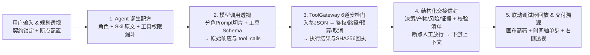
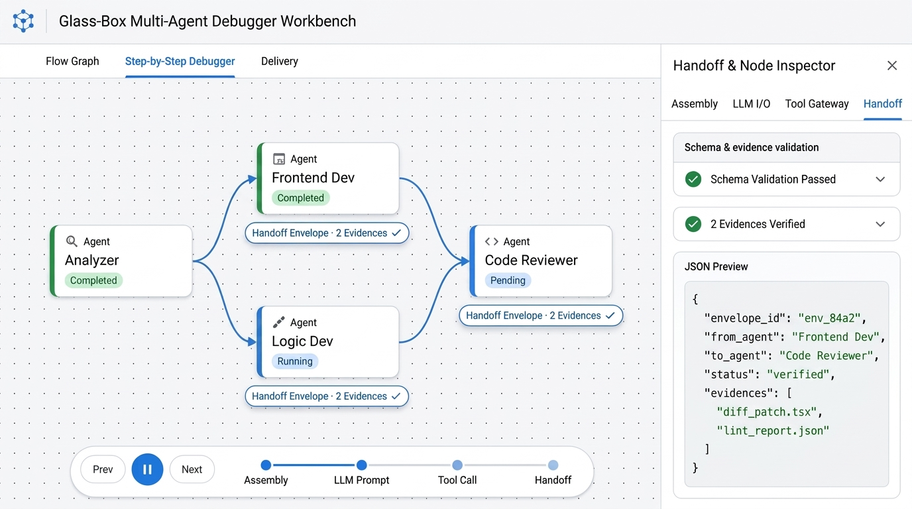
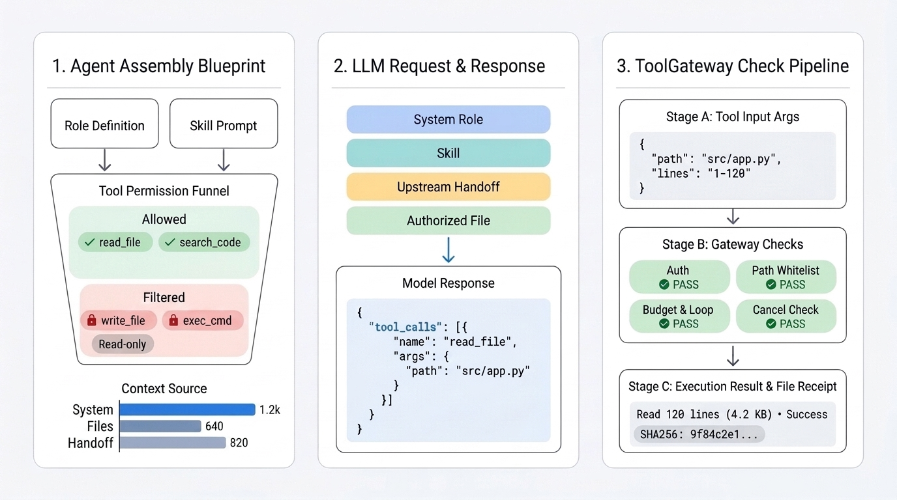
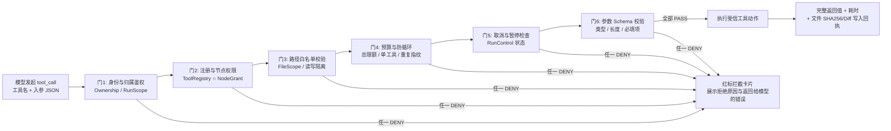

# Agent Studio「玻璃盒」多 Agent 全链路透明可视化与框架收敛概要设计

> **文档状态**：概要设计（v2.0，已合并多 Agent 核心框架修正与端到端 8 阶段全链路透明规范）
> **核心定位**：面向开发者与 AI Agent 学习者的**“玻璃盒（Glass-Box）”开源多 Agent 调试与教学工作台**。
> 不仅把每一步内部数据透明展示给用户，同时修正多 Agent 编排框架自身的双轨割裂、自由文本交接和缺乏断点调控等问题，确保展示给学习者的是**架构规范、边界清晰、可单步调控的真实多 Agent 系统**。

---

## 一、设计原则

1. **真实证据优先，绝不伪造**：页面展示的每一项鉴权结果、Prompt 片段、工具入参/出参、交接载荷均来自后端真实持久化记录，而非模型事后总结。
2. **全链路零黑盒（含失败与拦截）**：不仅展示“做成了什么”，更展示 **规划推理依据、被裁剪的工具及原因、ToolGateway 6 道安检门为何放行或拒绝、交接包为何通过或阻塞**。
3. **可调控的交互式学习**：用户不仅能事后回放，还能在运行前或运行中给任意节点/交接连线设置**断点（Breakpoint）**，停下来亲自检查每一处交接后再手动放行。
4. **教学友好、零门槛可体验**：内置免 API Key 教学剧本，开源访客启动后 1 分钟内即可单步解剖完整多 Agent 协作过程。

---

## 二、端到端 8 阶段全链路透明展示矩阵（从用户输入到最终输出）

确保从用户输入第一句话到最终拿到交付产物，中间每一个数据交接与转换环节都有清晰的 UI 透视：

| 阶段 | 数据流转（从谁 → 到谁） | 必须展示的核心内容 | 对应 UI 载体 |
| --- | --- | --- | --- |
| **1. 输入与想法整理** | 原始输入 → 结构化任务（目标/约束/交付物/验收） | 整理前后对照、采用的整理方式（本地规则 vs LLM）与耗时 | 任务整理弹窗对比区 |
| **2. 路由与候选规划** | 任务输入 → 路由模板 + 候选 DAG 图 | **规划器自身的 Prompt、原始回复与校验自修复记录**；每个节点的读写集、绑定模型与选择理由 | 候选计划确认弹窗（可展开规划透视） |
| **3. 契约锁定** | 用户确认 → 冻结 `WorkflowPlan` + 授权 + 价格 | 集中展示本次运行锁定的不可变契约（授权文件清单、各模型冻结单价、节点读写集、执行模式与断点） | 运行页顶部「运行契约卡」 |
| **4. Agent 诞生装配** | `PlanNode` + 定义/Skill/工具 → `AgentAssemblySnapshot` | 角色定义与固定版本、Skill 原文展开、**工具权限漏斗（放行工具 vs 被裁剪工具及原因）**、上下文来源占比条 | 抽屉 Tab 1：`Assembly（装配）` |
| **5. 模型调用透视** | `AgentContextAssembler` → `ControlledModel` → LLM | **请求侧**：按来源分色展示完整 `Messages` 切片 + 注入的 `Tools JSON Schema`；**响应侧**：原始文本 + `tool_calls` 决策 + Token/耗时/费用 | 抽屉 Tab 2：`LLM I/O（模型透视）` |
| **6. 工具网关安检** | 模型 `tool_call` → `ToolGateway` 6 道安检 → 工具执行 | **入参 JSON → 6 道安检门逐项 PASS/DENY 依据 → 完整返回值 + 文件 SHA256/Diff 写入回执** | 抽屉 Tab 3：`Tool Gateway（工具安检）` |
| **7. 多 Agent 交接** | 上游节点 + 证据 → `HandoffValidator` → 下游节点 | **结构化交接信封**（结论、已做决策、产物清单、遗留风险、工具回执）+ 校验清单 + 下游 Prompt 注入定位 | 连线徽章 + 抽屉 Tab 4：`Handoff（交接）` |
| **8. 结算与最终交付** | 节点产物 + 写入回执 + 审查 → 最终用户 | 交付说明、文件预览/下载、Git 审批步骤条，支持从任意交付文件一键溯源至“产出节点 → 写入工具回执 → 审查结论” | 「交付说明」与 HTML 报告 |

---

## 三、全局可视化蓝图与 UI 概念原型

### 3.1 全链路“玻璃盒”信息流

### 3.2 玻璃盒多 Agent 调试器主视图（UI 概念原型）

主界面延续 **Google Material Design 3 浅色高密度工作台风格**，由三大联动区域构成：
- **左/中画布区（DAG 流程图）**：展示节点卡片（角色、状态色条、耗时、模型标签、断点标记）；连线上直接挂载可点击的 **交接信封徽章**（如 `Handoff Envelope · 2 Evidences ✓` 或 `Blocked · Missing Output`）。
- **底部单步调试时间轴（Step-by-Step Debugger）**：支持 `上一步 / 播放暂停 / 下一步` 及事件类型筛选；点击任意时间步时，上方画布自动高亮对应节点或交接连线，右侧抽屉同步切换至该步透视面板。
- **右侧透视抽屉（Node & Handoff Inspector）**：固定 4 个标签页——`Assembly`、`LLM I/O`、`Tool Gateway`、`Handoff`。

---

## 四、四大核心透视面板与 ToolGateway 6 道安检链路

### 4.1 Agent 诞生配方（Assembly Blueprint）
- **身份与版本**：内置/私有来源及固定版本号（如 `v1`）、角色定义、绑定模型与冻结价格版本。
- **Skill 注入原文**：可展开查看每个已挂载 Skill 实际拼入 System Prompt 的 Markdown 原文，明确区分“文本指导”与“执行权限”。
- **工具权限漏斗**：直观对比「已放行工具（绿标）」与「被裁剪工具（红锁 + 裁剪原因）」（如：`WORKSPACE_WRITE` 因当前为只读分析节点被移除）。
- **上下文来源占比**：可视化展示本次装配的上下文中「用户目标 / 上游交接 / 项目记忆 / 检查证据」各自贡献的字符数与占比。

### 4.2 模型调用透视（LLM Request & Response Inspector）
- **请求侧**：按来源分色展示发送给模型的完整 `Messages` 切片（System Role / Skill / 上游交接 / 授权文件 / 历史工具返回），以及可折叠的 `Tools JSON Schema`。
- **响应侧**：原样展示模型输出文本与结构化 `tool_calls` 决策块（工具名 + 参数 JSON），配合 Token、耗时与预留/结算费用。

### 4.3 ToolGateway 工具门户 6 道安检链路
每次工具调用完整展示 **「入参 JSON → 6 道安检门 → 执行结果与回执」** 三段式流水线：

每道关卡以状态胶囊（`PASS` 绿标 / `DENY` 红标 / `SKIP` 灰标）展示，点击可展开具体依据（例如命中白名单路径、当前重复指纹计数 `1/3`、或越权拒绝理由）。

### 4.4 多 Agent 结构化交接信封（Handoff Envelope）
1. **流向与实例追溯**：`发送节点 (实例 # / 尝试 #) → 接收节点 (实例 # / 尝试 #)`。
2. **结构化交接载荷**：拆分为「核心结论 `summary`」「已做决策 `decisions[]`」「产出文件/产物 `artifacts[]`」「未解决风险与待确认 `openRisks[]`」，并保留原始完整正文可展开。
3. **附带真实证据**：关联工具调用与文件写入回执（SHA256），点击直达对应 ToolGateway 记录。
4. **交接校验清单**：逐项展示 `HandoffValidator` 判定（✅ 直接上游匹配 / ✅ 终态合法 / ✅ 必需产物落盘且摘要一致）。
5. **下游消费定位**：标注该信封被注入到了下游节点 LLM 请求的哪一段上下文。

---

## 五、多 Agent 核心框架同步修正（保证底层架构与展示同样规范）

在补齐可视化透视的同时，对底层多 Agent 框架同步进行 **3 项结构收敛**，消除历史包袱：

1. **收敛双轨执行器 + 升级结构化 `WorkflowHandoff`**
   - 现状问题：老引擎（`DirectRunExecutor` / `RunHandoffFactory`，用于 Bug 与记忆流程）与新 DAG 引擎（`WorkflowScheduler` / `WorkflowHandoff`）并存；且新版 `WorkflowHandoff` 退化为纯文本 `sourceResult`，缺少结构化字段。
   - 修正方案：扩展 `WorkflowHandoff` 携带结构化载荷（`summary`、`decisions`、`artifacts`、`openRisks`、`writeReceipts`），并逐步将 Bug 闭环与项目记忆流程收口至统一 DAG 引擎，使全系统只有一套规范的编排与交接范式。
2. **支持「DAG 并发执行」与「单步教学串行」双模式**
   - 现状问题：`WorkflowScheduler` 当前用 `while (true)` 每次只认领 1 个节点，与画布上的分叉并行结构视觉不符。
   - 修正方案：在写集互斥校验通过的前提下，支持并发认领所有无依赖就绪节点（复用 Spring `workflowRunExecutor` 并发池）；同时保留「单步教学模式」开关并在页面顶部明确标注当前执行模式。
3. **引入节点与交接断点（Breakpoint）人工调控**
   - 现状问题：运行中途无法在指定交接点精确停下检查。
   - 修正方案：允许用户在流程图上为任意节点或交接连线设置断点。`WorkflowScheduler` 在认领该节点前检测到断点时自动进入 `PAUSED`（原因为 `BREAKPOINT`），待用户在抽屉中审阅完上游产出、交接信封与即将拼装的下游上下文后，手动点击「放行下一步」（支持附带一条人工补充说明）继续执行。

---

## 六、后端数据采集（Flyway `V4`）与安全脱敏

| 表 / 实体 | 新增字段 | 用途 |
| --- | --- | --- |
| `model_call_payloads`（新表，与 `model_calls` 1:1） | `request_messages_json (CLOB)`、`request_tools_json (CLOB)`、`response_content (CLOB)`、`response_tool_calls_json (CLOB)`、`truncated (BOOLEAN)` | 持久化模型调用完整请求切片与原始响应，避免拖慢列表查询 |
| `tool_invocations`（扩展） | `input_args_json (CLOB)`、`gateway_checks_json (CLOB)`、`full_result (CLOB)`、`result_truncated (BOOLEAN)` | 记录工具入参、ToolGateway 6 道安检门逐项判定结果与完整出参 |
| `workflow_handoffs`（扩展） | `structured_payload_json (CLOB)`、`validation_checks_json (CLOB)` | 持久化结构化交接信封与 `HandoffValidator` 逐项校验明细 |
| `workflow_plans`（扩展） | `execution_mode (VARCHAR)`、`breakpoints_json (CLOB)` | 记录运行模式（`PARALLEL` / `STEP_TEACHING`）与节点/连线断点配置 |
| `agent_assemblies`（扩展 JSON） | `filteredTools[]`、`contextSegments[]`、`skillContents[]` | 补充被裁剪工具及原因、上下文来源切片与 Skill 原文 |

**安全与体积底线**：所有透视载荷落库前统一经 `SensitiveDataMasker` 自动脱敏（API Key / Bearer Token / Cookie / 密码模式掩码）；单条超过 64 KB 自动截断并标记 `truncated = true`。

---

## 七、开源零门槛教学剧本（免 API Key 一键体验）

首页提供「教学演示剧本」一键入口（基于确定性模拟模型，无需任何 API Key）：
1. **剧本一：多开发分工与汇合审查** —— 演示分析 → 双开发分工 → 独立审查的结构化交接信封与文件写入回执。
2. **剧本二：越权操作与防循环拦截** —— 故意触发只读节点写文件或重复搜索，演示 ToolGateway 6 道安检门的红标拦截卡片。
3. **剧本三：缺失产物阻塞与断点调控** —— 演示在交接连线打断点人工放行，以及 `OUTPUT_MISSING` 阻断下游审查与检查点恢复。

---

## 八、分阶段实施路线

- **Phase 0（框架收敛与断点机制）**：升级结构化 `WorkflowHandoff`，在 `WorkflowScheduler` 增加 `PARALLEL` / `STEP_TEACHING` 模式与节点断点暂停/放行能力；规划旧引擎向统一 DAG 收口路径。
- **Phase 1（后端透视数据层）**：新增 Flyway `V4__glassbox_trace_payloads.sql`，在 `ControlledModel`、`ToolGateway`、`AgentAssemblyPlanner`、`PlanCandidateGenerationService` 中采集脱敏快照，并在 `ExecutionNodeDetailProjector` 中向后兼容透出。
- **Phase 2（前端玻璃盒透视与联动调试器）**：将 `NodeInspector` 拆分为 4 个清晰子面板（`Assembly` / `LLM I/O` / `Tool Gateway` / `Handoff`），画布连线增加交接信封与断点控制，升级「画布 + 底部单步时间轴 + 右侧抽屉」三方联动。
- **Phase 3（开源教学剧本与发布准备）**：内置 3 个免 Key 教学剧本，补充 README 演示动图与架构导读。
