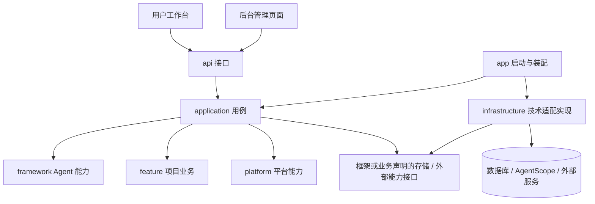

# 项目代码组织与 Agent 框架目录设计

> 现状补充：本文的旧目录位置及构建方式是迁移前基线。生产源码已经统一迁入 `backend/src/main/java`，旧说明已归档，具体进度见 [后端源码说明](../../backend/README.md) 和 [概要设计实现状态](../开发记录/概要设计实现状态.md)；能力拆分仍在进行。

> 状态：目标结构设计，2026-11-17。本文件描述代码目前在哪里、为什么不易阅读，以及之后准备如何调整；**并不表示目录重构或新能力已经完成**。
>
> 适用范围：当前单体 Java 后端及后续多个前端应用。重点是 Agent 框架代码如何在一个源码根目录下按职责组织。本次仅设计，不移动代码、不改变行为。
>
> 配套设计：[动态 Agent 与可组合工作流重构概要设计](动态Agent与可组合工作流_重构概要设计.md)。具体的状态、交接、计划、权限与恢复等设计以该文档为准。
>
> 本结构调整已纳入本次动态 Agent 重构，不单独作为远期任务；一体化实施顺序与验收以配套设计第 16 章为准。本文件保留具体目录说明和迁移映射。

## 1. 想解决的问题

项目将来可能同时有用户工作台、平台管理后台等多个界面，但它们共同使用后端提供的能力。用户希望学习 Agent 内部实现时，打开后端的一个 `src`，就能按照能力找到 Agent、记忆、工具、工作流和控制等内容；每个能力内部再放接口、实现和必要的领域类型。

本方案采用：**一个仓库、多个独立前端应用、一个后端源码根目录；后端内部按能力分包，框架能力和项目业务分开。** 这并不排斥未来拆成多个 Maven 模块，但目前先不为了目录整齐引入额外构建模块或大量空接口。

## 2. 当前实际结构

### 2.1 仓库与构建

```text
agent-dev-workbench/
├── pom.xml                         当前唯一的 Maven 工程
├── backend/
│   ├── src/main/java/              应用入口、公共领域类型
│   ├── src/main/resources/         配置与数据库结构
│   ├── src/test/java/              后端测试
│   ├── modules/<功能>/src/main/java/
│   │                               多个额外的后端源码根目录
│   ├── app/                        当前主要是说明文件
│   └── tests/                      当前主要是说明文件
├── frontend/
│   ├── user-workbench/             已有用户工作台，React + Vite
│   └── admin-console/              目前只有规划说明，尚未实现
├── config/、data/、docs/、infra/    配置、运行数据、文档与基础设施资料
└── examples/                       示例资料
```

根目录的 `pom.xml` 通过 `build-helper-maven-plugin` 把 `backend/modules` 中的 12 个源码路径加入同一个编译过程。它们**不是 12 个独立 Maven 子模块**：没有各自的 `pom.xml` 和由 Maven 强制的模块依赖边界。目录上分开，不等于编译层面已经解耦。

### 2.2 当前具体问题

1. **源码根目录太分散**：找一个能力要在 `backend/src` 和多个 `backend/modules/*/src` 之间切换；增加目录还要修改根 `pom.xml`。
2. **同一能力横跨目录**：模型提供者和多种工具实现放在 `modules/agent`，部分工具契约放在 `modules/tool`；上下文放在 `modules/orchestration/context`；Checkpoint 领域类型又在 `backend/src/.../domain`。
3. **目录名和真实职责不完全一致**：`modules/model`、`modules/checkpoint`、`modules/event` 当前只有说明而没有 Java 源码，不能把这些目录误认为能力已独立实现；实际相关代码分散在其他包中。
4. **类的职责仍然过宽**：例如 `RunService` 协调多种固定步骤，`RunRepository` 承担较多运行数据操作；只是把文件移动到另一个目录不会消除它们的耦合。
5. **框架、项目业务与入口混在一起**：一些 Controller 与能力实现同包；工作区、Bug、报告是项目业务，Agent 运行时、记忆和控制更接近框架能力，阅读时不容易区分。
6. **角色与数据仍有实际耦合**：如 `AgentAssemblyPlanner` 当前仍根据固定 `AgentRole` 和 `ToolKind` 计算装配；目录整理不能自动使动态 Agent 和开放能力注册生效。

这些问题是对代码组织和边界的判断，不代表现有功能都不能运行；历史测试、状态及交接能力仍需保留。

## 3. 目标：项目顶层结构

```text
agent-dev-workbench/
├── pom.xml                         单个后端构建入口
├── backend/
│   └── src/
│       ├── main/
│       │   ├── java/dev/workbench/  后端唯一的 Java 生产源码根
│       │   └── resources/           配置、迁移脚本、静态资源配置
│       └── test/
│           ├── java/dev/workbench/  对应生产代码的测试
│           └── resources/           测试专用资源
├── frontend/
│   ├── user-workbench/             用户工作台，独立 src、构建和测试
│   ├── admin-console/              后续平台管理后台，独立 src、构建和测试
│   └── shared/                     确有复用需求时再建设；目前不要求创建
├── docs/                            设计、学习资料、规范和开发记录
├── config/                          本地配置与密钥文件，遵守忽略规则
├── data/                            本地运行数据，不作为源码提交
├── infra/                           本地容器、部署和监控配置
└── examples/                        示例与演示资料
```

这里的“一个 `src`”针对 **Java 后端**：前端是独立应用，有自己的语言、依赖和构建流程，所以每个前端仍有各自的 `src`。这样既符合后端能力集中阅读，也能容纳多个页面应用。除用户工作台和管理后台外，目前没有确认第三个前端应用，不提前虚构。后端生成的 HTML 报告是输出产物，不自动等于第三个前端工程。

## 4. 后端源码：从一个入口找到全部能力

以下是**目标包结构**，用英文包名、中文解释；带“规划”的目录或类不代表当前已有实现。目录按实际需要逐步创建，不一次性铺满空文件。

```text
backend/src/main/java/dev/workbench/
├── app/                            启动、依赖装配、全局配置和异常处理
├── api/                            HTTP 入口与请求/响应转换
│   ├── user/                       用户工作台接口
│   └── admin/                      后台接口；后续按权限与需求实现
├── application/                    项目用例：接收任务、启动/查看/控制运行
├── framework/                      Agent 框架能力，本文重点
│   ├── agent/                      定义、装配、实例和执行接口
│   ├── workflow/                   模板、计划、节点、依赖与调度
│   ├── handoff/                    多 Agent 交接及校验
│   ├── model/                      模型提供者与调用契约
│   ├── context/                    上下文来源、筛选、装配
│   ├── memory/                     会话记忆、长期记忆、压缩策略
│   ├── tool/                       工具契约、注册、权限网关
│   ├── skill/                      Skill 定义与装配
│   ├── control/                    预算、取消、超时、重试等
│   ├── checkpoint/                 检查点、校验与恢复
│   ├── event/                      运行事件与审计契约
│   ├── observability/              指标、链路与观测接口
│   └── evaluation/                 Agent 评测契约与执行
├── feature/                        本项目的业务能力
│   ├── task/                       任务入口、任务生命周期
│   ├── workspace/                  仓库/工作区、授权范围
│   ├── bug/                        Bug 任务和证据
│   └── report/                     报告生成
├── platform/                       后续平台能力：身份、租户、管理
└── infrastructure/                 数据库、外部系统、框架适配等技术实现
```

`framework` 表示本项目中的 Agent 能力层，不是另写一套取代 AgentScope 的推理框架。继续复用 AgentScope；由项目负责装配、业务编排、权限、记录和控制。`feature`、`platform`、`infrastructure` 使用同一个后端进程和同一个源码根，不意味着立即拆分成独立服务。

### 4.1 各区域的职责与依赖



- `api` 负责协议校验、身份上下文和 DTO 转换；业务规则不堆在 Controller。
- `application` 负责把一次用例串起来，调用计划、执行和业务能力；不直接写各类数据库查询。
- `framework` 内部按能力拆分，稳定契约表达输入、输出和限制；不依赖具体页面或 Controller。
- `feature` 处理本项目具体问题，如工作区和 Bug；不让所有框架组件依赖具体的 Bug 类型。
- `platform` 为后续身份和租户能力预留边界；没有实现鉴权隔离之前不能声称已支持多租户。
- `infrastructure` 实现需要访问数据库、AgentScope 或外部资源的适配；由应用启动时装配到所需接口。不是每个普通类都需要人为增加接口。

同一个 Maven 工程中的包边界不能自动阻止反向依赖；重构后需靠代码评审或架构检查维持。实际迁移可能先保留旧依赖，再逐步抽出接口，不要求一次同时改完。

## 5. Agent 框架内部如何拆分

### 5.1 Agent：定义、装配、实例和执行

```text
framework/agent/
├── definition/                     Agent 定义、能力引用、版本
├── assembly/                       解析定义、检查兼容、组装组件
├── instance/                       实例身份、生命周期与装配快照
└── execution/                      执行请求、结果和执行接口
```

Agent 定义描述职责、模型策略、上下文来源、记忆配置、Skill 与工具引用列表。装配器读取定义和节点上下文，检查组件存在、版本兼容、授权和预算，再创建实例。实例表示一次实际执行，不能因为使用同一份定义就默认共享上下文。具体 AgentScope 对象及其适配器放在 `infrastructure/agentscope/`，由装配根连接；保留对版本特有 API 的隔离。

如一个 Agent 不需要长期记忆或工具，可不装配这些可选能力；工具列表、记忆策略和模型不作为 Agent 子类里写死的字段组合。定义声明了能力也不等于已获授权。

### 5.2 工作流与多 Agent 交接

```text
framework/workflow/
├── template/                       模板及其版本
├── plan/                           计划、节点、依赖、图校验
├── scheduler/                      顺序调度、就绪判断和执行分派
└── execution/                      节点尝试、状态与结果

framework/handoff/
├── contract/                       交接内容、证据引用、版本
├── validation/                     身份、依赖、授权、证据检查
└── service/                        交接保存和接收的业务规则
```

任务先形成并保存计划，调度器按依赖选择节点。只有 Agent 类型的节点创建 Agent 实例；检查、用户决策或系统动作节点由各自的执行方式处理。交接按发送／接收节点、实例、目标、证据和未验证项记录；并非将所有 Agent 的内部会话直接混在一起。首期的顺序执行及兼容旧交接的范围见配套重构设计。

### 5.3 记忆：通用契约和多种压缩方案

```text
framework/memory/
├── contract/                       记忆记录、来源、作用域与访问契约
├── session/                        短期会话记忆的使用边界
├── longterm/                       长期记忆的读取/写入与治理规则
└── compression/
    ├── MemoryCompressionStrategy  压缩策略契约，规划
    ├── CompressionRequest          输入和预算，规划
    ├── CompressionResult           内容、来源及丢失信息，规划
    └── strategies/                 各种独立的压缩策略实现，按需增加
```

压缩是一种内部策略，不一定是直接暴露给大模型调用的 Tool。可以把每个压缩方案做成单独的策略类，统一实现同一契约，由配置／装配器选择；只有确实需要模型主动调用时，才另外设计一个受控工具包装。无论选择什么策略，都需要保留必要约束、证据来源与不确定信息，并规定失败或信息过长时怎么办。

首期当前代码中主要是用户确认的工作区背景记忆，并不等于已经实现自动长期记忆、会话压缩或多种压缩策略；这些类名是规划，不能以创建空类充当完成。

### 5.4 工具：每个工具独立、统一接入

```text
framework/tool/
├── contract/                       工具标识、输入输出、元数据、结果契约
├── registry/                       工具注册和查找
├── gateway/                        权限、次数、超时、记录和统一调用
└── provider/                       受信工具提供者的扩展接口

feature/workspace/ 或 infrastructure/...
└── 每个实际工具独立类               根据业务与依赖归属放置
```

一个可供 Agent 调用的具体工具是独立类；它声明输入、输出、风险及能力，再由工具列表引用。统一网关负责校验、控制与记录，不能让工具直接绕过权限。不同具体工具可根据职责属于项目业务或基础设施适配，`framework/tool` 保存通用契约，而不是把所有具体工具塞进 Agent 类。**本轮只规划扩展接口，不新增 Git、测试等具体工具。**

### 5.5 其他能力放在哪里

- `model`：模型选择策略、调用契约与用量；DeepSeek、模拟模型等适配可放 `infrastructure/model`，具体迁移按依赖确定。
- `context`：收集任务、交接和经授权的记忆，限制大小并保留来源；不等同于长期记忆数据库。
- `control`：总预算、节点预算、轮次、工具调用次数、取消、超时等；具体持久化由外部适配实现。
- `checkpoint`：内部快照契约、支持恢复的边界和校验；与 Git 工作区状态有明确关联但不是同一种状态。
- `event`、`observability`：记录真实事件和指标；用户运行轨迹与平台聚合监控使用不同视图和权限。
- `evaluation`：评测案例、执行、断言与结果；项目特有的 Bug 证据判断按职责留在相应业务或评测适配中。
- `skill`：指导性能力及版本；Skill 不能替代工具权限、安全控制和真正执行。

## 6. 当前代码到目标结构的映射

| 现有位置或类 | 目标归属 | 迁移时注意 |
| --- | --- | --- |
| `backend/src/.../app/WorkbenchApplication` 等 | `app/` | 保持 Spring Boot 扫描根和启动入口兼容。 |
| `backend/src/.../domain/` | 按归属迁到 `framework`、`feature` 等各能力包 | 不继续形成无限增长的公共领域包；枚举持久化编码和 API 字段要保持兼容。 |
| `modules/agent/AgentAssemblyPlanner`、`AgentExecutionRequest`、`AgentExecutor` | `framework/agent/assembly`、`execution` | 当前装配依赖固定角色，需要配合动态 Agent 设计改造。 |
| `modules/agent/AgentScopeExecutor` | `infrastructure/agentscope`，实现框架执行接口 | 保留受控模型、工具、状态和取消边界；先验证对上游 API 的依赖。 |
| `modules/agent/AgentModelProvider`、`AgentModelRegistry`、`DeepSeekModelFactory`、`DemoModel` | 模型契约归 `framework/model`，供应商／模拟实现归 `infrastructure/model` | 拆分真实与模拟；不在文档或测试输出中暴露密钥。 |
| `modules/agent/ToolGateway`、`AgentToolProvider`、`AgentToolRegistry`，以及 `modules/tool/ToolResult` 等 | `framework/tool`；具体工具根据职责放到 `feature` 或 `infrastructure` | 先统一契约和执行路径；旧工具及授权行为不能丢失。 |
| `modules/orchestration/plan/*`、`WorkflowGraph` | `framework/workflow/plan` | 图校验和就绪判断可复用；当前图类本身不负责完整调度。 |
| `modules/orchestration/RunService` | 按职责拆到 `application`、`framework/workflow` 等 | 不是原样移动后继续作为大类；需逐项保留事务、状态、取消与恢复行为。 |
| `orchestration/Handoff`、`task/HandoffValidator` | `framework/handoff` | 旧 Schema 与证据字段保持可读；动态节点交接需要版本化扩展。 |
| `orchestration/context/*` | `framework/context` | 维持来源顺序、权限与装配记录。 |
| `modules/memory/MemoryService` 等 | 记忆契约和规则归 `framework/memory`，数据库实现归 `infrastructure/persistence`，工作区授权由业务边界提供 | 当前类同时接触数据库和工作区，不能只改包名；保持已有数据和权限规则。 |
| `modules/task/RunRepository` | 按运行、计划、交接、检查点等职责逐步拆分至各自存储接口与 `infrastructure/persistence` | 保持事务边界；分仓储并不允许跨事务产生半完成状态。 |
| `modules/control`、`skill`、`evaluation`、`observability` | `framework` 下相应能力；数据库和供应商实现放 `infrastructure` | 根据已有实现迁移，标记尚未实现的能力。 |
| `modules/workspace`、`bug`、`report` | `feature` 下相应业务；Controller 迁入 `api` | 保留外部接口与现有业务能力；框架不依赖具体页面。 |

映射表描述的是责任归属，类可能需要拆分、重命名或暂时保留适配层，不要求一次逐文件原样搬迁。`backend/modules` 的 README 等说明需要在最终确认内容迁移后再决定保留或归档，不能未经核对直接删除。

## 7. 前端应用和后端如何配合

用户工作台关注任务计划、执行节点、Agent 调用、交接、产物和用户决策。管理后台后续关注系统健康、资源与 Token 消耗、告警、评测和可授权的运维操作。两者可以调用同一后端中不同的 API，但接口、身份和权限边界应分别设计；当前管理后台只有占位文档。

两个前端各自可按 `src/features/<功能>` 组织组件、页面和接口调用；确有重复组件与类型后，再考虑 `frontend/shared`，并明确版本和依赖，避免为了共享而创建空工程。本设计不处理前端视觉重做。

## 8. 目录规则和代码风格

1. 按业务能力找代码；一个类只负责一个明确职责，不用一个“大 Agent 类”容纳模型、记忆、工具和持久化。
2. 接口只用于确有多实现、外部依赖隔离或明确替换需求的地方；一个策略一个类，不为每个普通方法额外创造接口。
3. 目录按真实复杂度再拆 `contract`、`service`、`strategy` 等；小能力可先保持少量文件，不做无意义深层嵌套。
4. 面向框架稳定状态使用枚举与明确领域类型；可扩展的工具、定义、模板 ID 采用受校验的开放标识，不强迫所有值变成封闭枚举。
5. 类、接口、公开方法以及复杂约束采用准确的中文注释；排版遵守项目已有 Google Java Format 规范。测试目录与生产包结构对应。
6. 同一个能力的权威状态及写入入口要清晰；模块间不能互相直接修改对方内部状态，不能用目录名掩盖数据依赖。
7. 未实现的设计放在文档；不批量创建空目录、空接口或空类来制造完成感。

## 9. 建议迁移顺序和检查

本节说明本次动态 Agent 重构中结构迁移的具体方法，不在本文编写时执行。批次与完成条件见配套设计第 16 章。当前工作区已有未提交改动，动手前需先确认并保留现状，不覆盖或清理它们。

1. **建立迁移清单**：清点源码根、当前 Spring 组件、资源、前端静态文件、测试和现有行为；建立可恢复基线。按功能小批次迁移，保留数据库与用户配置。
2. **统一源码根**：确定目标包名后逐批移动源文件并调整 package/import、包可见性、Spring 扫描、组件注入、测试及文档；移完某个目录后再更新根 `pom.xml` 的 `build-helper` 配置。核查配置中引用的类名、序列化格式及持久化枚举值，不因重命名包而破坏历史数据或外部接口。最终只保留 `backend/src/main/java` 作为后端生产 Java 源码根；不可在源码尚未迁完时提前移除旧根。
3. **厘清模块边界**：优先从模型、工具、上下文及交接入手；提取真实需要的契约，拆分混合持久化与业务逻辑的大类，并维持原事务边界。
4. **配合动态 Agent 改造**：把固定阶段编排逐步迁移到计划、节点、装配与调度；每一步保留旧运行与历史数据读取，避免仅改目录就声称动态工作流完成。
5. **集中验收**：按迭代集中进行编译、现有测试、Spring 启动和用户工作台构建检查；覆盖交接、权限、检查点、数据库迁移及同定义多节点等关键回归。检查页面和原有 API 兼容；不需要在每移动一个小文件后做全量回归。

目录迁移和能力重构可分批，但每一批都要明确是否改变行为，记录变更和结果。不能直接覆盖用户密钥、数据库、本地文件或未提交工作；数据迁移和兼容失败要停止推进并保留可恢复状态。

## 10. 达到什么程度才算结构整理完成

- 后端生产 Java 代码统一从 `backend/src/main/java` 构建；不再依赖多个散落的功能源码根。
- 开发者能从 `framework` 找到 Agent、工作流、记忆、工具、交接、控制和评测等能力；项目业务和后台接口有清晰归属。
- 工具和记忆策略可按契约组合，未实现的策略仍明确标为规划；工具授权与预算不能因迁移失效。
- 测试、资源、构建、启动、现有接口、历史记录与支持的恢复路径经过适当回归；结果如实记录。
- 动态 Agent 的完成与否由配套设计的功能验收决定，不能仅凭目录整理来判断。
