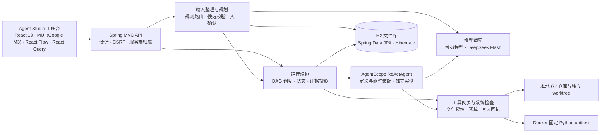
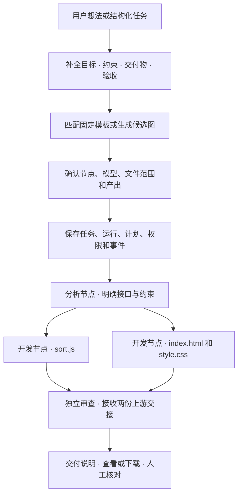

# Agent Studio 项目总览

> 产品需求与技术架构总结。已同步至 2026-11-21 前后端架构重构后的最新实现基线（ArchUnit 零循环依赖、Flyway 迁移、MUI Google M3 工作台、按调用模型计价）。本文供使用者、维护者和接手开发的 Agent 阅读。

## 1. 项目目的

Agent Studio 是一个**面向个人开发者的本地代码开发 Agent 工作台**，也是一个用于观察多 Agent 协作的学习项目。它把需求整理、计划拆解、节点执行、成果交接、审查和 Git 交付连成一条可操作、可追溯的流程。用户给出一个想法或任务，在实际执行前确认工作范围，可以在执行中看到每个 Agent 做了什么，结束后能找到产物并核对证据。

项目有三个产品目标。

| 产品目标 | 用户能看到或做到什么 |
| --- | --- |
| 理解 Agent 怎么协作 | 从同一张流程图查看计划、依赖、当前节点、实际装配和每次尝试。展开交接可读正文，并追溯来源、接收者、工具调用和检查证据。 |
| 掌控 Agent 可以做什么 | 选择任务入口、模型、Agent 和工作区，授予文件范围。确认计划、暂停或取消运行，决定是否接受产物和执行 Git 交付。 |
| 拿到可核对的产物 | 在「交付说明」定位文档、代码、测试观察和文件下载。每份文件可追到产出节点、写入回执和摘要，缺失、失效、未验证项目有明确说明。 |

**成功的使用结果**是用户能回答「为什么安排这几个节点」「每一步拿到了什么、交出了什么」「文件在哪里」「哪些检查实际执行了」「现在需要我做哪项决定」。有证据支持的完成、需要补充、等待人工核对和失败都应有可理解的结果。

## 2. 用户与使用场景

| 用户 | 典型工作 |
| --- | --- |
| 个人开发者或学习者 | 输入一句话想法、确认计划、观察节点，从交付说明拿到可检查的代码或文档。可以创建自己的 Skill、工具配置和 Agent。 |
| 本地管理员 | 初始化账号，按需领取旧 `LOCAL` 历史，添加普通用户，授予或撤销仓库导入资格，使用评测、监控与审计功能。 |
| 维护者或接手开发的 Agent | 用固定样本和模拟模型重跑关键流程，核对接口、持久化记录、权限边界和交付证据，再扩展模型、工具、模板或调度能力。 |

用户常走三条路径。

1. **从想法到新产物**。把「做一个能单步演示冒泡排序的页面」整理成可编辑的任务输入，写明交付文件与验收条件。生成候选计划，观察两个开发节点各自的文件范围与汇合审查。确认后可准备独立工作区，最终从「交付说明」下载并打开网页文件。
2. **在已有仓库工作**。导入已获授权的可信本地仓库，以独立 Git worktree 运行。选择只读分析或显式授权修改，观察文件读取、工具调用与变更，按需人工审批、本地提交，或单独准备与批准推送、合并。
3. **把自己的 Agent 用到计划里**。创建并发布 Skill 与只读工具配置，手动装配或从思路生成 Agent 草稿。发布 Agent 后，可指定已发布的 Agent 或把已选 Agent 交给规划器推荐。系统在规划时固定精确版本。确认前查看选中理由、版本与模型策略，执行后查看装配快照和交接。

模拟 Bug 是另一条可复核的教学路径。固定容器先跑复现并核对目标测试现象，再进入分析、授权修改、回归和审查。缺少测试的合格场景可提交补充后从安全边界继续。回归通过后保留用户核对环节。 [模拟 Bug 分诊与交付](交接/任务3_分诊与交付_交付记录_2026-11-19.md)

## 3. PRD 范围与产品规则

| 功能 | 当前用户能力 | 关键边界 |
| --- | --- | --- |
| 输入与路由 | 支持通用、需求、设计、代码、测试和模拟 Bug 入口。想法可由本地规则或模型整理为目标、约束、交付物、验收条件与待确认问题。规则路由可解释所选模板。 | 需求、设计以文档分析结果为主。普通测试入口支持授权读取和证据核对，实际运行测试的能力目前由模拟 Bug 专用流程验证。 |
| 计划与确认 | 固定模板可直接使用。代码任务可先生成候选草稿，查看依赖、节点读写集、预期产物及实际模型策略。待确认的模板计划另有节点预算、依赖变更入口。 | 候选生成独立于执行。无执行节点、写入授权或代码修改，直到用户确认并创建运行。新版候选使旧版过期。已创建的运行使用固定计划。 |
| 观察与控制 | 「观察流程」「逐步回放」「交付说明」「列表视图」可互相切换。节点、连线、调用、交接、检查和阻塞可下钻。可用确认、暂停、继续、取消、补充或恢复操作由服务端返回。 | 步骤回放依据持久化事件与证据。页面展示可核对的输入、输出、业务判定和工具结果，不提供模型隐藏推理。 |
| 文件与 Git 交付 | 授权文件可读、可搜索，显式授权后可修改。用户可审查差异和未跟踪文件、批准本地提交，或准备、批准和执行推送或合并。 | 交付内容读取时复核当前授权与文件摘要。审批绑定代码版本和操作目标，冲突与未知结果保留待核对状态。 |
| 账号与组件 | 创建本地用户，管理私有 Agent、Markdown Skill 与工具配置。支持草稿、发布、版本历史和归档，可从思路生成可编辑的 Agent 草稿。 | 首批私有工具是受信只读读取或搜索执行器的配置，可按扩展名收窄。首批私有 Agent 用于允许的分析或审查节点。 |
| 历史、评测与运维 | 查看完整、精简或脱敏 HTML 报告，按归属查看运行概况。管理员可用版本化评测套件、数据集、批次对照、环境自检、告警和审计。 | 评测展示实际断言与失败运行。套件定义或预算不一致时标明不可比。报告脱敏按已实现规则执行，完整报告可能含代码或任务内容。 |

**默认预算**遵循用户可选原则。轮次、工具次数、时间、Token 和费用等上限可留空。显式配置的预算才按对应规则生效。固定模型的私有 Agent 在确认页逐节点标明实际模型。带费用硬预算的混合模型计划在确认时按实际模型分别冻结同币种价格版本，并在每次 `ModelCall` 派发前通过行锁预留、完成后独立事务结算汇总至运行总账本。

## 4. 总体技术架构

这是一个本地单进程应用。前端构建产物由 Spring Boot 提供，浏览器调用同源 HTTP API。业务持久化采用 **Controller → Service → Spring Data JPA Repository**，Hibernate 负责映射，通过 JDBC 驱动连接 H2。AgentScope Java 执行单节点 Agent，工作台自身管理跨节点计划、调度、权限、证据、恢复与交付。

| 层或模块 | 责任与代码入口 |
| --- | --- |
| 用户工作台 | React 19、Vite。全站统一使用 MUI（Google Material Design 3 主题令牌），React Query 管理服务端缓存与轮询，React Router 管理多视图路由，React Flow 与 Dagre 展示执行图。主要入口包括 `WorkbenchShell`、`TaskComposer`、`RunDetailPage`、`NodeInspector`、`RunReplayPanel`、`RunOutputsPanel` 和 `AgentsPage`。 |
| 接入与身份 | Spring Boot 3.5.7、Java 21。Controller 提供 DTO 与 HTTP 响应。Spring Security 过滤器链、Servlet 会话、PBKDF2 密码存储和 CSRF 校验共同承载本地登录。 `OwnershipService` 与 `ExecutionScopeResolver` 解析并核对归属。 |
| 任务与规划 | `TaskIdeaService` 整理想法，`EntryRouteService` 路由模板，`PlanCandidateService` 维护候选版本，`PlanCandidateValidator` 校验图和权限。 `TaskCreationService` 统一创建事务，提交后派发。 |
| 运行编排 | `RunService` 管理运行与派发。 `WorkflowScheduler` 按依赖顺序认领就绪节点。 `WorkflowExecutionService` 结算节点、系统检查和产出。 `HandoffValidator` 校验直接上游、状态和证据关联。 |
| Agent 装配与模型 | `AgentAssemblyPlanner` 解析内置或私有定义、Skill、上下文和工具，形成装配快照。 `AgentExecutor` 是执行接口，当前适配为 AgentScope Java 2.0.4 的 `AgentScopeExecutor`。 `ControlledModel` 与运行控制协调调用、预算和停止。 |
| 工具、工作区与外部适配 | `ToolGateway` 统一校验注册工具、取消状态、限额和权限。 `WorkspaceAuthorizationService` 解析文件范围并在运行时复验。 `WorkspaceService` 管理 Git 与文件。 `BugService` 调用固定容器并保存逐用例证据。 |
| 观测与交付 | `ExecutionViewService` 聚合图、节点、焦点和操作。 `RunDeliveryService` 聚合交付。事件按运行游标分页，工作台约每 1.8 秒轮询和重连去重。Spring Boot Actuator 与 Micrometer 提供健康及 Prometheus 指标。 |
| 数据与基础设施 | 实体、投影和 Repository 集中于 `persistence`，细粒度读写服务位于 `store`。数据库结构由 Flyway 版本化脚本（`db/migration/V1__baseline.sql` ~ `V3__run_model_price_bindings.sql`）管理，Hibernate 自动建表关闭。AgentScope SDK 依赖全部收口在 `infrastructure` 与 `persistence.agentscope`，由 `ArchitectureGuardTest`（ArchUnit）自动守卫分层与零顶层包循环依赖。异步执行由 `AsyncConfiguration` 中的 Spring `ThreadPoolTaskExecutor` 统一托管。 |

项目按业务职责分包，在一个 Maven 应用中部署。 `framework` 定义 Agent、工具、模型、上下文及工作流契约，`infrastructure` 提供具体执行和模型适配，`planning`、`orchestration`、`task` 等模块负责业务编排。 [后端源码入口](../backend/src/main/java/dev/workbench) · [前端源码入口](../frontend/user-workbench/src) · [持久化规范](开发规范/代码开发规范.md)

## 5. 一次运行如何形成

上图的两条开发分支表达**依赖关系**。当前调度器按就绪顺序逐个执行，各开发节点有独立 Agent 实例、尝试和写入范围。系统检查节点可以加入同一张图，由服务端执行受信检查。

1. **生成候选**。规划器返回结构化图。服务端校验节点键、依赖、环、稳定拓扑、角色、文件必需产出和独立审查。节点写集属于节点读集，节点读集属于任务授权。开发节点写集互斥。模型只能引用服务器给出的 Agent 短代号。
2. **确认落库**。服务端核对候选摘要、输入版本、最新候选、Agent 版本、工作区基线和文件摘要。任务、运行、计划、节点规格和授权在同一创建事务保存。重复确认返回同一个运行。新建独立工作区使用稳定操作标识与准备租约，结果未知时等待人工核对。
3. **装配与执行**。调度器认领就绪节点，保存尝试和装配快照。上下文来自用户任务、明确授权的项目背景、受信检查和已接受的上游交接。工具按节点与工作区的授权交集注册并执行。失败、取消、超限和不确定写入会影响下游是否继续。
4. **交接与结算**。下游只接收符合依赖、状态和证据约束的交接。缺少必需文件时，运行以 `OUTPUT_MISSING` 阻塞，审查不会启动。通过判定的节点输出、实际调用及写入回执关联到本次运行。
5. **交付与恢复**。交付投影展示文本、文件、产出节点、审查和未验证项。成功写入且当前仍获授权、摘要一致的文件可以查看或下载。支持的安全检查点可创建恢复子运行，复用经核验的结果并继承预算。写入和 Bug 场景的中断由用户核对。

**运行结果要与节点结果一起读。** 节点全部结束后，写入任务仍可能处于 `BLOCKED` 等待人工核对。该状态也可表示缺少输入、检查失败或产物缺失，界面通过具体原因和可用操作区分。 `COMPLETED` 表明运行已按流程结束，Git 交付与验收仍各有自己的记录。 [规划与多节点交付记录](交接/下一阶段_任务2与任务3_交付记录_2026-11-20.md)

## 6. 主要数据与接口

### 数据模型

| 聚合 | 代表性数据 | 关联和用途 |
| --- | --- | --- |
| 任务、候选、运行 | `tasks`、`plan_candidates`、`runs`、`workflow_plans` | 任务保存用户目标和授权，候选保存待确认版本。任务可以有多个运行，恢复子运行关联父运行。运行固定其计划和候选来源。 |
| 节点、尝试、交接 | `plan_nodes`、`plan_node_dependencies`、`plan_node_specs`、`plan_node_agent_bindings`、`workflow_attempts`、`workflow_handoffs` | 图表达依赖。节点规格固定读写范围与必需产物。绑定记录定义来源和版本。尝试关联实例，交接关联实际发送者和接收者。 |
| 过程与证据 | `events`、模型和工具调用、Agent 装配、`workflow_checks`、写入证据 | 运行内事件序号 `run_seq` 和调用引用支撑游标分页、页面刷新与回放。检查、写入回执和授权摘要支撑审查和下载。历史缺失字段按已知信息读取。 |
| 工作区、身份与组件 | `workspaces`、`users`、`resource_ownership`、`repository_authorizations`、私有组件与版本表 | 数据库保存工作区位置、授权和版本，文件内容与 Git 对象保存在对应仓库或 worktree。私有 Agent 发布版本固定 Skill 与工具快照。 |
| 预算、恢复与评测 | `run_cost_limits`、`cost_reservations`、`workflow_checkpoints`、`run_snapshots`、`recovery_leases`、评测套件与数据集版本 | 预算累计与结算可核对。恢复检查保存的安全边界及文件指纹。评测批次固定定义和配置以便比较。 |

AgentScope 会话保存节点对话和工具上下文，检查点保存工作台可验证的业务恢复边界。两者分别服务 Agent 执行和运行恢复。 [Flyway 基线迁移](../backend/src/main/resources/db/migration/V1__baseline.sql) · [持久化迁移记录](交接/持久化统一迁移_总记录_2026-11-19.md)

### HTTP 入口

| 用途 | 代表性接口 |
| --- | --- |
| 想法与候选 | `POST /api/task-ideas/draft`，`POST /api/plan-candidates`，`GET /api/plan-candidates/{id}`，`POST /api/plan-candidates/{id}/runs` |
| 任务和运行控制 | `GET/POST /api/tasks`，`GET /api/runs/{id}`，运行资源下的计划确认、暂停、继续、取消、补充和检查点恢复 |
| 执行与交付 | `GET /api/runs/{id}/execution-view`，节点详情、`GET /api/runs/{id}/events`、`GET /api/runs/{id}/delivery`、`GET /api/runs/{id}/delivery/files?path=…`、`GET /api/runs/{id}/report` |
| 工作区与版本控制 | `/api/workspaces` 下的文件、审批、提交和交付请求，`/api/repositories` 下的用户导入授权查询 |
| 账号与私有配置 | `/api/auth` 下的初始化、登录、退出、CSRF 与用户管理，`/api/my/agents`、`/api/my/skills`、`/api/my/tools` |
| 辅助功能 | `/api/bugs`、`/api/evaluations`、`/api/cost`、`/api/monitoring`、`GET /api/system/self-check` |

## 7. 安全、可靠性与扩展

- **账号与仓库**。默认监听本机。账号初始化后，API 以会话和服务端归属判定访问权限。管理员的仓库导入授权在 Git 调用前校验。撤销导入资格影响之后的新导入，已建工作区继续受原归属约束。
- **文件与交付**。目录授权先展开有效文件集并应用排除规则，工具调用再校验当前范围。代码差异和下载以实际写入路径和回执为依据。文件内容、权限或 Git 目标发生变化时，需要重新验证相应证据或审批。
- **模型与 Skill**。任务或经确认的固定节点可使用 DeepSeek。调用可能发送相关输入并产生费用。Skill 是文本指导，模型选择与提示均不能扩大工具权限。会话中可能有任务和授权代码，工作区和数据库应作为本地业务数据管理。
- **事务与副作用**。数据库事务覆盖相关创建与状态结算，事件按运行保存顺序。模型、Git 与文件操作有各自的外部边界，结果未知时先记录与核对。暂停是协作式控制，已经发出的调用可能继续结束。
- **新增能力的接入点**。新模型接入提供者与受控调用层。新工具由开发者注册受信执行器并声明输入、输出、授权和副作用。新流程用模板或候选契约表示，再接入相同的调度、执行视图与验收。组织或项目作用域可从当前归属解析接口演进。

## 8. 验收样本与范围

| 样本 | 已有证据 | 验收边界 |
| --- | --- | --- |
| 多节点冒泡排序网页 | 运行 `11bb8421-8070-4905-9035-9bedbac6033d`。两个开发节点交付三个文件，独立审查收到两份交接。浏览器验证单步、播放、暂停、重置、非法输入和文件下载。 | 候选及执行覆盖确定性适配。最新阶段真实 DeepSeek 从候选生成到多节点交付的完整链路尚未验收。 |
| 私有 Agent 与账号 | 运行 `ff12511c-c1eb-4158-8ced-b28c9a4a9475`。本地规则推荐私有 Agent v1，运行页显示固定版本、实际工具与交接。验证跨账号隔离、版本固定以及浏览器的预算、退出和版本标签。 | 模型生成草稿和模型规划的私有组件链路使用桩模型或本地规则复核。 |
| 模拟 Bug 与 Git | 已在真实 Docker 执行受控 unittest，保存逐用例复现、回归和交付证据。既有交付记录含真实 DeepSeek 修复样本、隔离仓库提交及临时裸远端推送。 | 模拟 Bug 来源、Python 测试入口与临时远端是样本范围。 |
| 集中回归 | 本阶段交付记录为带 Docker 的后端 `mvn test` 共 305 项，失败 0、错误 0、跳过 2。前端 2 项通过并完成构建。 | 跳过项均为 Windows 符号链接权限用例。数据迁移验收使用隔离的 H2 副本。本总结引用已有验证记录。 |

[私有 Agent 交付](交接/下一阶段_私有Agent与组件装配_交付记录_2026-11-20.md) · [多节点样本](交接/下一阶段_任务2与任务3_交付记录_2026-11-20.md) · [模拟 Bug、Git 与运维交付](交接/任务4-7_交付记录_2026-11-19.md)

## 9. 当前边界与后续路线

| 方向 | 当前基线 | 后续事项 |
| --- | --- | --- |
| 编排 | 单进程、顺序执行已确认的 DAG。多节点可分工并汇合。 | 收敛新旧双轨执行器、升级结构化 `WorkflowHandoff`、支持写集互斥的 DAG 并发与单步教学双模式、引入节点/交接断点人工调控。 |
| 玻璃盒透明与教学 | 已有执行图、装配快照、游标回放与交付证据。 | 补齐端到端 8 阶段全链路透视（规划器 Prompt、LLM I/O 切片、ToolGateway 6 道安检门明细、结构化交接信封、画布+时间轴联动调试器）与免 Key 开源教学剧本。详见 [玻璃盒多 Agent 全链路可视化概要设计](概要设计/玻璃盒多Agent全链路可视化_概要设计.md)。 |
| 验证与交付 | 交付能追溯实际产物。模拟 Bug 有真实容器证据。 | 普通测试入口执行受信测试、人工接手后原运行内重新验证，以及真实 DeepSeek 候选到交付的完整验收。 |
| 可靠恢复 | 只读安全边界、节点结算快照、租约和未知结果人工核对。 | 定时快照、跨进程故障演练、写入或外部副作用的完整对账与恢复。 |
| 外部集成 | DeepSeek 模型可接入。外部动作对账用隔离适配器验证，Git 交付在隔离远端验收。 | 真实 Issue 平台、托管 Git 与分支保护、外部告警和完整运营流程。 |
| 部署与数据 | 本地账号、资源归属和 H2 文件库。 | 组织及共享部署隔离仍待设计验证。Docker MySQL 已列待办，需适配驱动、DDL、自检及可选的历史数据迁移。 |

[下一阶段交接和暂缓事项](交接/下一阶段_Agent动态规划与多节点执行_开发交接.md) · [扩展方向与 MySQL 待办](迭代计划/1.1及以后_扩展方向.md)

## 10. 本地运行与维护入口

- 常规运行需要 Java 21、Maven、Git、Node.js 和 npm。先在 `frontend/user-workbench` 执行 `npm ci`、`npm run build`，再从仓库根目录运行 `mvn spring-boot:run`。默认访问 [本机工作台](http://127.0.0.1:8088)。初次使用时通过页面初始化本地管理员，按需要决定是否领取旧记录。
- 默认业务库是项目 `data/workbench.mv.db`，Git 工作区通常在 `data/workspaces`。应用升级或切库前先停服备份。若 worktree 依赖外部仓库，备份时也要考虑对应仓库的 Git 元数据。
- Docker 用于模拟 Bug 容器验证。DeepSeek 凭据按本地安装指南配置。基础模拟工作流可以在两者均未启用的情况下演练。
- 新开发先用隔离库与临时仓库重放一个任务，再按边界增加功能和验收。任务、运行和产物记录从工作台与 API 查证。安装、回退与故障处理见运维指南。

[个人版安装、升级、备份与回退](交接/个人版_安装升级与备份回退.md) · [开发记录](开发记录/开发记录.md) · [关键流程验收约定](开发规范/关键流程开发与验收约定.md)
