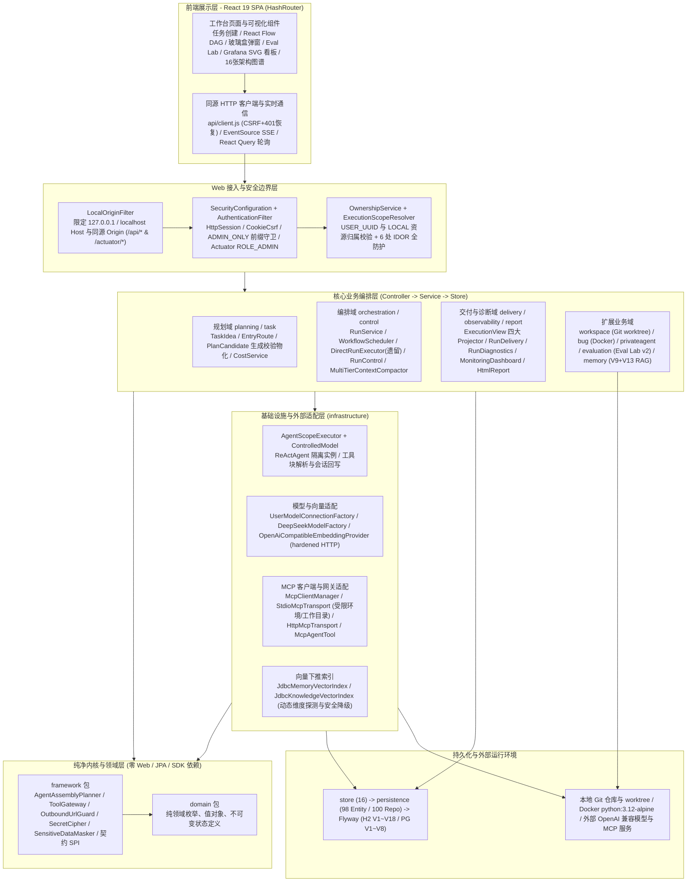
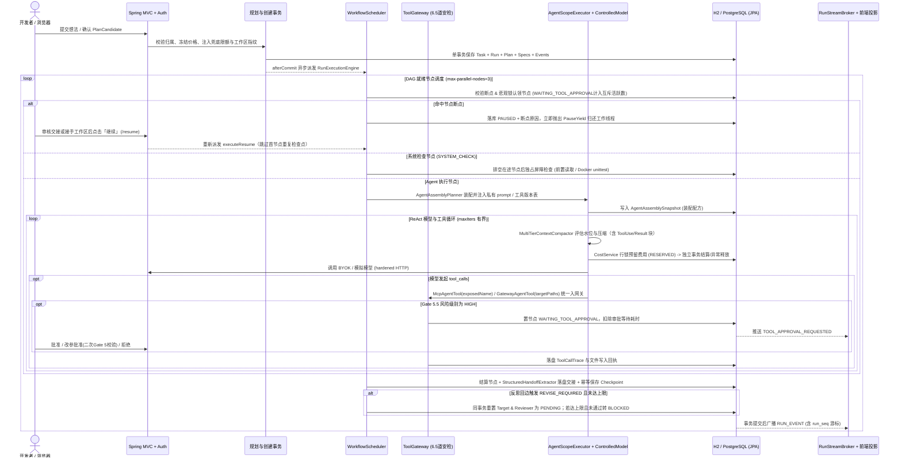

# Glass-Box Agent Studio（Agent Studio）项目总览：产品需求与技术架构

> **文档基线声明**：本文档已于 **2026-11-26** 同步至最新 AI 框架可视化 V0–V6 封板基线（Commit `cb39a4c`，后端 **684 个 Java 主源码文件 / 189 个测试文件 / 778 用例全绿**，前端 **145 个源码文件 / 37 个 Vitest 测试文件 / 169 用例全绿 / 1,800 对中英词条**，Flyway **H2 `V1~V18` + PostgreSQL 16/pgvector `V1~V8`，共 98 张表**，含同任务调改轮次表 `run_iterations`）。全文以当前真实代码与实测门禁为唯一真相源，清晰区分「已落地验收能力」与「当前真实边界/演进方向」。

---

## 一、项目定位与核心目标

**Glass-Box Agent Studio** 是一个单进程本地部署的开源多 Agent 软件工程工作台与实战学习平台，同时承担两重核心角色：

1. **受控本地代码开发工作台**：打通「想法整理 -> 入口路由 -> 候选 DAG 规划与人工确认 -> 独立 Git worktree 隔离修改 -> 多节点协作开发与独立审查 -> 人工审批与本地提交/推送/合并」的完整工程闭环，支持用户自带大模型 API Key（BYOK）与免 Key 模拟模型。
2. **「玻璃盒」多 Agent 全链路可视化学习平台**：把传统黑盒 Agent 执行拆解为透明可审计的工程实体——覆盖 Agent 装配配方与工具权限裁剪漏斗、发送给大模型的完整 `SYSTEM/USER/ASSISTANT/TOOL` Messages 与 Tool Schema、`ToolGateway` 六道半安检门实测依据、结构化交接信封校验、五步自动故障诊断以及六维能力评测实验室。

| 产品目标 | 用户能看到并掌握的核心机制 |
| :--- | :--- |
| **理解 Agent 如何协作** | 从同一张 React Flow 执行图查看计划依赖、当前节点、反思回边、实际装配快照与每次尝试；展开结构化交接信封，追溯直接上游来源、接收回执、工具证据与系统检查依据。 |
| **掌控 Agent 能做什么** | 选择六类任务入口、模型连接、私有 Agent 与工作区，显式授予文件白名单；运行前审核候选计划与价格冻结，运行中随时断点暂停、接手修改、批准高危工具或协作取消。 |
| **拿到可核对的真实产物** | 在「交付说明」定位文档、代码、Git 差异、容器测试观察与文件下载；每份产物可追溯至产出节点、写入回执与 SHA-256 指纹，缺失、失效或未验证项均明确标记。 |

### 三条典型使用路径与教学样本

1. **从想法到新产物**：将一句自然语言需求（如「做一个单步演示冒泡排序的页面」）整理为结构化任务契约（目标、约束、交付物、验收条件），生成多节点候选 DAG 并确认，分配独立工作区完成并行/汇聚开发与独立审查，最终在线浏览并下载产物。
2. **在受控已有仓库中开发**：经管理员白名单授权本地 Git 仓库后，基于独立 Git worktree 与分支隔离运行；支持只读分析或显式授权路径修改，高危写操作进入 Gate 5.5 HITL 人工审批，交付阶段支持指纹绑定审查、本地提交与隔离远端推送/合并。
3. **构建与装配私有 Agent**：创建并发布 Markdown Skill、只读 Tool（`READ`/`SEARCH`）与私有 Agent 的不可变版本；规划器以短代号推荐并发固定精确版本，执行期注入私有 `systemPrompt` 与不可信 Skill 隔离区并实施最小权限裁剪。
4. **模拟 Bug 容器复现与教学剧本**：固定 `MOCK-PY-001` 通过隔离 `python:3.12-alpine` 容器先复现目标失败断言，经授权修改后回归验证通过再交付人工核对；首页另提供 **3 套免 Key 玻璃盒教学剧本**，零门槛体验全流程透视。

---

## 二、全栈技术栈与量化工程规模

| 层级 | 技术栈与核心依赖 | 源码实测规模与基线 |
| :--- | :--- | :--- |
| **后端运行时** | Java 21 · Spring Boot 3.5.7 · Spring MVC · Spring Security 6 | `backend/src/main/java/dev/workbench` 共 **684 个 Java 主源码文件**（26 个活跃顶层业务/分层包，含 `timeline` 观测/开放协议包） |
| **Agent 核心引擎** | AgentScope Java `2.0.4`（`core` / `extensions-jdbc` / `harness` / `model-openai`） | `ReActAgent` 单次尝试独立实例化；主循环支持真流式与思考链分道落库；原生 SDK 严格隔离在 `infrastructure`、`persistence.agentscope`、`app` |
| **持久层与双库** | Spring Data JPA / Hibernate ORM 6.6 · Flyway · H2（默认 `./data/workbench`）· PostgreSQL 16 + `pgvector`（可选 Profile `postgres`） | **98 个 JPA Entity（98 张表）**、**100 个持久层仓库/投影类型**；Flyway **H2 `V1~V18` + PG `V1~V8`**；长文本统一使用 `@JdbcTypeCode(SqlTypes.LONGVARCHAR)` 兼容 `CLOB`/`TEXT`（全仓 0 处 `@Lob`） |
| **安全与凭据** | PBKDF2WithHmacSHA256（120k 轮）· `HttpSession`（SameSite Strict / HttpOnly）· Cookie CSRF · AES-256-GCM（`SecretCipher`） | 单机 `LOCAL` 平滑迁移至本地登录账号 `USER_<UUID>`（含异步评测安全上下文透传）；语义化 `errorCode`；统一出站防 SSRF 防火墙（`OutboundUrlGuard` + 禁用重定向 `OutboundHttpClients`） |
| **前端工作台** | React 19.1 · Vite 6.3 · MUI v9（Google M3 Token）· `@xyflow/react` 13 + `@dagrejs/dagre` · TanStack Query 5 · `HashRouter` | `frontend/user-workbench/src` 共 **145 个源码文件**（**10 个懒加载路由页**、三级 `ErrorBoundary`、自研 `VirtualList`、**1,800 对**中英双语 JSON Key、**37 个** Vitest 测试文件 / **169 用例**） |
| **质量与容器沙箱** | JUnit 5 · **ArchUnit 1.4.1**（`ArchitectureGuardTest` 5 铁律）· Docker（`python:3.12-alpine`、`pgvector/pgvector:pg16`）· Actuator + Prometheus | 后端 **189 个测试文件**；全量 **`778 用例 / 0 失败 / 0 错误`**，`ArchitectureGuardTest` **5/5**、`FlywayMigrationCompatibilityTest` **4/4**，PG 16 + `pgvector` 集成 **`3/3 通过`** |

---

## 三、总体架构与分层守卫

### 3.1 后端包结构与 ArchUnit 五条铁律

| 包路径 (`dev.workbench.*`) | 核心职责 |
| :--- | :--- |
| `domain` | 纯领域枚举与值对象（`TaskStatus`、`RunStatus`、`PlanNodeStatus`、`StopCause`、`EvalCategory`、`MemoryType` 等），**零持久化与 Web 依赖** |
| `framework` | 内核契约与无状态原语：`AgentAssemblyPlanner`、`ToolGateway`、`ConservativeToolRiskPolicy`、出站防护（`OutboundUrlGuard` / `OutboundHttpClients`）、压缩契约、`SecretCipher`、`SensitiveDataMasker`、评测契约 |
| `infrastructure` | 外部适配：`agentscope`（`AgentScopeExecutor`、`ControlledModel`、`GatewayAgentTool`、`McpAgentTool`）、`model`（BYOK/DeepSeek/Embedding）、`mcp`（STDIO/Streamable HTTP）、`vector`（PGVector JDBC） |
| `persistence` | 98 个 JPA Entity、98 个 Repository、`view/` 轻量投影、`support/` 原生统计查询、`agentscope/` 会话、`artifact/` L1 卸载存储 |
| `store` | 细粒度事务读写与 `afterCommit` 领域事件/SSE 发布门面 |
| `planning` | 想法整理、入口策略/路由、候选计划生成/校验/画布修订落库（`PlanCandidateRevisionService`、`PlanDraftConflictAnalyzer`）/确认物化、`RunForkService` 分叉重跑、`PlanService`、`RunSnapshotService` |
| `timeline` | V4~V6 玻璃盒观测与开放协议：`RunObservationService`（7 类 Span 时间轴、Checkpoint 状态检视、双跑对照）、`ArchitectureXrayService`（动态架构 X 光）、`TraceExportService`（OTel/Glass-Box 脱敏导出）、`ExternalTraceService`（外部框架只读 Trace 接入）、`EvalFlywheelService`（真实运行一键脱敏沉淀为评测用例） |
| `orchestration` | `RunService`、`RunCreationService`、`RunExecutionEngine`、`WorkflowScheduler`（含 `WorkflowMemoryContext`）、`ReflectionCoordinator`、`ControlledAgentRuntime`、`DirectRunExecutor`（遗留） |
| `task` | 跨服务事务协调：`TaskCreationService`、`WorkflowExecutionService`、`WorkflowRecoveryService`、`RecoveryLeaseService`、`CostService`、`RunDeliveryService`、`TaskSupplementService` |
| `control` | 四级上下文压缩与 L1 产物管理：`MultiTierContextCompactor`、`ContextArtifactController`、`ContextArtifactService`（带严格归属校验） |
| `agent` / `tool` | 工作区工具实现（读写/搜索/声明式单文件写）与 `ToolApprovalService`（Gate 5.5 HITL 审批） |
| `workspace` / `bug` / `external` | 文件沙箱、Git worktree 三段式交付、模拟 Bug Docker 验证、外部动作幂等演练 |
| `memory` | V9 分层长期记忆（CRUD/晋升/历史/情景提取/混合检索）与 V13 RAG 知识库（`DocumentChunker`、`KnowledgeRagService`） |
| `privateagent` | 私有 Skill、只读 Tool 与私有 Agent 的草稿/发布/归档/推荐 |
| `evaluation` | Eval Lab v2（`EvalLabService`、Benchmark Hub、自定义数据集、6 类原生 Runner、2 类裁判、A/B 对照）+ 种子套件 v1 + 可管理数据集 |
| `observability` / `delivery` / `report` / `audit` | SSE 流与游标分页、Micrometer/Prometheus 快照指标、类 Grafana 看板、5 步诊断、执行图投影、HTML 安全脱敏报告、审计台账 |
| `auth` / `ownership` / `modelconnection` / `app` | 本地会话与 CSRF、资源归属与仓库授权、BYOK 加密连接、RAG Embedding 配置、全局异步线程池配置 `AsyncConfiguration` |

`ArchitectureGuardTest` 强制校验 5 条架构规则：① 顶层包零循环依赖；② `domain` 保持绝对纯净；③ `framework` 不依赖业务/持久化/Web/`agentscope`；④ `io.agentscope` 仅限 `infrastructure`/`persistence.agentscope`/`app`；⑤ `@RestController` 禁止直接依赖 JPA/Entity/Repository。

---

## 四、认证、权限隔离与安全防线

1. **认证、CSRF 与同源来源校验**：
   - 未初始化用户前处于单机兼容模式（`LOCAL`）；初始化首个管理员（`PBKDF2WithHmacSHA256` 120,000 轮）后全局切入强制认证，支持一次性认领旧 `LOCAL` 数据；会话采用 `HttpOnly` + `SameSite=Strict` + 登录后 `changeSessionId()`。
   - `CookieCsrfTokenRepository` 配合 `SessionCsrfMatcher` 保护所有登录态写请求；`LocalOriginFilter` 校验 `/api/` 与 `/actuator/` 的 `Host` 和 `Origin` 必须匹配本机回环地址。
   - `AuthenticationFilter.ADMIN_ONLY` 严格限定 `/api/audit`、`/api/monitoring`、`/api/system`、`/api/evaluations`、`/api/evaluation-datasets`、`/api/eval-lab/hub/*/import`（及管理员动作）、`/api/rag-embedding`、`/api/cost/`、`/api/admin/`、`/api/external-actions` 及 `/actuator/**` 仅限 `ROLE_ADMIN` 访问。
2. **资源归属隔离与 IDOR 防护**：
   - `OwnershipService` 基于 `resource_ownership` 隔离用户之间的任务、运行、工作区、审批单（`ApprovalService`）、L1 上下文产物（`ContextArtifactService` 按 `(ownerScopeKey, workspaceId, sha256)` 隔离）、任务入口路由、失败运行导出数据集及 BYOK 异步压缩连接（显式透传 Run 绑定的 `ownerScope` 与 `connectionId` 并在 `ControlledModel` 计费，禁止后台线程回退 `"LOCAL"`）。
3. **出站 SSRF 防火墙与 MCP 沙箱收口**：
   - `OutboundUrlGuard` + `OutboundHttpClients` + `ModelHttpTransports` 为全平台 BYOK、Embedding 端点与 MCP Streamable HTTP 提供统一防护：拒绝凭据/查询串/分片、解析并校验全部 A/AAAA IP（拦截十进制/简写/八十六进制/IPv4-mapped IPv6/私网/回环开关/链路本地/保留段）、禁止 `3xx` 自动重定向、过滤保留 HTTP 头并限制响应大小。
   - `StdioMcpTransport` 仅管理员可注册/探测，严格校验可执行名与参数安全、剥离 `PATH`/`LD_*`/`NODE_OPTIONS`/`PYTHON*`/`DOCKER_*`/`JAVA_*` 等危险环境变量，并在独立临时工作目录中隔离启动子进程。
4. **凭据加密与安全脱敏**：
   - BYOK API Key、MCP `headers`/`env` 均以 `SecretCipher`（AES-256-GCM + 随机 12 字节 IV）加密持久化，接口永远仅返回 `sk-****xxxx` 掩码；HTML 脱敏报告改为**先字段级脱敏再 HTML 转义**（修补 `&quot;` 漏网与闭合标签破坏），玻璃盒列表载荷采用 JSON 安全裁剪与主流云/代码托管密钥/JWT/PEM 正则脱敏。

---

## 五、任务规划、DAG 编排与运行时控制

### 5.1 双层状态模型与双轨规划
- **`TaskEntryKind` 六类入口**：`GENERAL`、`REQUIREMENT`、`DESIGN`、`CODE`、`TEST`、`MOCK_BUG`，结合 `EntryPolicyService` 强制入口契约；
- **状态解耦**：`RunStatus`（`PENDING -> RUNNING/PAUSED -> COMPLETED/BLOCKED/FAILED/LIMITED/CANCELLED/INTERRUPTED`）聚焦 Agent 客观执行结果（代码写入完毕待验收时保留为 `BLOCKED + HUMAN_REVIEW_REQUIRED`）；`TaskStatus` 在人工 Git 交付或确认接收后升级为 `DELIVERED`，防止事后篡改执行证据。
- **规划确认与兜底预算**：支持 `EntryRouteService` 规则模板路由与 `PlanCandidate` LLM 动态生成（`PlanCandidateValidator` 校验无环、拓扑、写集互斥、产物契约、独立审查、反思上限、私有组件版本），确认后悲观锁物化为固定计划并自动补齐平台兜底运行限额，避免无限烧钱。

### 5.2 DAG 并行调度、非阻塞断点与反思闭环

- **非阻塞断点与恢复幂等**：断点命中时保存 `PAUSED` 与具体原因后立即抛出 `PauseYield` 归还工作线程池，4 线程池可并发支撑超过核心线程数的挂起运行而不发生饥饿；`/cancel` 可立即终结让出线程的暂停运行并清理断点状态；`/resume` 通过原子状态迁移重入调度器并跳过重复 `RUN_STARTED`/首节点检查点写入，`WorkflowRecoveryService.saveBoundary()` 具备检查点幂等防护。
- **并发与账本安全**：`RunControl` 使用原子 CAS 轮次/工具计数与状态变更写库降频；`CostService` 所有异常路径严格释放预留额度并按「锁预算行 -> 重读预留」顺序防范事务竞态；`WAITING_TOOL_APPROVAL` 全口径计入活跃节点保护写集互斥、屏障与取消清理。

---

## 六、Agent 装配、ToolGateway、MCP 与上下文/RAG

1. **Agent 装配与私有组件安全**：`AgentScopeExecutor` 为每次尝试实例化隔离的 `ReActAgent`（`maxIters` 有界默认 40，可配置收敛 1~200），注入私有 Agent 的 `systemPrompt` 与 `<untrusted_skill_playbook>` 隔离段，并仅在真实注册工具后同步装配版本表；`REVIEWER` 节点强制不注册 MCP 工具，`ANALYST` 与只读节点过滤写类 MCP。
2. **ToolGateway 6.5 道安检门与 HITL 审批**：统一覆盖内置工具、私有只读工具与 `McpAgentTool`（显式传 `mcp::<slug>::<tool>` 接入风险策略）。`GatewayAgentTool` 为单文件/多文件写工具传入 `targetPaths`（不混入只读路径）供 `ConservativeToolRiskPolicy` 精准定级；高危操作默认开启 Gate 5.5 HITL 审批并挂起节点等待用户批准/改参/拒绝。
3. **四级上下文压缩与会话回写**：`MultiTierContextCompactor` 准确提取 `TextBlock`/`ToolUseBlock`/`ToolResultBlock` 字符并映射主流模型窗口大小，触发压缩后经 `ControlledModel` 同步回写 `AgentScope` 上下文，保证下轮调用真实生效：
   - **L0（`<60%`）**：分桶观测；
   - **L1（`>=60%`）**：超 `1500` 字符旧工具消息幂等卸载至归属隔离的 `context_artifacts`，原位保留 `[ArtifactRef]` + 大纲 + Query-Aware BM25 摘录；
   - **L2（`>=78%`）**：通过 `ControlledModel` 计费的 `ByokCompactionSummarizer` 提炼四段增量锚点检查点；
   - **L3（`>=92%`）**：按相关度淘汰中间块，保护 System、锚点与 `tool_call`/`tool_result` 成对结构及有限步长防死循环。
4. **V9 分层长期记忆 & V13 + PGVector Hybrid RAG**：
   - `MemoryRetrievalService` 与 `KnowledgeRagService` 先用无 `embedding_json` 的轻量 JPQL 投影全量计算 BM25，仅对候选集回表算余弦（或 PostgreSQL 下直接 `ORDER BY embedding_vec <=> :vec` HNSW 下推），将远端 Embedding HTTP 移出数据库事务并使用批量写入与动态维度降级，避免大表检索 OOM 与事务长连接占用。
   - 动态工作流通过 `WorkflowMemoryContext` 按节点接入 `memoryEnabled` 门控的长期记忆，同一 `runId` 冻结共享首次召回与引用台账。

---

## 七、工作区 Git、模拟 Bug、Eval Lab v2 与观测交付

1. **受控 Git worktree 与容器沙箱**：工作区展开清单上限 200 文件、禁止符号链接与 `.git`/`.gitattributes`/`.gitmodules` 篡改；Git 子进程禁止hooks/fsmonitor/`ext`/`sshCommand`/`credential.helper` 等危险选项；`MOCK-PY-001` 以强隔离 Docker（`--network=none`、`--read-only`、non-root、资源配额）执行真实 `unittest` 复现与回归。
2. **Eval Lab v2 六维评测体系**：
   - 内置 `MINI`（24 题）、Benchmark Hub（6 包元数据：5 个可跑 `bfcl-v3-simple`/`ruler-niah-compact`/`longmemeval-s`/`gaia-dev-l1`/`agentdojo-security` + 1 个只预览 `swe-bench-lite`）及 `CUSTOM` 自定义集；
   - **真实扣分与隔离治理**：`SAFETY_INJECTION` 拆分为模型抗注入（`MODEL_NOT_HIJACKED`）与平台网关拦截（`GATEWAY_BLOCKED`），模型被劫持不得拿满分；`CODING_REFLECTION` 真实比对初始夹具核查越权写入并在 `finally` 递归清理临时 worktree 与源 Git 仓库；`LlmJudgeGrader` 使用随机 nonce 隔离 `<untrusted_model_output>`，裁判报错/超时强制 Fail-Closed（`JUDGE_ERROR`），调用前校验美元预算上限并将 `judgeCost` 计入终态 `totalCostUsd`。
3. **可观测性、全链路玻璃盒可视化（V0–V6）与前端工作台**：
   - **V0–V1 活的玻璃盒**：10 路由页懒加载 + 三级 `ErrorBoundary` + SSE/轮询协同（280ms 防抖、终态零 SSE）+ 虚拟滚动；Agent 主循环真流式与思考链分道落库（`reasoning_content`）、按节点分桶的 `ReActSwimlane` 实时泳道与 `GatePipeline` 六道安检横向流水线；
   - **V2–V3 透明机理与可视化编排**：`ContextMicroscopePanel`（纯 SVG 六层堆叠水位面积图 + L1/L2/L3 阈值线 + 压缩前后对照 + `artifactRef` 弹窗直读原文）、`RagRetrievalXRayPanel`（BM25/向量 → RRF 召回漏斗与裁剪原因）、`MemoryAndChunksPanel`（三层记忆管理与文档切片边界）、以及支持实时冲突告警并可落库冻结执行的 `PlanComposerCanvas` 多 Agent 编排画布；
   - **V4–V6 时间旅行、实时 X 光与开放生态**：7 类 Span 执行时间轴火焰图、Checkpoint 快照检视与 What-If 分叉重跑（`run_forks`）+ 双跑对照；`ArchitecturePage` 静态教学 ↔ 实时运行 X 光（步进回放 + 按模块精准跳回玻璃盒）；OTel/Glass-Box 脱敏导出、受归属/脱敏保护的外部 Agent Trace 只读接入（`external_trace_runs/spans`）与 Eval Flywheel 一键沉淀为自定义评测用例；
   - 整仓授权（`.` + 默认噪音排除）与三档常驻授权条 `WorkspaceAuthorizationBar`、管理员一键自动授权导入工作区、以及全栈三层中英双语（1,800 对 UI JSON / Spring `MessageSource` / 外置镜像 Prompt）。

---

## 八、数据持久化双轨设计

数据库禁用 Hibernate 自动 DDL（`ddl-auto=none`、`open-in-view=false`），由 Flyway 管理全部 **98 张表**，全实体长文本采用 `@JdbcTypeCode(SqlTypes.LONGVARCHAR)` 同时适配 H2 `CLOB` 与 PostgreSQL `TEXT`（全仓 0 处 `@Lob`）：
- **默认 H2 迁移链（`classpath:db/migration`，`V1~V18`）**：`V1~V2` 基线与兼容升级 -> `V3~V6` 价格绑定/玻璃盒 Payload/BYOK 连接/冻结语言 -> `V7~V10` 反思压缩/HITL 审批/长期记忆/MCP -> `V11~V14` Eval Lab v2/Hub/RAG 知识库、上下文产物与核心复合二级索引 -> **`V15` 模型思考链与流式标记 -> `V16` 分叉运行表 `run_forks` -> `V17` 外部 Trace 表 `external_trace_runs/spans` -> `V18` 同任务调改轮次表 `run_iterations`（`feedback`/`previous_summary` 使用 `LONGVARCHAR`，历史运行证据零改动）**。
- **PostgreSQL 16 + pgvector 迁移链（`classpath:db/migration-pg`，`V1~V8`）**：`V1` 等价建表基线（`TEXT`）-> `V2` `vector` 扩展与 HNSW 余弦索引 -> `V3` 等价历史迁移标记 -> `V4` 核心复合二级索引 -> **`V5~V8` 与 H2 `V15~V18` 逐一成对等价**。已由 `PostgresPgVectorIntegrationTest` 在真实 `pgvector/pgvector:pg16` 容器中通过 3/3 实机读写与 HNSW 隔离验证。

---

## 九、实机验证基线与当前真实边界

### 9.1 最新实机验收基线（2026-11-26 · `cb39a4c`）
- **后端全量测试**：`mvn test` → **778 用例，0 失败，0 错误，16 跳过**（既有 Docker/PG/系统环境条件跳过）；`ArchitectureGuardTest` **5/5**、`FlywayMigrationCompatibilityTest` **4/4**（断言 V18 与 98 张表）、`AuthenticatedEndToEndWorkflowAndEvalTest` **1/1**；
- **PostgreSQL 16 + pgvector**：`WORKBENCH_PG_TEST=true mvn -Dtest=PostgresPgVectorIntegrationTest test` → **3/3 通过，0 失败**；
- **前端四步门禁**：`npm run format:check` / `lint` / `test` / `build` 全 0 退出，Vitest **37 文件 / 169 用例全部通过**，中英 i18n **1,800 / 1,800** 键差 0。

### 9.2 当前真实边界（详单见 [V0–V6 最终验收记录](交接/AI框架可视化_V0-V6_最终验收记录.md) 与 [漏洞审计与后续演进文档](项目漏洞审计与后续演进改进文档.md)）
1. **战略定位与聚焦边界**：项目明确聚焦「单机 AI 框架玻璃盒可视化与调试台」，**暂缓**重型多租户组织空间、企业 RBAC/OIDC、KMS、Jira/Linear 适配等 SaaS 方向。
2. **V2~V6 既定工程边界**：`knowledge_search` / `context_artifact_read` 受控只读工具当前不默认授予内置角色（自定义 Agent 声明即可装配，保持最小权限）；V3 编排画布聚焦图拓扑与读写/验收编排，节点级异构模型/Skill/MCP 协议字段留待后续；V4 分叉沿用任务模型且写同一工作区，双跑对照按「声明写入范围 + 节点产出」呈现；外部 Trace 严格只读不参与执行/恢复/分叉。
3. **既有历史边界**：遗留 `DirectRunExecutor`（老直线流程）仍保留用于无 `WorkflowPlan` 的历史兼容；Bug 容器沙箱固定支持 `MOCK-PY-001` Python `unittest`；外部动作对账为内存适配器；尚无独立后端 `Dockerfile` 与 GitHub Actions CI/CD 流水线。

---

## 十、本地启动、配置与维护入口

- **前置环境**：Java 21、Maven 3.9+、Node.js 20+、Git（Docker Desktop 可选，用于模拟 Bug 沙箱与 PostgreSQL 16 + pgvector）。
- **构建与启动**：在 `frontend/user-workbench/` 运行 `npm ci && npm run build`，回到仓库根目录运行 `mvn spring-boot:run`，访问 `http://127.0.0.1:8088`。首次打开引导初始化本地管理员；免 Key 剧本可直接运行。
- **切换 PostgreSQL 16 + pgvector**：详见 [PGVector 切换与部署指南](开发记录/PGVector切换与部署指南.md)；H2 备份与回退详见 [个人版安装、升级、备份与回退](交接/个人版_安装升级与备份回退.md)。
- **开发与安全红线**：遵循 [代码开发规范](开发规范/代码开发规范.md) 与 [关键流程开发与验收约定](开发规范/关键流程开发与验收约定.md)；严禁查看或提交 `config/master.key`、`config/deepseek-api-key.txt` 与 `data/`。
